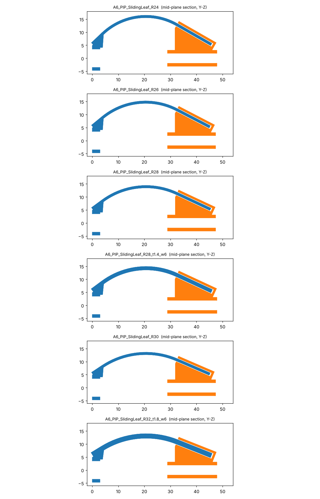
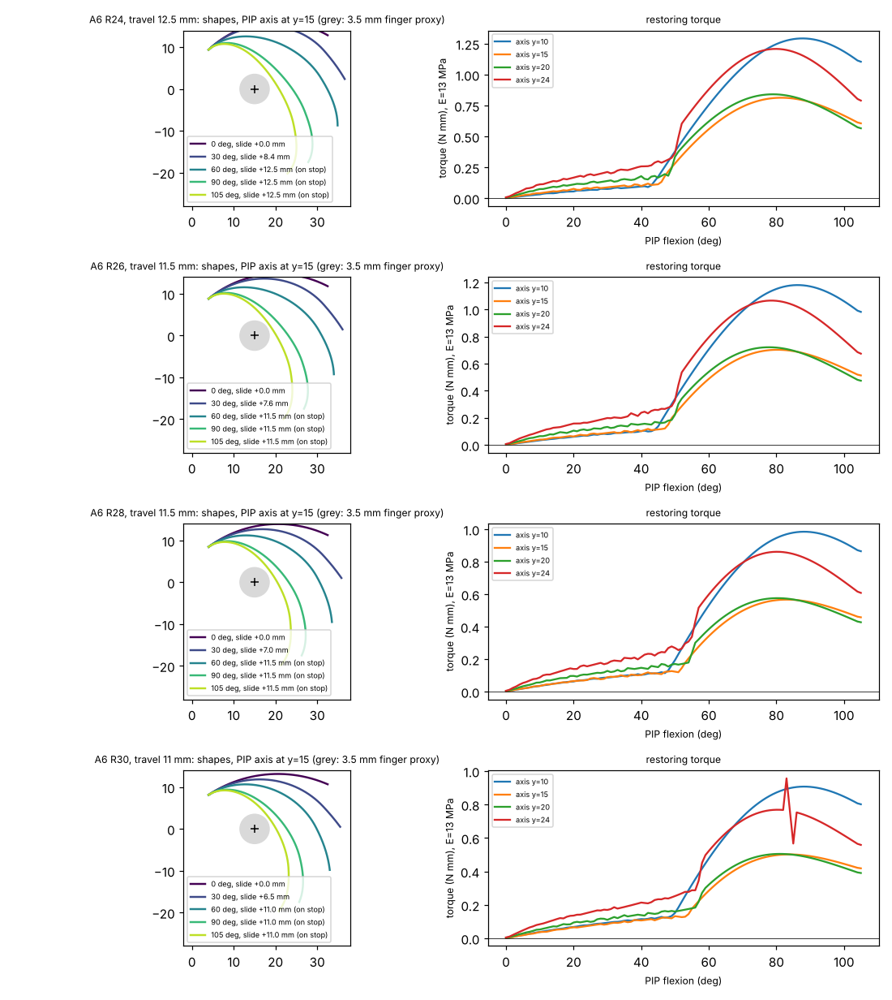

# A6: sliding-end leaf spring, sized for human PIP flexion

A pre-curved leaf is fused to the proximal-phalanx (PP) cuff. Its free end slides in a guide
on the middle-phalanx (MP) cuff. When the joint flexes, the guide turns with the MP, which
forces the leaf to change its end angle. The leaf bends, stores energy and pushes the joint
back toward neutral. The tip slides so the leaf is not also stretched, and a T-head on the
tip stops it pulling out.

**Target: 0° to 105° PIP flexion**, the human active range. Hyperextension is left out for now.

Generated by `scripts/make_a6_designs.py` and tested by `scripts/a6_rom_check.py`. Axes match
`A8_PIP_Meander_3turn_2mm`: Y runs from PP to MP, +Z is dorsal, and the MP cuff starts at
y = 28.86.

## The designs

| File | Leaf R | Travel | Guide | MP cuff length | Leaf top above PP cuff |
|---|---|---|---|---|---|
| `A6_PIP_SlidingLeaf_R24` | 24 mm | 12.5 mm | 16.5 mm | 19.0 mm | 11.7 mm |
| `A6_PIP_SlidingLeaf_R26` | 26 mm | 11.5 mm | 15.5 mm | 18.5 mm | 10.4 mm |
| `A6_PIP_SlidingLeaf_R28` | 28 mm | 11.5 mm | 15.5 mm | 18.5 mm |  9.6 mm |
| `A6_PIP_SlidingLeaf_R30` | 30 mm | 11.0 mm | 15.0 mm | 18.5 mm |  8.8 mm |

These dimensions are shared by all four designs:

| Feature | Value |
|---|---|
| PP cuff | 13.8 × 9.4 mm outside, corner R 3.55, 1.2 wall, 3 mm long (A8's) |
| MP cuff | 10.1 × 6.2 mm outside, corner R 2.10, 1.2 wall (A8's section), run the length of the guide |
| Leaf | 6.0 mm wide × 1.0 mm thick |
| Guide | mouth at y = 32.5, then a 1.5 mm neck and a pocket for an 8.0 × 1.2 mm T-head |
| Sliding clearance | 0.25 mm per side on every face, so both bodies can be printed in place |

`*.STEP` is a two-body part: PP cuff + anchor + leaf, and MP cuff + guide. It opens in
SolidWorks. `*.STL` contains both bodies, for slicing. `A6_variants.csv` has the geometry,
and both bodies are checked to be valid solids that do not overlap.

## What changed from the first A6 set, and why

The first set had a 2.5 mm stroke and a 4 × 1 mm leaf on a short guide. It stopped at 15° to 36°.

1. **Travel went from 2.5 mm to 11–12.5 mm.** As the PIP flexes, the path over the back of the
   joint lengthens by roughly the leaf's distance from the axis times the angle. The tip has
   to slide out by that much.
2. **The stop is part of the mechanism now.** Past about 45° to 58°, a freely sliding tip has
   no equilibrium and runs on until the T-head meets the neck. From then on the leaf bends
   between two held ends, which is where the torque curves below step up. With too little
   travel, the leaf goes taut before 105° or cuts across the knuckle. With too much, the tip
   jumps onto the stop and the joint snaps. Each design's travel is the middle of the window
   between those two failures (`a6_rom_check.py --tune`).
3. **The guide mouth moved 3.6 mm onto the MP cuff, and the guide grows distally from there.**
   A mouth further from the joint widens that window. With the mouth at the cuff's
   proximal edge, only one travel passed, for one radius.
4. **The MP cuff runs under the whole guide**, so the 15 mm guide is carried by the cuff
   rather than cantilevered off it.
5. **Only tight radii, R24 to R30.** Flatter leaves pass through the joint in flexion. R32
   passed at a single travel and failed 0.5 mm either side, which is too fragile to print.
6. **The leaf is 6 mm wide instead of 4.** Width adds stiffness without adding strain.
   Thickness stays at 1 mm, because strain is the limiting quantity.

## Test result: 16 of 16 cases pass

The PIP axis is not in any file I have, so each design is tested with the axis at y = 10, 15,
20 and 24 mm, all at z = 0. That spans the gap between the cuffs. A case passes when the
design:

1. reaches 105°;
2. pushes back toward extension at every angle, so it never snaps;
3. stays at least 3.5 mm from the axis, so it does not cut through the joint;
4. stays under 20% peak bending strain.

| Design | Closest to axis | Peak strain | Head reaches stop at | Torque at 105° (E 8–18 MPa) | Stiffness near 0° |
|---|---|---|---|---|---|
| R24 | 4.13–5.16 mm | 9.5–14.4% | 44–51° | 0.35–1.53 N·mm | 0.10–0.72 N·mm/rad |
| R26 | 3.74–4.61 mm | 8.8–13.8% | 45–51° | 0.29–1.36 N·mm | 0.11–0.64 N·mm/rad |
| R28 | 4.05–4.83 mm | 7.5–12.1% | 49–56° | 0.26–1.20 N·mm | 0.12–0.61 N·mm/rad |
| R30 | 3.90–4.58 mm | 6.9–11.7% | 50–58° | 0.24–1.11 N·mm | 0.11–0.56 N·mm/rad |

Per-case detail is in [`results/a6/rom_check.csv`](../results/a6/rom_check.csv). Every A6
analysis is logged in [`results/a6/README.md`](../results/a6/README.md).

## Which thickness and curvature are best

These four files all use a 1.0 × 6 mm leaf. A sweep of curvature, thickness and width found
a stronger valid combination, R32 / 1.8 mm / 6 mm with 11.5 mm of travel. It has about 3 to
5 times the mean restoring torque, but sits right at the 20% strain limit. A safer
alternative is R28 / 1.4 mm / 6 mm. Neither has been generated as CAD yet. See
[`results/a6/README.md`](../results/a6/README.md).

## What this does not tell you

* **The joint axis is assumed.** Each design passes at four guessed axis positions, not at a
  measured one. A STEP export of the fit-check assembly would replace the guesses with the
  real axis.
* **The MP cuff is now 18.5–19 mm long.** Whether that fits the MP without reaching the DIP
  hasn't been checked.
* **The devices are bulky.** The leaf stands 8.8–11.7 mm above the PP cuff.
* **The restoring torque is weak.** It is roughly 10 to 25 times below the A3's 6.1 N·mm/rad.
  A thicker leaf raises torque with the cube of thickness but raises strain linearly.
  Without a stiffness target and a strain limit from the filament test, that trade can't
  be set.
* **The 20% strain limit is a placeholder**, not a TPU property. Nothing here is
  experimentally validated: the modulus is uncalibrated, and friction in the guide and
  contact with the finger aren't modelled.
* **The R30 torque curve with the axis at y = 24 has a spike near 82°.** It stays positive,
  so the case passes, but I haven't confirmed whether it's real or a numerical artefact.
