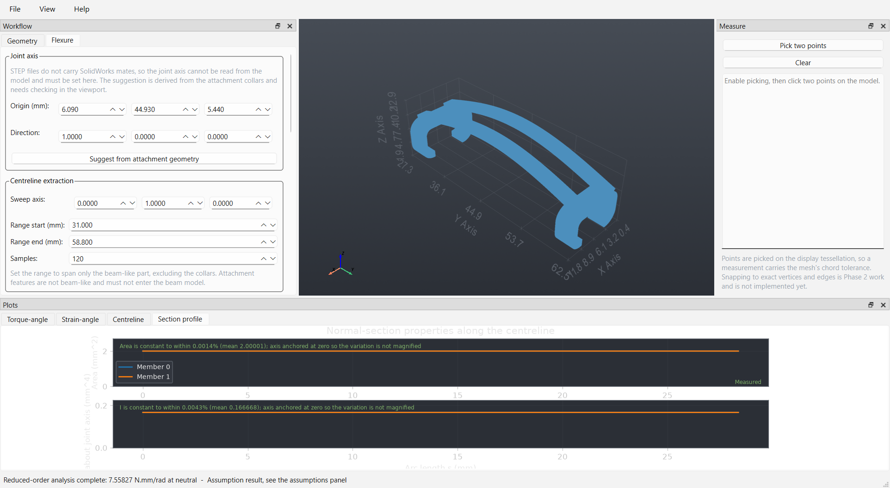

# Barnes UI

A desktop application for designing TPU compliant flexures, measuring their stiffness, fitting
them to prosthetic-hand finger joints, and simulating the resulting motion and restoring torque.

**Current state: all seven phases built.** The application imports CAD and assemblies,
measures them, reconstructs flexure centrelines, computes reduced-order stiffness, meshes with
second-order tetrahedra, runs nonlinear hyperelastic analysis in CalculiX, adapts a parametric
flexure to a new joint, previews the motion, fits joint springs to FEA results, sweeps the design
space and reports the trade-offs. **CalculiX is a native executable you must install
separately** — see [docs/08-calculix-installation.md](docs/08-calculix-installation.md). Until it
is installed, FEA is disabled and the application will not substitute a reduced-order result for
one you asked a solver for.

**What is not done is not code.** Four inputs are outstanding — an A8 STEP export, its SolidWorks
mass properties, a list of which A8 dimensions were measured rather than estimated, and a tensile
test of the actual filament. Until the last of those exists, **nothing in this project is
experimentally validated**, and the gate that would mark something validated has nothing to
accept. See [docs/06-required-inputs.md](docs/06-required-inputs.md).

### The three numbers worth knowing

**The reduced-order model overstates the A3 flexure's stiffness by 9 % to 20 %**, against
6.103 N·mm/rad from CalculiX — a figure with its own convergence study, 0.936 % between a
17,042-element and a 32,965-element mesh — with the spread coming from where the strap is taken to be
clamped rather than from the physics. That makes it sound for ranking design variants and
unsound for an absolute torque figure — which was the standing assumption and is now a
measurement. An earlier single figure of 23.8 % compared two different spans; the correction,
and why it matters more than the number, is in
[docs/05-development-plan.md](docs/05-development-plan.md).

**Design ranking does not depend on the material being calibrated.** Both the fast model and a
small-strain FEA are linear in the elastic modulus, so across a stated 8 to 18 MPa range the
Pareto front is identical: the geometric objectives move 0 % and the stiffness moves 38 %. So
screening and selection work today; sizing does not.

**Six of seven advanced solver capabilities reproduce an answer known in advance.** Gravity,
tendon loading, frictionless contact, friction, mechanical stops and self-contact all pass.
Viscoelasticity does not exist in CalculiX at all. Self-contact took four set-ups and was
recorded as a failure for three of them — the write-up of why is the most useful part of
[docs/09-phase6-capability-findings.md](docs/09-phase6-capability-findings.md).



---

## What this project is for

A prosthetic hand under development uses TPU flexures as compliant joint elements: they bend as
the finger moves, store energy, and push the joint back toward its neutral position. The design
question is how the flexure's geometry — number of meander turns, width, thickness, span —
determines its stiffness, restoring torque, range of motion and peak strain.

Answering that by hand means exporting CAD, meshing it, writing a solver deck, running it,
parsing results, and repeating for every variant. This application automates the repetitive parts
while keeping every engineering assumption visible and overridable.

## The principle that shapes the whole codebase

**A plausible-looking wrong answer is worse than no answer.**

Design decisions get made from these numbers, and parts get printed from those decisions. A
finite element run that converges and renders a smooth deformed shape is extremely persuasive and
is worth nothing if the material coefficients were guessed. The number looks identical either
way.

So the code is built around a few non-negotiable rules:

- **Every value carries its provenance** — whether it was measured from CAD, estimated
  analytically, predicted by a reduced-order model, computed by FEA, or validated against a
  physical measurement. The tag travels with the value through every calculation into the plots
  and the CSV exports. A guessed material parameter cannot be laundered into an apparent
  measurement by passing through three functions.
- **No fabricated output.** If a solver is missing or fails to converge, that is reported as a
  failure. The application never substitutes a simpler model and presents the result as if it
  came from the one you asked for.
- **No invented material parameters.** "TPU 90A" is a hardness grade, not a constitutive model.
  Hyperelastic coefficients are never synthesised from it, nor from the filament's datasheet,
  which carries no modulus. Without calibrated data the application runs in a clearly marked
  provisional mode.
- **Convergence is not validity.** A converged solution of the wrong model is a precise answer to
  the wrong question, and the UI does not conflate the two.

If you only read one document, read
[docs/01-feasibility-assessment.md](docs/01-feasibility-assessment.md) — it states plainly what
this tool can and cannot do.

---

## Getting started

### Requirements

- Windows 10/11, macOS, or Linux (developed and verified on Windows 11)
- Python 3.10–3.12 (3.12 recommended; **not 3.13** — the CAD kernel has no wheel for it yet)
- About 1.5 GB of disk space, most of it the OpenCASCADE kernel
- A working OpenGL driver for the 3D viewport

### Install

```bash
git clone https://github.com/Melle2006/BARNES_UI.git
cd BARNES_UI
python -m venv .venv
```

Activate the environment — on Windows PowerShell:

```powershell
.venv\Scripts\Activate.ps1
```

On macOS or Linux:

```bash
source .venv/bin/activate
```

Then install the package and its development tools:

```bash
pip install --upgrade pip
pip install -e ".[dev]"
```

The download is large (roughly 500 MB) because `cadquery-ocp` bundles the entire OpenCASCADE
runtime. This is expected and happens once.

To reproduce the exact environment this was verified against, use
`pip install -r requirements.lock.txt` instead.

### Run

```bash
python -m barnes_ui
```

Or open a file directly, which saves four clicks when iterating on one part:

```bash
python -m barnes_ui path/to/flexure.step
```

### Test

```bash
pytest
```

350 tests, running in under a minute with no display required. The engineering core is
deliberately free of GUI dependencies so the test suite stays fast and headless — a rule enforced
by `tests/test_architecture.py` rather than left to discipline.

```bash
pytest -v                      # see each test
pytest --cov=barnes_ui         # with coverage
pytest -m "not gui"            # skip anything needing a display
```

---

## What Phase 1 does

| Capability | Notes |
|---|---|
| Import STEP, IGES, BREP | Exact B-rep geometry via OpenCASCADE |
| Import STL | Visualisation only — blocked for analysis, and the UI says why |
| Import DXF | 2D curves only |
| 3D viewport | Rotate, zoom, pan, standard views, section plane |
| Body tree | Per-body visibility and selection |
| Measured properties | Volume, surface area, bounding box, centre of mass, inertia, topology counts |
| Unit detection | Read from the STEP/IGES header; explicit confirmation for formats that declare none |
| Validity checking | OpenCASCADE topology check, disconnected bodies, zero-volume bodies, high aspect ratio |
| Analysis-readiness report | States exactly why a model is not ready, if it is not |
| Point-to-point measurement | On the display tessellation; exact vertex snapping not yet implemented |
| Projects | Save, reopen, imported CAD copied in so the project is self-contained |

## What Phase 2 adds

| Capability | Notes |
|---|---|
| Cross-section extraction | Area, centroid, second moments, from exact surfaces |
| Centreline reconstruction | Two-pass: locate along an axis, then re-cut normal to the tangent |
| Multi-member separation | Twin straps recovered as two independent members |
| Section profiles | Area and I against arc length |
| Material models | Neo-Hookean, Mooney-Rivlin, Ogden (N=1,2), linear elastic |
| Material fitting | Least-squares fit to uniaxial test data, with recorded validity range |
| Reduced-order stiffness | Clamped-clamped curved beam by Castigliano, bending + axial + shear |
| Torque–angle curves | Restoring torque and peak strain against joint angle |
| Provenance everywhere | Badge in the panel, banner stamped onto every exported figure |

**Verified in Phase 2** — the numbers, not the intent:

- Straight fixed-fixed member under pure imposed rotation: **9 ppm** against the exact
  slope-deflection result 4EI/L
- Section I extracted from CAD: **0.166667 mm⁴** against b·h³/12 = 0.1666667, six figures
- Depth doubled → stiffness ×**8.000** exactly; two parallel members → ×**2.000** exactly
- Castigliano against an independently written frame-FE solver, like-for-like: **0.057 %**

## Meander (serpentine) support

The A3 twin-strap part is a simple arch. The A8 family is a serpentine that doubles
back, and it needs different machinery throughout — so the project carries both.

| Capability | Notes |
|---|---|
| Parametric meander template | Generates a serpentine from parameters; volume exact against `width × thickness × centreline_length` |
| Reference parts | `reference_parts/meander_*.step` — a turn-count sweep with analytically known properties, plus `A3_PIP_twin_strap_1.0mm.step`, the real part the committed results were measured on |
| Path-following tracing | Marches along the member instead of sweeping across it |
| Spatial beam model | Torsion plus both bending axes, for members that twist |

**Two reference parts are generated, not supplied.** They are *not* the A8 design —
they are meanders with exactly known arc length, volume and section, which is what the
extraction and mechanics code can be verified against. Validating anything about the
real A8 needs a STEP export of the actual part.

### The most important result in this section

On a generated meander, the **planar bending-only model overstated stiffness by a factor
of 670**. Two causes compounded: it has no torsion term, and a meander's straight runs lie
along the joint axis, so projecting into the plane of rotation collapses them to
near-zero length. Torsion carries about 30 % of the strain energy in these parts — which
is precisely why serpentine flexures are compliant.

The planar model now **refuses** such a member rather than warning. An error of that size
does not degrade gracefully, and a warning leaves the wrong number on screen.

A related failure is recorded in the risk register as R3b: axis-sweep extraction on a
meander returned **no error at all** while overstating the second moment 4× and reporting
an arc length of 1.61 mm against a true 62.14 mm. Both are now guarded.

**Verified against analytically known geometry:**

- Generated meander volume vs `w·t·L`: **exact** (0.0000 %) across turn counts and widths
- Traced centreline vs analytical path: max deviation **0.0075 mm**, arc length **99.99 %**
- Pure torsion vs closed-form `GJ/L`: **ratio 1.000000**
- Pure bending vs `4EI/L`: **9 ppm** — the spatial model reduces correctly to the planar one
- Torsion constant vs the known square-section value `0.1406·a⁴`: within **0.2 %**

### What Phase 2 deliberately does not do

Finite element analysis. Meshing. Nonlinear material response. Large-deflection kinematics.
Contact. Flexure fitting onto an assembly. Hand animation. Optimisation.

None of it is stubbed out or faked. Where a later phase is referenced in the UI, it says which
phase and what is missing.

**The most important limitation of Phase 2**: the reduced-order model is linear, and on the A3
twin-strap part it predicts 42 % peak bending strain at 90° of flexion. That is far outside
small-strain validity, so the absolute torque is not trustworthy — only the relative comparison
between design variants is. Measuring the error against nonlinear FEA is the whole point of
Phase 3.

---

## What Phases 3 to 7 add

### Phase 3 — nonlinear FEA

Gmsh meshing with second-order tetrahedra, CalculiX deck generation with
`*NLGEOM` and `*HYPERELASTIC`, a cancellable background solve with a full run
archive, and convergence diagnostics shown beside every result rather than behind a
button.

Verified against closed forms before it was pointed at real geometry: a cantilever to
0.75 %, a hyperelastic uniaxial test to 0.094 % out to a stretch of 2.0, mesh
convergence to 0.012 %, global equilibrium to 0.0000 %. Submitting real decks found
four defects that every structural test had passed — including a `*RIGID BODY` whose
member set was never written, which produced a **converged solve with every
displacement exactly zero, reported as success**.

### Phase 4 — assemblies, joints and adaptation

STEP assembly import that keeps the component tree, the names and the individual
placements, which the ordinary reader flattens away. Candidate joint axes ranked from
cylindrical geometry, with the evidence attached — and a `Joint` that refuses to be
used until a person has confirmed one. Interference and clearance across a motion
range, which refuses to sweep a flexure rigidly because that shows the part in a pose
it never takes.

Flexure adaptation regenerates from parameters and never scales the solid: stiffness
goes as width cubed, so a 10 % distortion is a 33 % change nobody asked for. Every
adaptation reports which parameters moved, and separates the ones you did not request.

### Phase 5 — kinematics and joint springs

Forward kinematics for a serial finger chain, with each joint acting about its axis
*as currently placed* — a chain that uses as-imported axes looks almost right and is
wrong by a growing amount toward the fingertip.

Joint springs fitted to FEA torque–angle points, which **refuse** to report a torque
outside the angles the FEA covered. A fit beyond its data is not a worse estimate but
an arbitrary one.

Mode 1 and Mode 2 are separated in the type system, not by a label: the kinematic
preview's result type has nowhere to put a torque.

### Phase 6 — what the solver can actually do

Contact, friction, mechanical stops, gravity and tendon loading, each benchmarked
against an answer known in advance, with the verdict written to a registry the
application reads before offering the feature. A fresh checkout has everything
disabled; evidence turns things on, not the absence of evidence against them.

### Phase 7 — sweeps and trade-offs

Parameter sweeps that keep every value's provenance, because four hundred rows of
numbers read as rigour. A Pareto front that **refuses to name a winner** when the
objectives conflict, since that choice is a trade-off and not a calculation. And a
sensitivity analysis that measured the thing this project most needed to know: the
design ranking does not move across the material's uncertainty, so selection works
before the material is characterised.

---

## A note on SolidWorks files

Native `.SLDPRT` and `.SLDASM` files **cannot be read** without SolidWorks. No open-source
library imports them with their parametric history; tools that appear to are reading the embedded
preview mesh, which is not adequate for analysis.

Export to STEP instead:

1. Open the part or assembly in SolidWorks
2. **File → Save As**
3. Choose **STEP AP214 (\*.step)**
4. For assemblies, tick **"Save all components as a single file"** so component placement is
   preserved — exporting components separately loses the assembly transforms

Nothing needed for analysis is lost in a STEP export. The application recognises native
SolidWorks extensions and shows these instructions rather than a bare "unsupported format".

One thing STEP does *not* carry is SolidWorks mates. Joint axes and motion limits cannot be
recovered from the export and must be defined in the application; this is why Phase 4 asks for
them explicitly instead of guessing from geometry.

---

## Project layout

```
docs/           Feasibility, stack choices, solver evaluation, architecture, plan, risks
scripts/        Reproducible analysis runs: the A3 stiffness, its mesh study, the
                Phase 6 solver benchmarks, the reference assembly generator
results/        Evidence those scripts produced, committed so it can be read
                without re-running anything
reference_parts/ Generated geometry with analytically known properties, plus the
                real A3 twin strap the committed results were measured on
src/barnes_ui/
    core/       Engineering code — CAD, assemblies, mechanics, FEA, kinematics,
                optimisation, storage. NO GUI IMPORTS.
    gui/        Qt interface. Depends on core; never the reverse.
tests/          Headless test suite (598 tests, including offscreen Qt)
```

The `core` / `gui` separation is the one architectural rule to know before editing anything. It
keeps the physics testable without a display and usable from a plain script, and a test fails if
it is broken.

Full details, including the data model and the fidelity ladder:
[docs/04-architecture.md](docs/04-architecture.md).

---

## Documentation

| Document | What it covers |
|---|---|
| [01-feasibility-assessment.md](docs/01-feasibility-assessment.md) | What is achievable, what needs user input, what is out of scope, and why |
| [02-software-stack.md](docs/02-software-stack.md) | Every library choice with its reasoning and rejected alternatives |
| [03-solver-comparison.md](docs/03-solver-comparison.md) | CalculiX vs Code_Aster vs FEniCSx vs Elmer for finite-strain TPU analysis |
| [04-architecture.md](docs/04-architecture.md) | Module layout, data model, provenance system, threading, project format |
| [05-development-plan.md](docs/05-development-plan.md) | Seven phases with measurable acceptance criteria |
| [06-required-inputs.md](docs/06-required-inputs.md) | CAD files and material data needed, and which phase each one blocks |
| [07-risk-register.md](docs/07-risk-register.md) | What could make the results wrong, and what is done about each |
| [08-calculix-installation.md](docs/08-calculix-installation.md) | What was installed, why, and the four defects checking it exposed |
| [09-phase6-capability-findings.md](docs/09-phase6-capability-findings.md) | Which advanced solver capabilities work here, measured rather than assumed |
| [manual/running-a-simulation.md](docs/manual/running-a-simulation.md) | A recorded end-to-end run of the GUI — every click, every number, every caveat, with screenshots |
| [handover.md](docs/handover.md) | Where things stand: recent changes, work in flight, open decisions, and what a second machine needs |
| [CONTRIBUTING.md](CONTRIBUTING.md) | Commit conventions, code standards, review checklist |

---

## Roadmap

| Phase | Scope | State |
|---|---|---|
| 1 | CAD import and inspection | **Complete** — one criterion awaits a SolidWorks export |
| 2 | Flexure geometry, material models, reduced-order mechanics | **Complete** |
| 3 | Nonlinear FEA via CalculiX, with analytical verification | **Complete — 8/8** |
| 4 | Hand assembly import, joint definition, flexure adaptation | **Complete — 5/6**, criterion 1 awaits a SolidWorks assembly |
| 5 | Whole-hand kinematics and reduced-order coupling | **Complete — 5/5** |
| 6 | Contact, self-contact, friction, viscoelasticity | **Complete — 3/3**; six capabilities pass, viscoelasticity does not exist in the solver |
| 7 | Optimisation and experimental calibration | **4/6** — criteria 5 and 6 blocked on a physical measurement |

Each phase has acceptance criteria that are testable statements rather than descriptions of
intent. A phase is done when someone else can run the stated check and watch it pass.

---

## Known limitations

These are honest limitations of the current build, not bugs:

- **Nothing is experimentally validated.** No printed specimen has been tested, so every absolute
  force and stress in this application is a prediction from an uncalibrated material. The gate
  that would mark a result validated is built and tested; it has nothing to accept.
- **The joint axis is an input, not something the software can find.** STEP carries no mates. The
  application suggests candidates from cylindrical geometry and refuses to use one until a person
  confirms it. On the A3 flexure the cylinder detector finds the mounting bosses and *not* the
  joint axis — a compliant joint has no pin on its axis — so the axis there has to be stated.
  A two-millimetre error in it changes the reported stiffness substantially.
- **Contact has only been demonstrated at 1,700 to 8,000 elements.** The A3 flexure is 33,000 and
  takes half an hour without contact. Nothing has been run at that scale.
- **The assembly importer is not exposed in the GUI**, because no real assembly has been supplied
  to run it against. It is tested against a generated assembly to better than 1e-5 mm.
- **Point measurement uses the display mesh**, so it carries the tessellation's chord tolerance.
- **STL files cannot be analysed.** Tessellated geometry has lost the exact surfaces that
  curvature and bend radius depend on. The import works; analysis is blocked with an explanation.
- **PySide6 is capped below 6.9.** Version 6.12.0 installs and then fails to import on Windows 11
  with a current MSVC runtime. The reason is recorded in `pyproject.toml`; raise the cap only
  after testing the import.
- **Python 3.13 is not supported**, because `cadquery-ocp` has no wheel for it.
- **CalculiX has no viscoelastic capability** — confirmed against the manual, not assumed. TPU
  genuinely creeps and relaxes, and none of that can be modelled here. Every result is purely
  hyperelastic and says so.

## Licence

MIT. See `pyproject.toml`.
