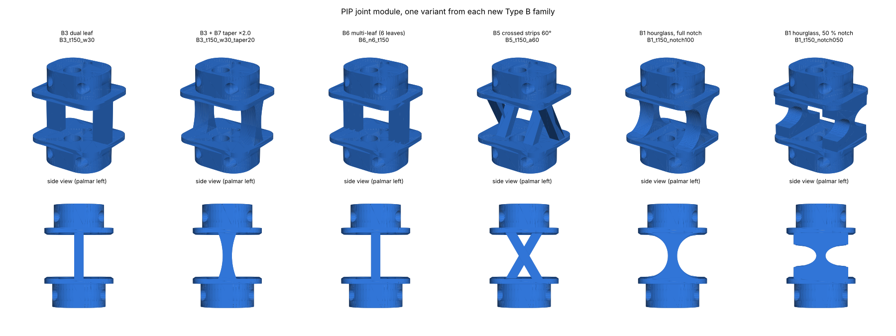

# Type B flexure families: B1, B3, B5, B6 (+ B7 taper)

These four families sit alongside the bow-tie lattice designs. Each one uses
**exactly the same finger**: the phalanges in `common_phalanges/`, the tabs,
sockets, pins, collars, flange, tendon and sensor channels, and the flex-zone
lengths (MCP 10.25 mm, PIP 7.55 mm, DIP 7.3 mm). Only the TPU between the two
collars of each joint changes, so any difference in testing comes from the
flexure alone.



## Common rules

* **Side by side, on the centre line.** Every flexure sits on the section's
  centre line (y = 0), so each joint bends about the middle of its section.
  Every flexure is placed either side of a clear central corridor, so the
  tendon and sensor lead pass through in open air, as they do in the lattice.
  Stacked leaves were ruled out because they rotate poorly (see the
  discussion of B6).
* **Thickness grading.** The thickness in a variant's name is the **PIP**
  value. The MCP is 1.27× thicker and the DIP 0.82× thinner, the same ratios
  as the original lattice struts, so the bigger joint stays stiffer.
* **Clearances.** Flexures stay at least 0.3 mm inside the collar outline.
  Neighbouring leaves and strip lanes keep a clear 0.6 mm gap. Nothing is
  thinner than 0.6 mm.
* **What's in each folder.** Every variant folder holds the three joint
  modules as STEP and STL, plus `finger_assembly.step` (the whole finger).
  Each family folder also has `variants_summary.csv`, with every dimension
  per joint, and `verification_report.csv`.

Regenerate everything with:

```bash
python "TYPE B/build_flexure_families.py"
```

Or regenerate one family:

```bash
python "TYPE B/build_flexure_families.py" B5
```

## Verification

All 42 variants pass all 38 geometric checks. These are the same 35 checks as
the lattice designs, plus one per joint confirming the flexure stays inside
the collar outline. The checks cover:

* tendon and sensor-lead routing, flange to fingertip
* tab-in-socket clearance and socket walls
* material around channels and pins
* screw, pin, boss and anchor holes
* each part being a single solid
* no overlap between neighbouring parts

As with the lattice, nothing has been checked about how the flexures bend,
how they fail or whether the hard stops engage. That needs FEA or testing.

## The stiffness column

`k` is a **first-order estimate** of each joint's bending stiffness. It is
calculated as k = E × Σ 1/∫(dz/I), using simple beam bending, and is given at
E = 12 MPa. That is the middle of the 8 to 18 MPa range this project assumes
for TPU. Each CSV gives `k_over_E_mm3`, so you can multiply by your own
measured modulus.

Use it to **rank variants within a family**, not as a prediction.

* It ignores shear, large deflection and stiffening from axial strain.
* For B5 it also ignores the coupling between the two strip directions, which
  in a real cross pivot adds stiffness.

The repository's reduced-order model overstated an earlier flexure's
stiffness by 9 to 20 % against FEA. Expect at least that much error here.

## B3: dual leaf (the agreed first test)

One flat leaf each side of the tendon corridor, at the outer edge of the
joint. The leaves bend about X, which gives a clean rotation. Their spacing
gives lateral and torsional stability.

Variants:

* **Leaf thickness:** 1.0, 1.25, 1.5 or 2.0 mm (PIP).
* **Leaf width:** 2.0 or 3.0 mm.
* **B7 taper:** four extra variants with a smooth parabolic taper, thicker at
  the roots. The middle thickness stays at the named value and the roots are
  1.5× or 2× it. The taper lowers the peak strain at the clamped roots for a
  given rotation, at the cost of a stiffer joint.

| Variant | Leaf t (PIP) | Leaf width | Taper (root ÷ middle) | k MCP / PIP / DIP (N·mm/rad at E = 12 MPa) |
|---|---|---|---|---|
| `B3_t100_w20` | 1.00 mm | 2.0 mm | 1.0 | 0.80 / 0.53 / 0.30 |
| `B3_t100_w30` | 1.00 mm | 3.0 mm | 1.0 | 1.21 / 0.79 / 0.45 |
| `B3_t125_w20` | 1.25 mm | 2.0 mm | 1.0 | 1.57 / 1.03 / 0.59 |
| `B3_t125_w30` | 1.25 mm | 3.0 mm | 1.0 | 2.36 / 1.55 / 0.88 |
| `B3_t150_w20` | 1.50 mm | 2.0 mm | 1.0 | 2.72 / 1.79 / 1.01 |
| `B3_t150_w30` | 1.50 mm | 3.0 mm | 1.0 | 4.07 / 2.68 / 1.52 |
| `B3_t200_w20` | 2.00 mm | 2.0 mm | 1.0 | 6.44 / 4.24 / 2.40 |
| `B3_t200_w30` | 2.00 mm | 3.0 mm | 1.0 | 9.65 / 6.36 / 3.60 |
| `B3_t100_w30_taper15` | 1.00 mm | 3.0 mm | 1.5 | 1.76 / 1.16 / 0.66 |
| `B3_t100_w30_taper20` | 1.00 mm | 3.0 mm | 2.0 | 2.22 / 1.46 / 0.83 |
| `B3_t150_w30_taper15` | 1.50 mm | 3.0 mm | 1.5 | 5.93 / 3.90 / 2.21 |
| `B3_t150_w30_taper20` | 1.50 mm | 3.0 mm | 2.0 | 7.48 / 4.93 / 2.79 |

## B6: multi-leaf, side by side

Each side's material is split into 2 or 3 narrower leaves (4 or 6 in total),
with 0.6 mm gaps between them. The total leaf width per side is 2.0 mm and the
thickness is the same as B3's. So each B6 variant has **exactly the same
material and the same estimated bending stiffness as `B3_t###_w20`**.

That's deliberate: it's the fair comparison your notes asked for. Any
measured difference between B6 and its B3 twin comes from splitting the
material. Expect it in torsional and lateral stiffness, strain distribution
and print quality, not in bending stiffness.

There are also two taper variants of `B6_n4_t150`.

The laminated, stacked version from the table was **not** built. With both
ends of the leaves clamped, stacked leaves have to stretch and compress to
rotate. They then behave almost like one solid strap rather than n·t³. They
only reach n·t³ if one end can slide.

| Variant | Leaves | Leaf t (PIP) | Each leaf width | Taper | k MCP / PIP / DIP (N·mm/rad at E = 12 MPa) |
|---|---|---|---|---|---|
| `B6_n4_t100` | 4 | 1.00 mm | 1.00 mm | 1.0 | 0.80 / 0.53 / 0.30 |
| `B6_n4_t125` | 4 | 1.25 mm | 1.00 mm | 1.0 | 1.57 / 1.03 / 0.59 |
| `B6_n4_t150` | 4 | 1.50 mm | 1.00 mm | 1.0 | 2.72 / 1.79 / 1.01 |
| `B6_n4_t200` | 4 | 2.00 mm | 1.00 mm | 1.0 | 6.44 / 4.24 / 2.40 |
| `B6_n6_t100` | 6 | 1.00 mm | 0.67 mm | 1.0 | 0.80 / 0.53 / 0.30 |
| `B6_n6_t125` | 6 | 1.25 mm | 0.67 mm | 1.0 | 1.57 / 1.03 / 0.59 |
| `B6_n6_t150` | 6 | 1.50 mm | 0.67 mm | 1.0 | 2.72 / 1.79 / 1.01 |
| `B6_n6_t200` | 6 | 2.00 mm | 0.67 mm | 1.0 | 6.44 / 4.24 / 2.40 |
| `B6_n4_t150_taper15` | 4 | 1.50 mm | 1.00 mm | 1.5 | 3.95 / 2.60 / 1.47 |
| `B6_n4_t150_taper20` | 4 | 1.50 mm | 1.00 mm | 2.0 | 4.99 / 3.28 / 1.86 |

## B5: crossed strips (cross-axis pivot)

Two strip directions cross at the middle of the flex zone. This defines the
centre of rotation and resists the tendon load squashing the joint.

The two directions run in **separate lanes**, A | B ‖ B | A across the width.
They cross in side view but are 0.6 mm apart, so they never fuse in printing
and act as true cross strips. The lanes are as wide as the joint allows, which
the table lists per joint.

Variants:

* **Strip thickness:** 1.0, 1.25, 1.5 or 2.0 mm (PIP), measured
  perpendicular to the strip.
* **Crossing angle:** 45°, 60° or 75° between the two strips.

90° was tried and dropped: the thicker strips' ends would run into the
collar's rounded corners at the MCP and DIP. Wider angles give longer strips,
which are more compliant per unit thickness but slightly less stable under
compression.

| Variant | Strip t (PIP) | Crossing angle | Lane width MCP / PIP / DIP | k MCP / PIP / DIP (N·mm/rad at E = 12 MPa) |
|---|---|---|---|---|
| `B5_t100_a45` | 1.00 mm | 45° | 2.45 / 1.95 / 1.45 | 1.82 / 0.95 / 0.40 |
| `B5_t100_a60` | 1.00 mm | 60° | 2.45 / 1.95 / 1.45 | 1.71 / 0.90 / 0.38 |
| `B5_t100_a75` | 1.00 mm | 75° | 2.45 / 1.95 / 1.45 | 1.56 / 0.82 / 0.35 |
| `B5_t125_a45` | 1.25 mm | 45° | 2.45 / 1.95 / 1.45 | 3.56 / 1.86 / 0.78 |
| `B5_t125_a60` | 1.25 mm | 60° | 2.45 / 1.95 / 1.45 | 3.33 / 1.75 / 0.74 |
| `B5_t125_a75` | 1.25 mm | 75° | 2.45 / 1.95 / 1.45 | 3.05 / 1.60 / 0.67 |
| `B5_t150_a45` | 1.50 mm | 45° | 2.45 / 1.95 / 1.45 | 6.15 / 3.22 / 1.36 |
| `B5_t150_a60` | 1.50 mm | 60° | 2.45 / 1.95 / 1.45 | 5.76 / 3.02 / 1.27 |
| `B5_t150_a75` | 1.50 mm | 75° | 2.45 / 1.95 / 1.41 | 5.28 / 2.77 / 1.13 |
| `B5_t200_a45` | 2.00 mm | 45° | 2.45 / 1.95 / 1.45 | 14.57 / 7.64 / 3.22 |
| `B5_t200_a60` | 2.00 mm | 60° | 2.45 / 1.95 / 1.45 | 13.66 / 7.16 / 3.01 |
| `B5_t200_a75` | 2.00 mm | 75° | 2.42 / 1.95 / 1.29 | 12.36 / 6.56 / 2.47 |

## B1: hourglass (control)

One 3 mm wide web each side of the corridor. Each web has an elliptical notch
cut from both faces down to the throat thickness. This is the classic notch
hinge, with established stiffness formulas, which makes it the control for
checking your measurements and the FEA pipeline.

Variants:

* **Throat thickness:** 1.0, 1.25, 1.5 or 2.0 mm (PIP).
* **Notch length:** the full flex zone, or the middle 50 %. The 50 % notch
  concentrates bending, so the centre of rotation is sharper but strain is
  higher. It is also much stiffer.

| Variant | Throat t (PIP) | Notch length | k MCP / PIP / DIP (N·mm/rad at E = 12 MPa) |
|---|---|---|---|
| `B1_t100_notch100` | 1.00 mm | 100 % of flex zone | 4.13 / 2.77 / 1.53 |
| `B1_t100_notch050` | 1.00 mm | 50 % of flex zone | 8.21 / 5.52 / 3.04 |
| `B1_t125_notch100` | 1.25 mm | 100 % of flex zone | 7.16 / 4.81 / 2.65 |
| `B1_t125_notch050` | 1.25 mm | 50 % of flex zone | 14.19 / 9.55 / 5.25 |
| `B1_t150_notch100` | 1.50 mm | 100 % of flex zone | 11.23 / 7.55 / 4.15 |
| `B1_t150_notch050` | 1.50 mm | 50 % of flex zone | 22.12 / 14.89 / 8.18 |
| `B1_t200_notch100` | 2.00 mm | 100 % of flex zone | 22.76 / 15.31 / 8.42 |
| `B1_t200_notch050` | 2.00 mm | 50 % of flex zone | 44.20 / 29.81 / 16.34 |

## Where to start

1. **B3: `B3_t100_w30`, `B3_t150_w30` and `B3_t200_w30`.** These three
   bracket the stiffness range. Add `B3_t150_w30_taper20` to test the taper on
   its own.
2. **B6:** the twins of whichever B3 thickness works, e.g. `B6_n4_t150` and
   `B6_n6_t150` against `B3_t150_w20`.
3. **B5:** `B5_t150_a60` as the middle case, then move the angle.
4. **B1:** `B1_t100_notch100` with the matching FEA run, as the calibration
   point.
