# Type B flexures: FEA selection report

This report picks the best variant of each Type B design. Each joint was
simulated as it would sit in the finger: bolted between the phalanges in the
same way your A3 fit check attaches its strap. The variants are compared on:

* range of motion,
* strain and stress through the flexion range (stress-strain graphs),
* the force the tendon needs,
* whether the joint can return the finger to straight,
* how well it resists sideways bending, twist and tendon compression.

The current A3 0.8 mm strap was run through the same test and is shown
alongside as the benchmark.

Everything here is reproducible from the scripts in this folder. See
[How to re-run](#how-to-re-run).

---

## 1. Results at a glance

### Selected variant of each design (PIP joint)

| Design | Selected variant | Usable range | Limited by | Peak strain @ 60° | Tendon force at end of range | Holds finger weight (return margin) | Twist, 1 N pinch 5 mm off-axis | Robust to weighting? |
|---|---|---|---|---|---|---|---|---|
| **B5 crossed strip** | `B5_t150_a45` (1.5 mm, strips at 45°) | **77.8°** | 20 % strain (collars touch at 77.9°) | 14.7 % | 2.6 N | 1.5× | **4.8°** | yes, 4 of 4 weightings |
| **B3 dual leaf** | `B3_t150_w30` (1.5 mm, 3 mm wide) | **76.6°** | collars touch | 13.5 % | 2.1 N | 1.3× | 16.1° | yes, 3 of 4 |
| **B6 multi-leaf** | `B6_n4_t150_taper15` (4 leaves, 1.5 mm, 1.5× taper) | 72.5° | 20 % strain | 16.4 % | 1.7 N | 1.2× | 15.0° | yes, 3 of 4 |
| **B1 hourglass** | `B1_t100_notch100` (1.0 mm throat, full notch) | 46.0° | 20 % strain | 27.0 % | 1.1 N | 1.2× | 5.4° | yes, 3 of 4 |
| **B-lattice (bow-tie)** | `B_T090_X3` (struts ×0.9, 3 cells) | 16.2° | 20 % strain (struts buckle near 10°) | 45.7 % | 1.4 N | 8.7× | 30.6° | 2 of 4 (the original `B00_baseline` wins range-first) |
| *A3 0.8 mm (current part)* | *twin strap beside a pin* | *≥ 90° (strap only, pinned hinge)* | *not reached* | *12.6 %* | *n/a (pin carries the load)* | *0.93×* | *n/a (pin carries it)* | |

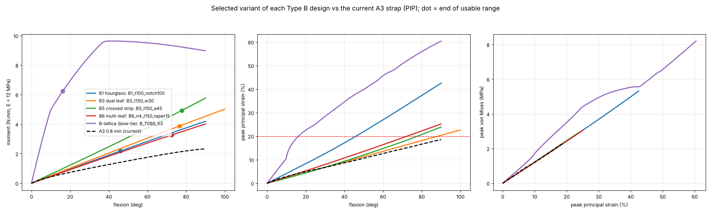

### Ranking across designs

1. **B5 crossed strip (`B5_t150_a45`) is the best Type B joint overall.** It
   has the longest usable range and a strain curve that tracks the A3's
   almost exactly. Its torsional stiffness is 3–6× that of any leaf design,
   so a pinch will not twist the finger. Its only cost is a slightly higher
   tendon force (2.6 N), and an MG995-class servo has plenty of margin for
   that.
2. **B3 dual leaf (`B3_t150_w30`)** is the simplest to print and has the
   lowest strain. It reaches the collar hard stop before its strain limit.
   It is soft in twist: about 16° under a 1 N pinch 5 mm off the axis.
3. **B6 multi-leaf (`B6_n4_t150_taper15`)** behaves like a B3 split into
   four leaves. It is slightly softer and lighter on the tendon. It gets no
   torsional benefit, and the taper that makes it strong enough to return
   the finger costs about 4° of range.
4. **B1 hourglass** concentrates all the bending in a short throat. Even
   the best variant reaches 20 % strain at 46°. Its 30 % strain angle is 66°.
   It is the control, and it behaved as one.
5. **The bow-tie lattice is not viable as drawn.** Its struts reach 20 %
   strain by 10–20°. The compressed-side struts buckle near 10°, which shows
   as a kink in the strain curve, and the joint moment plateaus at about 37°.
   It is also 10–35× stiffer than the leaf designs.

**Recommendation: print and test B5 `B5_t150_a45` first, with B3
`B3_t150_w30` as the second candidate.** Both need the collar change in
§5.1 to use their full range. Raise the MCP thickness as in §5.2 before
relying on any of them to straighten the finger at the MCP.

---

## 2. How the joint was attached and loaded

### 2.1 Where the TPU is held: taken from the A3 fit check

`Assem3_A3_0.8_PIP_FitCheck.STEP` (the parts are in `a3_reference/`) shows
how the TPU is attached to the phalanges. The A3 strap has a 3.2 mm collar
at each end that is held rigidly by the phalanx, and only the strap between
the two collars flexes. The Type B modules mirror this:

* Each module's tabs sit inside the PLA sockets, behind 0.8 mm collars that
  bear on the phalanx end faces.
* In the model, the **proximal collar is fully fixed**.
* The **distal collar is tied into one rigid body**. This is how the A3
  study treats its collars.
* The TPU between the collars is free.

The model is the **whole flex zone**: collar, flexure, collar.

### 2.2 Flexion test

* **Rotation.** The distal rigid body is rotated about the joint's lateral
  axis, from 0° to the joint's flexion target: MCP 90°, PIP 100° (90° for
  the later runs, §6.4) and DIP 80°.
* **Translations are free.** A Type B joint has no pin, so the TPU itself
  sets the centre of rotation. Fixing the rotation and leaving translation
  free applies a pure bending moment under displacement control. The
  joint's own centre of rotation is reported as a result ("centre drift").
* **The A3 benchmark is pinned.** The A3 is a return spring beside a real
  pinned hinge, so its distal collar was rotated about the actual pin axis.
  That axis was recovered from the Ø3.2 mm pin holes in `Index_PP.step`.
* **Solver settings.** Large-deflection nonlinear static analysis
  (CalculiX 2.21, `NLGEOM`), with the increment size set automatically
  (maximum 2.5 % of the target per increment).
* **Outputs every increment.** The joint moment, the rigid-body
  displacement, and the full strain and stress fields.

### 2.3 Off-axis tests

These use the same mesh and three small linear load cases:

* twist of 1° about the finger axis, giving torsional stiffness;
* sideways bend of 1°, giving lateral stiffness;
* axial compression of 0.02 mm, giving axial stiffness against tendon
  pull.

### 2.4 Hard stops (range of motion by geometry)

* **Rigid collision check.** Along the actual FEA motion, including the
  joint's drift, the collars and phalanges were tested for collision as
  rigid solids. The first angle at which any two touch is found by scanning
  the poses and then bisecting.
* **Self-contact inside the flexure.** Leaves or struts touching each
  other were detected from the FEA mesh. A contact is counted when two
  surface points that started more than 1.5 mm apart come within 0.1 mm.

### 2.5 Material, mesh and solver

| Item | Value |
|---|---|
| Material | The repo's provisional Neo-Hookean TPU, E = 12 MPa, ν = 0.4995 |
| Elements | 10-node quadratic tetrahedra (C3D10), gmsh 4.15 |
| Mesh size | min(thickness, width) ÷ 2, i.e. ≥ 2 quadratic elements through every leaf; 0.2 mm floor |
| Lattice | One of the four identical lattice columns, 1.5 elements through each strut, moment × 4 (valid because the collars are rigid); off-axis on the full lattice |
| Strain reported | Peak maximum principal engineering strain, ignoring a 0.4 mm band at each collar root (the sharp-corner singularity) |
| Stress reported | Peak von Mises |
| Model size | 4 000–48 000 elements per joint; 2–80 minutes per run |

**What depends on E and what does not.** The joint is driven by
displacement, so the strains, range of motion, collisions and centre drift
do not depend on E at all. These are the main selection criteria, and they
hold whatever the real TPU modulus turns out to be. Moments, tendon forces,
stresses and stiffnesses scale linearly with E and are quoted at 12 MPa.
Multiply them by (E_real / 12) once the TPU is characterised.

---

## 3. Selection criteria

| Criterion | How it is measured | Why |
|---|---|---|
| **Usable range of motion** | The first of: collar/phalanx collision, 20 % peak strain, self-contact, solver stop, joint target | The joint must reach the angle without damage or jamming |
| **Strain** | Peak strain at 60° (a common angle all leaf variants reach); full strain vs angle curve | Fatigue life of TPU depends on strain amplitude. 20 % is taken as the design limit; 10 % and 30 % are drawn for reference |
| **Stress-strain path** | Peak von Mises vs peak strain along the motion | Shows how far up the material curve each design is driven |
| **Tendon force** | Moment at end of range ÷ tendon moment arm (MCP 3.06, PIP 1.93, DIP 1.06 mm) | Servo load and tendon friction |
| **Return to straight (gate)** | Restoring moment at 20° must be at least the moment of the finger's own weight beyond the joint (MCP 3.68, PIP 0.80, DIP 0.15 N·mm). This is reported as the return margin | Without an extensor, the flexure is the return spring. The A3 sits at 0.93× by this measure |
| **Sideways stiffness** | Tip deflection under 1 N sideways at the fingertip | Grip stability |
| **Twist** | Rotation under a 1 N pinch 5 mm off the finger axis | Pinch stability; a twisting finger loses the object |
| **Axis drift** | Movement of the joint's centre of rotation over the range | A wandering axis changes the tendon moment arm and the finger's path |
| **Tendon compression** | Axial shortening under the end-of-range tendon force | A flexure that shortens under the tendon loses tendon travel |

**Scoring.** Variants that pass the return gate are scored within each
family:

1. Each criterion is normalised, so the best in the family = 1 and the worst
   = 0. Small differences are not inflated: each criterion has a minimum
   spread (e.g. 3° of range, 2 % strain), and differences smaller than that
   count as ties.
2. The normalised criteria are combined with the **balanced** weighting:
   range 30 %, strain 25 %, tendon force 15 %, sideways 10 %, axis drift 10 %,
   twist 5 %, compression 5 %.
3. To check that the choice does not depend on the weights, every family was
   also ranked with three other weightings:
   * range-first (range 50 %);
   * durability-first (strain 45 %);
   * equal weights.

   §1 lists how many of the four weightings agree.

---

## 4. Results by design (PIP)

Each design has two figures:

* `*_curves.png`: four panels showing moment, strain and stress against
  flexion, plus the stress-strain path. Colour is thickness, line style is
  the second parameter, the thick line is the selected variant, and the
  black dashed line is A3.
* `*_parameters.png`: how each parameter moves range, strain, tendon force
  and sideways stiffness.

The full tables, including the variants that failed the return gate, are in
[`results/tables_PIP.md`](results/tables_PIP.md). Every number per variant
is in [`results/summary_PIP.csv`](results/summary_PIP.csv).

### 4.1 B5 crossed strip → `B5_t150_a45`

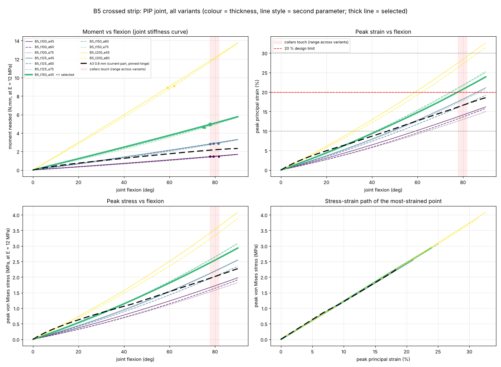
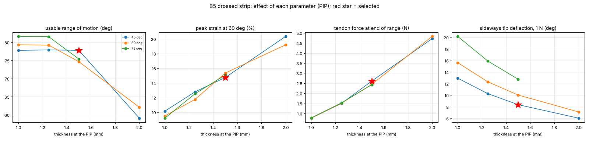

| Variant | Range | Limited by | Strain @60° | Tendon force | Side defl. | Twist | Return margin | Score |
|---|---|---|---|---|---|---|---|---|
| **`B5_t150_a45`** | 77.8° | strain 20 % | 14.7 % | 2.61 N | 8.4° | 4.8° | 1.5× | **0.853** |
| `B5_t150_a60` | 74.6° | strain 20 % | 15.3 % | 2.44 N | 10.0° | 3.3° | 1.5× | 0.763 |
| `B5_t150_a75` | 75.4° | strain 20 % | 15.1 % | 2.43 N | 12.8° | 2.5° | 1.4× | 0.706 |
| `B5_t200_a60` | 62.1° | strain 20 % | 19.2 % | 4.83 N | 7.1° | 2.4° | 3.5× | 0.316 |
| `B5_t200_a45` | 59.1° | strain 20 % | 20.3 % | 4.72 N | 6.0° | 3.2° | 3.7× | 0.263 |
| 1.0 and 1.25 mm (6 variants) | 77.8–81.6° | collision | 9.2–12.8 % | 0.8–1.5 N | 10–20° | 3–8° | 0.4–0.9× | fail return gate |

**Effect of the parameters:**

* **Thickness.** Thickness controls everything. Strain rises with thickness
  t, and moment rises with t³. At 1.25 mm, a B5 is too weak to return the
  finger (0.8–0.9×). At 2.0 mm it hits the strain limit at about 60°. The
  only thickness that gives both is 1.5 mm.
* **Crossing angle.** The angle trades lateral stiffness against torsional
  stiffness:
  * At 45° the strips resist sideways bending best: 8.4° deflection at
    the tip.
  * At 75° they resist twist best (2.5°), but sideways deflection rises
    to 12.8°.
  * Steeper angles also let the collars meet later (81.6° vs 77.8°), but at
    1.5 mm that does not help, because the strain limit arrives first.

  45° wins because it has the most range at 1.5 mm and the stiffest sideways
  support, while its twist is already 3× better than any leaf design.

### 4.2 B3 dual leaf → `B3_t150_w30`

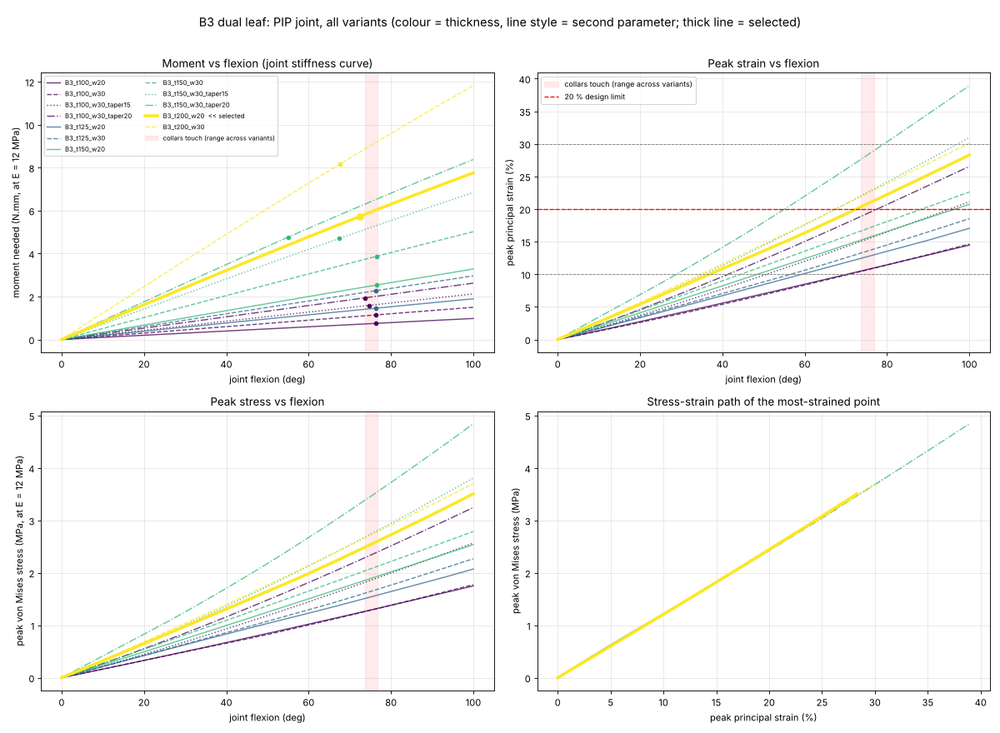
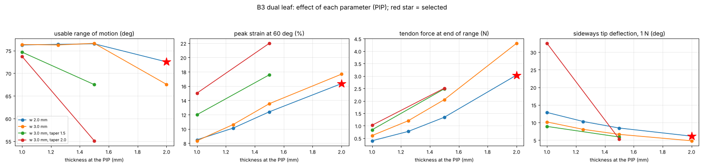

| Variant | Range | Limited by | Strain @60° | Tendon force | Side defl. | Twist | Return margin | Score |
|---|---|---|---|---|---|---|---|---|
| **`B3_t150_w30`** | 76.6° | collars touch | 13.5 % | 2.05 N | 6.6° | 16.1° | 1.3× | **0.750** |
| `B3_t150_w30_taper15` | 67.5° | strain 20 % | 17.6 % | 2.48 N | 5.9° | 9.5° | 1.8× | 0.586 |
| `B3_t200_w20` | 72.5° | strain 20 % | 16.3 % | 3.04 N | 6.1° | 9.8° | 2.0× | 0.555 |
| `B3_t200_w30` | 67.5° | strain 20 % | 17.7 % | 4.31 N | 4.8° | 7.3° | 3.1× | 0.470 |
| `B3_t150_w30_taper20` | 55.1° | strain 20 % | 22.0 % | 2.51 N | 5.3° | 6.4° | 2.2× | 0.392 |
| 1.0, 1.25 and 1.5 mm × 2.0 mm variants (7) | 73.7–76.5° | collision | 8.3–15.0 % | 0.4–1.3 N | 8–13° | 19–68° | 0.2–0.8× | fail return gate |

**Effect of the parameters:**

* **Thickness.** As for B5, thickness sets the balance. From 1.0 to 1.5 mm
  the range is fixed by the collars at about 76°, and strain rises from 8 %
  to 13.5 % at 60°. At 2.0 mm the 20 % strain limit cuts the range to 67–72°.
* **Width.** Going from 2 mm to 3 mm wide adds stiffness at almost no
  strain cost, since strain depends on t and not on width. At 1.5 mm, the
  3 mm width is what carries the return margin over 1×: 1.3× against 0.8×.
* **Taper (B7).** Tapering moves the bending to the thin middle of the
  leaf. The B7 taper gives:
  * 2–3× the torsional stiffness;
  * 20–40 % more strain;
  * a 10–20° shorter usable range.

  It is the right fix only when twist matters more than range.

### 4.3 B6 multi-leaf → `B6_n4_t150_taper15`

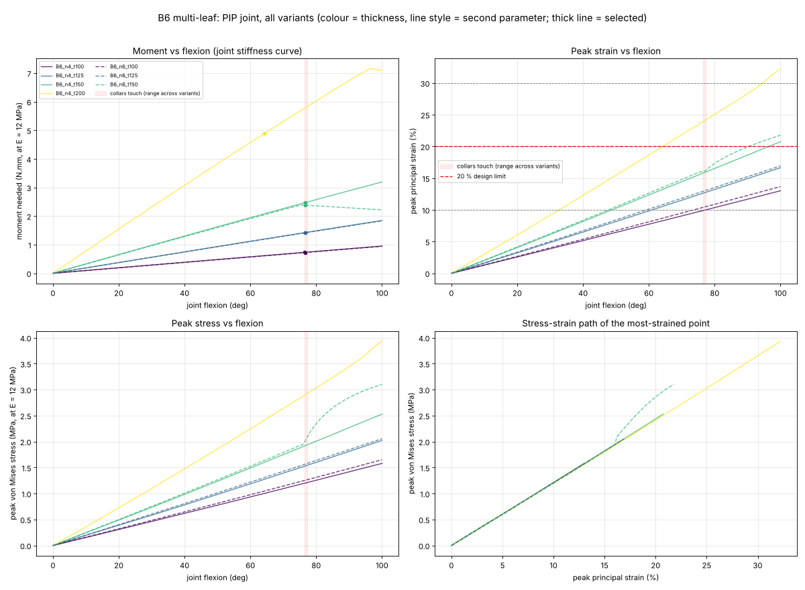
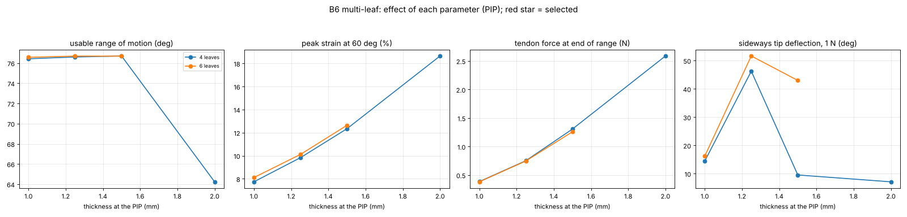

| Variant | Range | Limited by | Strain @60° | Tendon force | Side defl. | Twist | Return margin | Score |
|---|---|---|---|---|---|---|---|---|
| **`B6_n4_t150_taper15`** | 72.5° | strain 20 % | 16.4 % | 1.72 N | 8.4° | 15.0° | 1.2× | **0.742** |
| `B6_n6_t200` | 55.2° | leaves touch | 16.5 % | 1.85 N | 8.0° | 14.9° | 1.9× | 0.519 |
| `B6_n4_t150_taper20` | 58.2° | strain 20 % | 20.7 % | 1.70 N | 7.6° | 10.0° | 1.4× | 0.463 |
| `B6_n4_t200` | 64.2° | strain 20 % | 18.6 % | 2.59 N | 7.1° | 12.7° | 1.9× | 0.397 |
| 1.0–1.5 mm untapered (6) | 76.4–76.7° | collision | 7.7–12.6 % | 0.4–1.3 N | 10–16° | 27–97° | 0.2–0.8× | fail return gate |

**Effect of the parameters:**

* **Splitting into leaves.** The same total width split into 4 or 6 narrow
  leaves bends the same way as a B3 of the same thickness: same strain,
  about 10 % less moment. It also lowers torsional stiffness, because narrow
  leaves twist easily.
* **Six thick leaves.** Six 2.0 mm leaves touch each other at 55°, which is
  the self-contact limit in the table.
* **Taper.** The untapered 1.5 mm B6 just misses the return gate (0.8×).
  The 1.5× taper lifts it to 1.2× at the cost of range, which falls from
  76.7° to 72.5°.

  B6 has no advantage over B3 here. It is a fallback if a single wide leaf
  prints badly.

### 4.4 B1 hourglass → `B1_t100_notch100`

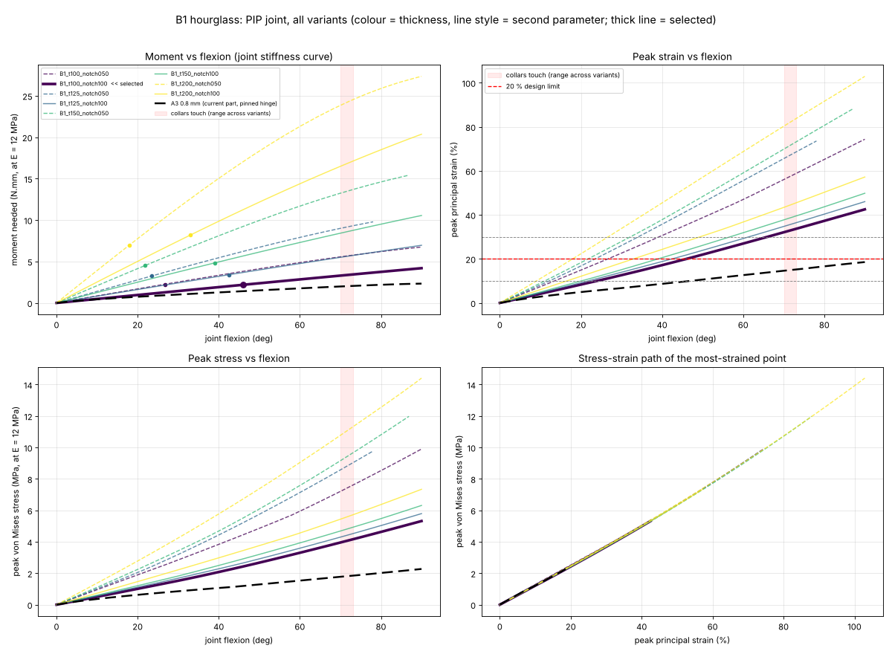
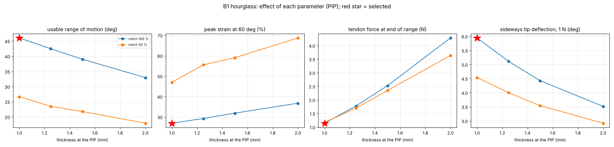

| Variant | Range | 30 % strain angle | Strain @60° | Tendon force | Side defl. | Twist | Return margin | Score |
|---|---|---|---|---|---|---|---|---|
| **`B1_t100_notch100`** | 46.0° | 66.0° | 27.0 % | 1.14 N | 5.9° | 5.4° | 1.2× | **0.762** |
| `B1_t125_notch100` | 42.5° | 61.4° | 29.2 % | 1.78 N | 5.1° | 4.1° | 2.0× | 0.714 |
| `B1_t150_notch100` | 39.0° | 56.7° | 31.9 % | 2.53 N | 4.4° | 3.1° | 3.1× | 0.647 |
| `B1_t100_notch050` | 26.7° | 39.3° | 47.0 % | 1.17 N | 4.5° | 1.9° | 2.1× | 0.606 |
| others (4) | 17.9–33.0° | 26.7–49.3° | 32–69 % | 1.7–4.3 N | 2.9–4.0° | 1.1–2.1° | 3.1–9.7× | 0.30–0.50 |

**Effect of the parameters:**

* **Why the hourglass is limited.** The hourglass makes a pivot by
  concentrating all the bending in its throat. Its axis is the most precise
  of all the designs (centre drift 0.08–0.24 mm, against 0.7–0.9 mm for the
  leaves). The price is strain: because bending is confined to a short
  length, every hourglass reaches 20 % strain long before the collars touch.
* **Notch.** The short-notch versions (`notch050`) also fold onto
  themselves at about 48°.
* **Thickness.** Thinner and full-length notches are better on every
  count except the return margin.

B1 is useful as a check of the method: it ranks last among the solid
designs, as a short notch flexure in TPU should.

### 4.5 B-lattice (bow-tie) → `B_T090_X3`

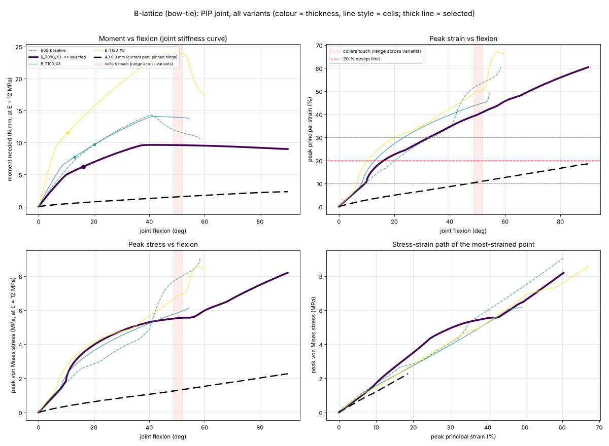
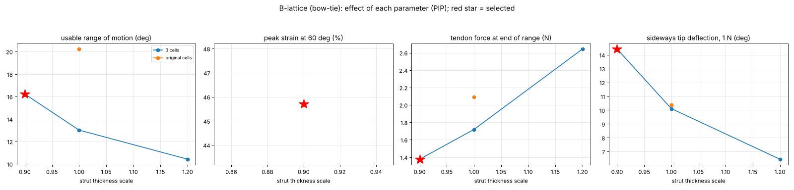

| Variant | Range | Limited by | Strain @30° | k₀ | Tendon force | Side defl. | Twist | Return margin | Score |
|---|---|---|---|---|---|---|---|---|---|
| **`B_T090_X3`** | 16.2° | strain 20 % | 28.4 % | 31.9 N·mm/rad | 1.38 N | 14.4° | 30.6° | 8.7× | **0.683** |
| `B00_baseline` (your original cells) | 20.2° | strain 20 % | 27.8 % | 38.4 | 2.09 N | 10.4° | 21.7° | 12.1× | 0.540 |
| `B_T100_X3` | 13.0° | strain 20 % | – | 47.7 | 1.72 N | 10.1° | 21.0° | 12.1× | 0.414 |
| `B_T120_X3` | 10.4° | strain 20 % | – | 93.6 | 2.64 N | 6.4° | 11.9° | 19.6× | 0.271 |

**What happens in the lattice:**

* **Strain.** The bow-tie cells bend their thin struts much harder than a
  leaf of the same overall size bends. Peak strain reaches 20 % at 10–20° of
  joint flexion.
* **Buckling.** Near 10° the struts on the palmar (compressed) side buckle.
  The strain curve kinks upward there and the stiffness drops. By about 37°
  the joint moment stops rising: the joint has no stiffness left to add,
  and it would not hold a position or return predictably.
* **Stiffness.** At 32–94 N·mm/rad, the lattice is 10–35× stiffer to start
  bending than the selected leaf designs (2.6–3.5 N·mm/rad).
* **Collars.** The lattice collars meet earlier than the leaves', at 49–52°.

Within the family:

* **Thinner struts are better.** `B_T090_X3` has the best balance.
* **Your original cell layout (`B00_baseline`) has the most range**, and it
  wins under the range-first weighting.

No lattice variant comes close to the leaf designs. Making the lattice
work would need much longer, thinner struts than the 7.55 mm PIP flex zone
allows.

### 4.6 A3 benchmark

The A3 0.8 mm twin strap was run whole, about its real pin axis:

* **Mesh and range.** 32 114 elements, size 0.5 mm, run to 90°.
* **Strain.** Peak strain is 6.7 % at 30°, 12.6 % at 60° and 15.8 % at 76°,
  and stays under 20 % to 90°.
* **Moment.** 0.74 N·mm at 20°, 1.76 N·mm at 60°, 2.11 N·mm at 76°.

How A3 compares with the Type B designs:

* **Strain.** The strain curves of B3 `t150_w30` and B5 `t150_a45` lie on
  top of the A3's up to about 60°. In fatigue terms, a 1.5 mm Type B joint
  at the PIP is no harsher on the TPU than the part you use today.
* **Moment.** The Type B joints need about 2× the A3's moment, because they
  carry the joint alone with no pin. Their return margins of 1.2–1.5× are
  therefore better than the A3's 0.93×.
* **What the A3 has that Type B lacks.** The pin carries all sideways,
  twist and compression loads, which a Type B joint must take through the
  TPU. That is why those criteria are in the score.

---

## 5. Findings that apply to every design

### 5.1 The PIP range is limited by the collars, not the flexures

Every leaf variant that is not strain-limited stops at **76.2–76.8° at the
PIP** (B5: 77.8–81.6°). At that angle the palmar edges of the two 0.8 mm
collars touch. This comes from the shared finger geometry, not from any
flexure:

* the collars are 11.4 mm tall;
* the PIP flex zone is 7.55 mm long.

[`relief_rom.py`](relief_rom.py) replays each winner's FEA motion without
the collars, so the next thing to touch is a phalanx end or the hard-stop
nub. That shows the range each winner would have with **palmar-relieved
(chamfered) collars**:

| Winner | Range now | With relieved collars | Strain at that angle |
|---|---|---|---|
| B5 `t150_a45` | 77.8° | 86.8° | ≈ 23 % (t ≈ 1.3 mm would keep it at 20 %, return margin ≈ 1.0×) |
| B3 `t150_w30` | 76.6° | 85.4° | ≈ 19 % |
| B6 `n4_t150_taper15` | 72.5° | 83.7° | ≈ 23 % |
| B1 `t100_notch100` | 46.0° | 79.6° | n/a (strain-limited at 46°) |

**Recommendation.** Chamfer the palmar edge of every collar by about
1.5 mm × 45°. Do the same for the matching faces of the phalanx ends, and
lower the hard-stop nubs to suit. This recovers about 9° at the PIP. B3 can
use it fully within 20 % strain. Further range needs a longer PIP flex zone.
These results come from a geometric replay of the contact-free motion, not
from an FEA with contact. Treat them as a redesign guide.

### 5.2 The MCP needs a stiffer flexure to straighten the whole finger

All four winners were re-run at the MCP and DIP, using their own graded
thicknesses (MCP ×1.27, DIP ×0.82):

| Winner | MCP range | MCP limited by | MCP strain @60° | MCP return margin | DIP range (target 80°) | DIP strain @60° | DIP return margin |
|---|---|---|---|---|---|---|---|
| B5 `t150_a45` | 82.2° | strain 20 % | 13.9 % | **0.6×** | 80° (full) | 12.5 % | 3.5× |
| B3 `t150_w30` | 88.0° | collars touch | 11.9 % | **0.4×** | 80° (full) | 10.8 % | 4.0× |
| B6 `n4_t150_taper15` | 77.7° | strain 20 % | 15.2 % | **0.4×** | 80° (full) | 13.7 % | 3.5× |
| B1 `t100_notch100` | 50.5° | strain 20 % | 24.2 % | **0.4×** | see `results/tables_DIP.md` | | |

**DIP.** Every winner reaches the full 80° with low strain, and returns
with a 3.5–4× margin.

**MCP: the gap.** At the MCP the flexure has to hold the whole finger
(3.7 N·mm), and every winner gives only 0.4–0.6× of that. Two ways to fix
it:

* **Thicker MCP flexure.** Moment grows with t³ and strain with t. Raising
  the MCP grade factor from ×1.27 to about ×1.5 for B5 (1.9 → 2.25 mm) or
  ×1.75 for B3 (1.9 → 2.6 mm) would give about 1.0× return margin. Strain
  at 60° would rise to about 16–17 %, inside the limit, but the MCP range
  would become strain-limited at roughly 70–75°. This estimate scales the
  FEA results; it was not re-run.
* **Extensor at the MCP.** Let an extensor tendon (or the servo's return
  stroke) straighten the MCP, and keep the flexure as is.

### 5.3 Leaves are soft in twist; crossed strips are not

* **Leaf designs.** Designs with parallel leaves (B3, B6) twist 6–97°
  under a 1 N pinch 5 mm off-axis, depending on thickness and taper. The
  selected ones twist 15–16°. A flat leaf is weakest in torsion.
* **Crossed strips.** B5's crossed strips resist twist 3–6× better at the
  same thickness, and taper (B7) roughly doubles a leaf's torsional
  stiffness.
* **Implication.** If the hand will pinch, this alone favours B5.

### 5.4 Thickness, not pattern, sets the trade-off

In every family thickness moves all criteria at once:

* **Strain ∝ t.** In the leaf families, thickness alone sets the strain.
  Width and leaf count barely change it.
* **Moment ∝ t³.** The return margin needs a minimum thickness, and the
  strain limit caps the maximum.
* **The window at the PIP.** With the repo's TPU and these flex-zone
  lengths, that window is narrow: **1.5 mm** for the leaf and strip designs.
  1.25 mm is too weak to return, and 2.0 mm reaches the strain limit by
  60–70°.
* **Effect of a stiffer TPU.** If the real TPU is stiffer than 12 MPa, the
  return margins scale up and the window opens towards 1.25 mm. Strains do
  not change.

---

## 6. Confidence and limitations

### 6.1 Checks done

* **Beam theory.** The B3 FEA moment is about 8 % above the simple beam
  estimate. That is the expected direction, since the collar roots add
  stiffness.
* **Mesh convergence.** `B3_t150_w30` at the PIP was re-run with 3
  elements through the thickness instead of 2. See
  `results/convergence/` and §6.3.
* **Return-gate calibration.** The A3 benchmark sits at 0.93× on the return
  gate, so the gate is calibrated against the part already in use.
* **Off-axis parser bug, found and fixed.** The first off-axis results were
  read from the wrong solver output whenever CalculiX split a step into
  increments. The fix is `fea_typeb.offaxis_stiffness`, and every result was
  re-read with `repair_offaxis.py`. All figures and tables here use the
  corrected values.

### 6.2 Limitations

* **Material.** TPU is a provisional Neo-Hookean, E = 12 MPa. Strains,
  range and collisions do not depend on E. Moments, forces and stresses
  scale with it. Print-direction anisotropy, layer adhesion and viscoelastic
  relaxation are not modelled.
* **The 20 % strain limit is a design assumption,** not a measured fatigue
  limit for your TPU. The 10 % and 30 % angles are in `summary_PIP.csv`, so
  the selection can be re-run with another limit by changing
  `STRAIN_LIMIT` in `analyse_results.py`.
* **No contact after first touch.** The collision angle ends the usable
  range; the FEA does not model what happens past it.
* **No fatigue, creep or tendon friction.** No cyclic loading was run.
* **Lattice model.** The lattice was run as one column × 4 with a coarser
  mesh (1.5 elements per strut). Its strains are, if anything,
  under-estimated, which does not change the verdict.
* **Grading not swept at MCP/DIP.** MCP and DIP were checked only for the
  PIP winners with the existing grade factors; the grading itself was not
  swept.

### 6.3 Mesh convergence

See [`results/convergence/`](results/convergence/). The B3 winner run with
3 elements through the thickness is compared with the 2-element run used
for the selection.

### 6.4 Run settings that changed during the campaign

* **Flexion target.** The first 20 runs (all B3 and B6 without taper) used
  a PIP target of 100°. All later runs, and the A3, used 90° to save time.
  Every joint's usable range ends below 82°, so this changes no result.
* **Lattice variants run.** Seven of the 13 lattice variants were run:
  * the original cells;
  * thickness 0.9, 1.0, 1.1 and 1.2 at 3 cells;
  * 2 and 4 cells at thickness 1.0.

  The trends are monotonic and the family is far from viable, so the other
  six would not change the verdict.

---

## 7. How to re-run

```bash
cd "TYPE B/analysis"
python run_campaign.py PIP --workers 2 --threads 2           # every variant (skips finished ones)
python run_campaign.py MCP B5_t150_a45 B3_t150_w30           # check given variants at another joint
python a3_benchmark.py /tmp/a3 results/A3_benchmark_PIP.json 2 0.5
python analyse_results.py PIP                                # tables, CSV, selection, figures
python relief_rom.py PIP B5_t150_a45 B3_t150_w30             # range with relieved collars
```

| File | What it does |
|---|---|
| `fea_typeb.py` | Builds the flex zone, meshes it, writes the CalculiX decks, runs them, and extracts strain, stress, moment, centre of rotation, contact and collision |
| `a3_benchmark.py` | The same protocol on the A3 strap about its real pin axis |
| `run_campaign.py` | Parallel runner; one JSON per variant in `results/<joint>/` |
| `analyse_results.py` | Criteria, scoring, selection, tables and figures |
| `relief_rom.py` | Range with palmar-relieved collars (geometric replay) |
| `repair_offaxis.py` | One-off re-read of the off-axis stiffnesses (see §6.1) |
| `results/` | Raw per-variant results, summaries, selection files |
| `figures/` | All plots |

Requirements: CadQuery 2.x, gmsh, CalculiX (`ccx`), numpy, scipy and
matplotlib. The repo's `barnes_ui` package supplies `generate_mesh` and
the TPU material.
