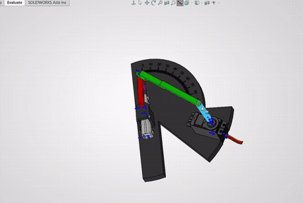
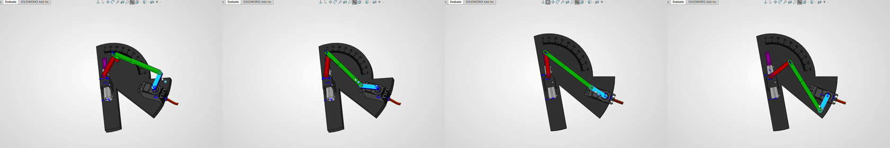

# Automated test rig (steps 4 and 5)

Changes to the Type B bending rig (`../build_test_rig.py`, procedure in
`docs/12-tpu-specimen-test-procedure.md`, Part 2) that automate step 4 (spring-back) and
step 5 (cycles). Design files supplied by the project team; this page lists them as they are
added.

| File | What it is | Replaces / adds to | Notes |
|---|---|---|---|
| `Base.SLDPRT` | Base for the automated rig | Rig base (`RIG`) | SolidWorks part, 1.5 MB |
| `Crank_New.SLDPRT` | Crank (current version) | new | supersedes `crank.SLDPRT` |
| `Coupler_new.SLDPRT` | Coupler (current version) | new | supersedes `coupler.SLDPRT` |
| `crank.SLDPRT` | Crank (earlier version) | new | kept for the record |
| `coupler.SLDPRT` | Coupler (earlier version) | new | kept for the record |
| `ground_link.SLDPRT` | Ground link of the linkage | new | the fixed link the crank and coupler work against |
| `MG995.SLDPRT` | MG995 servo (model) | new | the drive |
| `MG995_Assembly.SLDASM` | Servo sub-assembly | new | |
| `Fatigue_assembly.SLDASM` | Fatigue (cycling) sub-assembly | new | step 5 |
| `Master_Testrig_Assembly.SLDASM` | Whole test rig | new | top-level assembly |
| `rocker_arm.SLDPRT` | Rocker arm of the linkage | new | the output link (four-bar: ground, crank, coupler, rocker) |
| `S1_common_phalanges_02_Phalanx1.SLDPRT` | Phalanx 1 (as-built), as used in the assembly | S1 | SolidWorks copy of the repo's S1 |
| `S2_common_phalanges_04_Phalanx2.SLDPRT` | Phalanx 2 (as-built), as used in the assembly | S2 | SolidWorks copy of the repo's S2 |
| `s2_phalange.SLDPRT` | Modified Phalanx 2 | S2 | likely the S2 adapted to the linkage (to be confirmed) |
| `pan_head_tapping_screw_am.SLDPRT` | Pan-head tapping screw (hardware model) | — | fastener |
| `Shaft.SLDPRT` | Shaft | new | axle for the linkage (to be confirmed) |
| `slider_hole.SLDPRT` | Slider with a hole | new | guide for the moving end (to be confirmed) |
| `tpu_mimic.SLDPRT` | Stand-in for the TPU joint module | PIP module | CAD placeholder for the module, for fitting the assembly |
| `tpu_mimic_centre.SLDPRT` | Centre part of the TPU stand-in | PIP module | as above |
| `Wire_Boot.SLDPRT` | Wire boot | new | strain relief / guide for the tendon or a lead (to be confirmed) |
| `Wires.SLDPRT` | Wire / tendon model | — | for the assembly |
| `S1_common_phalanges_02_Phalanx1.step`, `S2_common_phalanges_04_Phalanx2.step` | Phalanges as used | S1, S2 | **identical to the repo's S1 and S2** (same volume, zero boolean difference): the automated rig uses the standard phalanges |
| `stl/Base.stl`, `stl/Crank_New.stl`, `stl/Coupler_new.stl`, `stl/Rocker_arm.stl`, `stl/Slider_hole.stl` | STL exports of the printed parts | | measured below |

The parts point to an MG995 servo driving a four-bar linkage (ground link, crank, coupler, rocker arm) that
cycles the finger for the fatigue test (step 5) and the spring-back test (step 4); details to be
confirmed. Open `Master_Testrig_Assembly.SLDASM` in SolidWorks with all the parts in this folder. The parts are SolidWorks files (SolidWorks 2015+ format), which
can't be opened outside SolidWorks; STEP or STL exports of each would let them be checked against
the rest of the rig and shown here.

## The printed parts, measured from the STLs

| Part | Size (mm) | Joints, centre to centre |
|---|---|---|
| Crank_New | 37.3 × 7.3 × 5.0 | two Ø3.15 holes **30.0 mm** apart (crank length) |
| Coupler_new | 114.4 × 17.0 × 7.4, stepped | Ø4.23 hole and Ø3.12 hole **106.0 mm** apart (coupler length) |
| Rocker_arm | 50.5 × 23.7 × 7.4, L-shaped | Ø3.12 hole at the foot, Ø3.13 pin at the top: **43.2 mm** apart (rocker length) |
| Slider_hole | 30 × 9.4 × 7.4 | Ø8.9 boss at the bottom, Ø3.15 cross hole at the top |
| Base | 179.7 × 132.8 × 32 | Ø16.1 bore (fits a Ø16 bearing, e.g. the 625ZZ) |

All five STLs are closed, printable meshes.

**Four-bar check (crank 30, coupler 106, rocker 43.2; the ground link, servo axis to rocker
pivot, is not in an STL).** The crank turns fully and the rocker rocks (Grashof crank-rocker)
only if the ground link is **between 92.8 and 119.2 mm**. The rocker's swing for a full crank
turn is then about 120° at 93 mm, 95° at 100 mm, 88-90° between 105 and 115 mm, and 100° at
119 mm. A swing near 90° matches the 0-90° range of steps 4 and 5. The servo's own sweep
limits this further if it is not turning the crank all the way round.

## The mechanism in motion

From the team's SolidWorks motion study (`automated_rig_motion.mp4`, 21 s). The servo (lower
right) turns the crank (light blue) on its horn. The coupler (green) runs up to the rocker (red),
which pivots on the joint's axis beside the protractor and is fixed to the moving phalanx, so the
finger follows the rocker over the scale. In the study the crank turns all the way round (the
continuous-rotation servo) and the rocker rocks back and forth: the crank-rocker described above.

## How it works (from the team)

* **Drive:** an MG995 servo turns the crank of a crank-rocker four-bar (crank 30 mm, coupler
  106 mm, rocker 43.2 mm). The rocker swings about 90°. For a smaller angle the servo sweeps
  the crank only part way. The MG995 is a positional servo (about 180°), not a 360° one, and
  that is all this needs: for a ground link of 105-115 mm the crank sweeps about 64-79° for 30°
  of rocker, 106-122° for 60° and 171-176° for the full 90°. (A "360°" MG995 is a
  continuous-rotation version with speed control only, which could not stop at an angle.)
* **Finger:** the bottom phalanx (S1) is fixed. The rocker is attached to the top phalanx (S2),
  with the rocker's pivot on the TPU joint's pivot, so the joint is bent to the rocker's angle:
  the test is angle-controlled.
* **Rocker-coupler joint:** a hole looser than the pin instead of a tight pin joint (Ø4.23 hole
  on a Ø3.13 pin: about 1.1 mm of play, about 1.5° of rocker). It takes up small
  misalignments, limits the force on the TPU if the servo goes past its target, and lets the
  joint settle a little at the end of each move instead of being held rigidly.

## Points to check

1. **Pivot drift (free modules).** A free TPU joint does not turn about a fixed point: the
   round-1 FEA has the B5's rotation centre moving about 1.1 mm palmar by 90°. With the rocker
   fixed to S2 and pivoting on a fixed point, the TPU is forced round a fixed centre, which adds
   load the real finger does not see. The pinned modules (H, K) already turn on a pin, so put
   the rocker pivot on the hinge pin's axis for them (0.65 mm palmar of the strip crossing for
   H, 0.8 mm for K) and there is no conflict. For the free modules (A, B, C, E, F, G), either
   accept it (and note it), or let the rocker-to-S2 connection slide about 1-2 mm along the
   finger.
2. **Step 4 (spring-back) needs the finger free.** The 1.5° of play lets the joint settle but
   not spring back: with the rocker fixed to S2, the finger follows the servo. For step 4, after
   the 60 s hold, either take the coupler pin out (or unhook the rocker) and read the angle as
   before, or add a lost-motion slot in the coupler long enough for the whole return.
3. **Step 5 becomes a different test.** Driven by angle, without the tendon and the fingertip
   weight, it cycles the strips in pure bending: a strain-controlled fatigue test, not the
   tendon-loaded cycle of the manual step 5. That is useful in its own right: it can measure the
   strain limit that every design decision uses as a 20 % placeholder (peak strain at each
   angle from the FEA, e.g. B5 t1.5 about 14.7 % at 60°). Report it as such.

## Which servo

Use a **standard (positional) MG995**, not the continuous-rotation "360°" version.

* A continuous servo turns the crank all the way round, so the rocker always makes its full
  ~90° swing. Every joint's range is below that (H 74°, K 76°, B5 t1.5 77.8°: collars meet or
  20 % strain), so each cycle would force the collars together; the 1.5° of slot play cannot take
  up 12-16° of overtravel. It also cannot hold an angle (step 4) or know where it is (cycle count,
  parking at 0°) without an extra sensor.
* A positional servo sweeps the crank only as far as needed (about 64-82° of crank for 30° of
  rocker, 106-122° for 60°, 151-176° for 90°), holds, and lets the code count cycles and park at 0°.
* If the continuous servo is kept, the crank must be shortened so its full swing is the test
  angle (same coupler and rocker, ground link 105-110 mm): about 11 mm for 30°, 16 mm for 45°,
  21.5 mm for 60°, one crank per test angle, plus a sensor for counting and a manual release for
  step 4.
* Either way, assemble with the finger straight at the rocker's start position, so the cycle runs
  0° → test angle.

## Servo code: `firmware/fatigue_rig/fatigue_rig.ino`

For a **standard (positional) MG995** on pin 9 of an Arduino Uno/Nano. Power the servo from its
own 5-6 V supply (at least 2 A) with its GND joined to the Arduino's; never from the Arduino's
5 V pin. Serial Monitor at 115200 baud, line ending "Newline".

The finger angle is not computed from the linkage: you calibrate by eye on the protractor, so it
is right whatever the exact link lengths are. Calibration is kept in EEPROM.

**Once per module (calibrate):**
1. `j 1500`, then `+` / `-` (5 µs steps; `++` / `--` for 50 µs) until the finger reads **0°**. Type `z`.
2. Jog until it reads the **test angle** (e.g. 60°). Type `t`, then `a 60` to note the angle.
3. Optional but recommended: jog to just before the collars meet on each side and type `lo` /
   `hi`; the sketch then never drives past them (`L` resets them).
4. `0` and `T` move to the two saved points to check them.

**Step 5 (cycles):** `f 2000` (2 s per cycle, 0.5 Hz), `w 200` (dwell at each end), `k 100`
(stop at 0° every 100 cycles), then `c 1000` (or `c 0` to run until `x`). At each stop, read the
protractor and type `r 1.5` (the resting angle) to log it and carry on. The count survives a
power cut (saved every 50 cycles); `n` resets it.

**Step 4 (spring-back):** `h 60` drives to the test angle and holds 60 s. Type the held angle
(`r 60`), pull the coupler pin when told, type `r` the moment it is free; the servo then goes limp
and the sketch prompts you at 1 s, 10 s, 60 s and 10 min (`r <deg>` each time). Refit the pin,
`e`, `0`.

Every reading is printed as a `LOG,...` CSV line, ready to paste into the workbook.

## How it changes the procedure

* Steps 1-3 stay manual (tendon and weights).
* Step 4: drive to the angle with the servo, hold 60 s, release (point 2), read the angle at
  1 s, 10 s, 60 s and 10 min.
* Step 5: cycle 0 → θ with the servo (θ = 60° or the angle for a chosen peak strain), count
  cycles in the controller, and every 100 (or 1,000) cycles stop at 0° and record the resting
  angle; stop at a crack or a 5° change in the resting angle. Record the servo's crank angles
  for 0° and θ once per module.

## Status

* Files: all in (20 SolidWorks files, 2 STEP, 5 STL, and the motion-study video).
* Still to confirm: the ground-link length (servo axis to rocker pivot), and how step 4's release
  will be done.
* Report: to be added to the test report when the rig results are written up.
