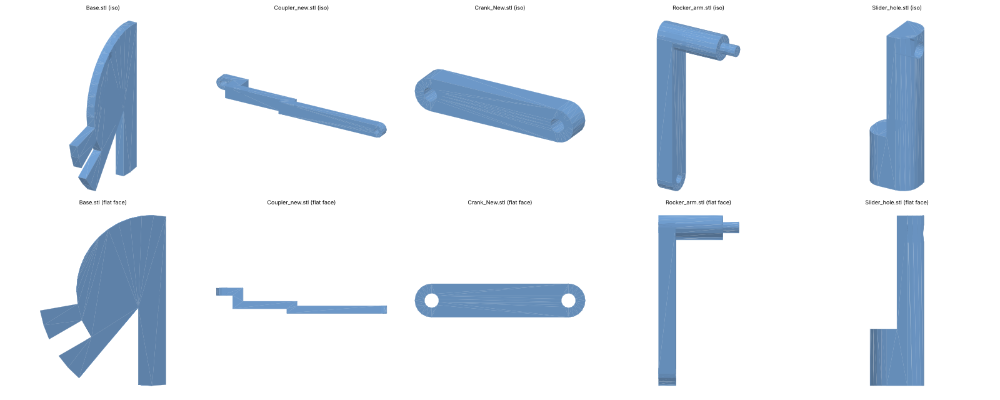

# Automated test rig (steps 4 and 5)

Changes to the Type B bending rig (`../build_test_rig.py`, procedure in
`docs/12-tpu-specimen-test-procedure.md`, Part 2) that automate step 4 (spring-back) and
step 5 (cycles). Design files supplied by the project team; this page lists them as they are
added.

| File | What it is | Replaces / adds to | Notes |
|---|---|---|---|
| `Base.SLDPRT` | Base for the automated rig | Rig base (`RIG`) | SolidWorks part, 1.5 MB |
| `Crank_New.SLDPRT` | Crank (current version) | new | supersedes `crank.SLDPRT` |
| `Coupler_new.SLDPRT` | Coupler (current version) | new | supersedes `coupler.SLDPRT` |
| `crank.SLDPRT` | Crank (earlier version) | new | kept for the record |
| `coupler.SLDPRT` | Coupler (earlier version) | new | kept for the record |
| `ground_link.SLDPRT` | Ground link of the linkage | new | the fixed link the crank and coupler work against |
| `MG995.SLDPRT` | MG995 servo (model) | new | the drive |
| `MG995_Assembly.SLDASM` | Servo sub-assembly | new | |
| `Fatigue_assembly.SLDASM` | Fatigue (cycling) sub-assembly | new | step 5 |
| `Master_Testrig_Assembly.SLDASM` | Whole test rig | new | top-level assembly |
| `rocker_arm.SLDPRT` | Rocker arm of the linkage | new | the output link (four-bar: ground, crank, coupler, rocker) |
| `S1_common_phalanges_02_Phalanx1.SLDPRT` | Phalanx 1 (as-built), as used in the assembly | S1 | SolidWorks copy of the repo's S1 |
| `S2_common_phalanges_04_Phalanx2.SLDPRT` | Phalanx 2 (as-built), as used in the assembly | S2 | SolidWorks copy of the repo's S2 |
| `s2_phalange.SLDPRT` | Modified Phalanx 2 | S2 | likely the S2 adapted to the linkage (to be confirmed) |
| `pan_head_tapping_screw_am.SLDPRT` | Pan-head tapping screw (hardware model) | — | fastener |
| `Shaft.SLDPRT` | Shaft | new | axle for the linkage (to be confirmed) |
| `slider_hole.SLDPRT` | Slider with a hole | new | guide for the moving end (to be confirmed) |
| `tpu_mimic.SLDPRT` | Stand-in for the TPU joint module | PIP module | CAD placeholder for the module, for fitting the assembly |
| `tpu_mimic_centre.SLDPRT` | Centre part of the TPU stand-in | PIP module | as above |
| `Wire_Boot.SLDPRT` | Wire boot | new | strain relief / guide for the tendon or a lead (to be confirmed) |
| `Wires.SLDPRT` | Wire / tendon model | — | for the assembly |
| `S1_common_phalanges_02_Phalanx1.step`, `S2_common_phalanges_04_Phalanx2.step` | Phalanges as used | S1, S2 | **identical to the repo's S1 and S2** (same volume, zero boolean difference): the automated rig uses the standard phalanges |
| `stl/Base.stl`, `stl/Crank_New.stl`, `stl/Coupler_new.stl`, `stl/Rocker_arm.stl`, `stl/Slider_hole.stl` | STL exports of the printed parts | | measured below |

The parts point to an MG995 servo driving a four-bar linkage (ground link, crank, coupler, rocker arm) that
cycles the finger for the fatigue test (step 5) and the spring-back test (step 4); details to be
confirmed. Open `Master_Testrig_Assembly.SLDASM` in SolidWorks with all the parts in this folder. The parts are SolidWorks files (SolidWorks 2015+ format), which
can't be opened outside SolidWorks; STEP or STL exports of each would let them be checked against
the rest of the rig and shown here.

## The printed parts, measured from the STLs

| Part | Size (mm) | Joints, centre to centre |
|---|---|---|
| Crank_New | 37.3 × 7.3 × 5.0 | two Ø3.15 holes **30.0 mm** apart (crank length) |
| Coupler_new | 114.4 × 17.0 × 7.4, stepped | Ø4.23 hole and Ø3.12 hole **106.0 mm** apart (coupler length) |
| Rocker_arm | 50.5 × 23.7 × 7.4, L-shaped | Ø3.12 hole at the foot, Ø3.13 pin at the top: **43.2 mm** apart (rocker length) |
| Slider_hole | 30 × 9.4 × 7.4 | Ø8.9 boss at the bottom, Ø3.15 cross hole at the top |
| Base | 179.7 × 132.8 × 32 | Ø16.1 bore (fits a Ø16 bearing, e.g. the 625ZZ) |

All five STLs are closed, printable meshes.

**Four-bar check (crank 30, coupler 106, rocker 43.2; the ground link, servo axis to rocker
pivot, is not in an STL).** The crank turns fully and the rocker rocks (Grashof crank-rocker)
only if the ground link is **between 92.8 and 119.2 mm**. The rocker's swing for a full crank
turn is then about 120° at 93 mm, 95° at 100 mm, 88-90° between 105 and 115 mm, and 100° at
119 mm. A swing near 90° matches the 0-90° range of steps 4 and 5. The servo's own sweep
limits this further if it is not turning the crank all the way round.

## How it changes the procedure

_To be written once all files are in: what moves the tendon, how the angle and cycle count
are recorded, and what stays manual (steps 1–3)._

## Status

* Files: all in (20 SolidWorks files, 2 STEP, 5 STL).
* Still to confirm: the ground-link length (servo axis to rocker pivot), whether the MG995
  turns the crank continuously or sweeps, and how the rocker and slider move the finger (tendon
  or direct).
* Report: to be added to the test report when the rig results are written up.
