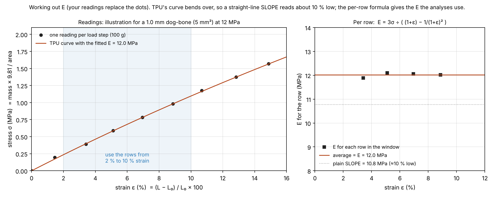

# TPU specimen test procedure

**What this is for.** Every torque, force and return margin in the BARNES analyses was
computed at a provisional TPU modulus of **12 MPa** (SUNLU publishes none; the plausible
range is 5.3–19.3 MPa). They all scale in direct proportion to the real modulus E. These
tests measure E on the spool you print the joints with, so the predictions can be rescaled
before you compare them with the rig.

**What you get out:** three numbers. Report them, and the analyses are rescaled by E ÷ 12.

| Test | Specimens (label) | Gives |
|---|---|---|
| A. Tension, printed flat | 1BA dog-bones, 1.0 mm (F1-1…3) and 2.0 mm (F2-1…3) | E (flat); optionally strength |
| B. Tension, printed on edge | Strips, 1.0 mm (E1-1…3) and 2.0 mm (E2-1…3) | **E (edge): the main number**, because the joint leaves are printed this way |
| C. Compression | Ø10 × 10 mm cylinders, 3 (unlabelled: number them C1–C3 with a marker) | E in compression (used by the B4/B8 bearings) |

Specimen files: [`TYPE B/round2/test_rig/`](../TYPE%20B/round2/test_rig/) (labelled
copies in [`print_ready/specimens/`](../print_ready/specimens/)). Log template:
[`results/material_tests/specimen_log.csv`](../results/material_tests/specimen_log.csv).

---

## 1. Before you test

1. **Print the specimens with the joints:** same spool, same session, same settings
   (100 % infill, 0.4 mm line, 0.2 mm layer, same temperatures and speed). Dry the
   filament first (about 50 °C for 4–6 h). Orientation: dog-bones flat; strips standing on
   their long edge (6 mm tall); cylinders on a flat end.
2. **Let them rest 24 h** at room temperature, and test them all within a day of each
   other. Write down the room temperature: TPU softens noticeably as it warms.
3. **Measure each specimen** with calipers, closing gently (TPU squashes):
   * dog-bone: width and thickness of the narrow 30 mm section, at 3 points;
   * strip: height (about 6 mm) and thickness, at 3 points in the middle 40 mm;
   * cylinder: diameter at 3 heights, and height.

   Use the averages. Area A = width × thickness (strips: height × thickness), or π d²/4
   for the cylinder. Do not use the nominal sizes: printed sizes are often 5–10 % off,
   and that error goes straight into E.
4. **Mark the gauge length** on every tensile specimen: two thin marker lines about 20 mm
   apart, centred on the narrow section (strips: centred on the middle). Measure the
   actual gap L₀ unloaded, to 0.02 mm.

## 2. Equipment

* A fixed top clamp, e.g. two flat PLA or wood plates with two M3 bolts, or a bench vice,
  clamped to a shelf so the specimen hangs freely.
* A bottom clamp of the same kind with a hook, and a bag or bucket to hang loads on.
* Loads: anything weighed on a kitchen scale (water, coins, washers), made up in steps of
  about **100 g** for the 1.0 mm specimens and **200 g** for the 2.0 mm ones. Up to about
  3 kg is needed. Force F (N) = mass (kg) × 9.81.
* Calipers; or better, a phone on a stand, square to the specimen, with a ruler in the
  same plane, so you can measure the marks from photos afterwards.
* For compression: a kitchen or parcel scale reading to about 20 kg, and a way to press
  down slowly and hold it (a drill press, a C-clamp, or a bolt through a plate).

Grip only the wide ends (dog-bones) or the outer 20 mm (strips). Put a strip of sandpaper
in the clamps so the TPU does not slip, and do not tighten so hard that you cut it.

## 3. Test A and B: tension (same steps for dog-bones and strips)

1. Hang the specimen with only the empty bag. That is the zero point: measure L₀ again here.
2. **Condition it:** load to about the mass in the table below (around 15 % strain),
   unload, and repeat three times. TPU is stiffer on its very first stretch (the Mullins
   effect); the joints in use are cycled, so the conditioned value is the one that counts.
3. **Measure:** add the load in steps. At each step **wait 30 s**, then record the mass and
   the mark gap L. Go on until the strain is at least 15 %.
4. **Optional, one 1.0 mm dog-bone to break.** Not needed for the analyses. TPU 90A
   stretches several times its length and holds roughly 10–20 kg in the 1.0 mm dog-bone
   before breaking, so only do it if you can hang that safely (stand clear of the load).
   Record the last mass held and where it broke; a break at a grip is not a valid strength.
5. Do the other two copies the same way.

Approximate load for 15 % strain (×0.45 to ×1.6 if E is at the ends of its range):

| Specimen | Area | Mass for ~15 % at 12 MPa |
|---|---|---|
| 1BA 1.0 mm (F1) | 5 mm² | ≈ 0.9 kg |
| 1BA 2.0 mm (F2) | 10 mm² | ≈ 1.8 kg |
| Strip 1.0 mm (E1) | 6 mm² | ≈ 1.1 kg |
| Strip 2.0 mm (E2) | 12 mm² | ≈ 2.2 kg |

**Working out E.** For each step:

* strain ε = (L − L₀) ÷ L₀
* stress σ = F ÷ A, in MPa when F is in N and A in mm²

* **E for that row** = 3σ ÷ ((1 + ε) − 1 ÷ (1 + ε)²)
  (in the log sheet, strain is column M as a fraction and stress column N: put `=3*N2/((1+M2)-1/(1+M2)^2)` in column O, E_row)

**E is the average of that last column over the rows between 2 % and 10 % strain**
(for one specimen: `=AVERAGEIFS(O:O, A:A, "F1-1", M:M, ">=0.02", M:M, "<=0.10")`). This is the formula for the
neo-Hookean material the analyses use, so it gives exactly the E they need. Do not just
take the straight-line slope of σ against ε: TPU's curve bends over, and the slope reads
about 10 % low. The rows' E values should be roughly level; if they climb or fall steadily,
note it. Also note σ at 20 % strain: the designs are held to 20 %.

## 4. Test C: compression

1. Put a drop of oil or a smear of grease on both flat ends of the cylinder, so they can
   spread sideways freely (dry ends make it look stiffer).
2. Stand it on the scale between two flat, rigid plates, the top plate under the press.
   Zero the scale with the top plate on.
3. Press it down in steps of about **0.2 mm** (2 % of the height). At each step **wait
   30 s**, then record the scale reading and the height h (calipers across the two plates,
   minus the plates' thickness). Go to about 1.0 mm (10 %): about 10 kg at 12 MPa, up to
   16 kg if the TPU is at the stiff end. A scale reading to 20 kg covers it.
4. Do it twice on the same cylinder (the second run is the one to use), then repeat on
   the other two.

**Working out E:** strain ε = (h₀ − h) ÷ h₀ and stress σ = F ÷ A (both positive); for each
row E = 3σ ÷ (1 ÷ (1 − ε)² − (1 − ε)), in the log sheet `=3*N2/(1/(1-M2)^2-(1-M2))` in column O; then
average the rows from 2 % to 10 %, as for tension.

## 5. Checking and reporting

* The three copies of each specimen should agree within about **±10 %**. If one is out,
  look at it (voids, a slipped grip, a bad measurement) and test a spare if you have one.
* **Flat against edge:** if they differ by more than 15 %, the print direction matters,
  and the **edge** value is the one to use for the joints.
* **Tension against compression:** they should be within about 20 %. If not, both numbers
  are used: compression for the B4/B8 bearings, tension for everything else.
* Fill in [`results/material_tests/specimen_log.csv`](../results/material_tests/specimen_log.csv)
  (one row per load step), commit it, and send me the three E values. Every prediction is
  then rescaled by E ÷ 12 MPa before you compare it with the rig. As a quick check: a Type A
  or Type B torque, force or return margin in the report at 12 MPa is multiplied by E ÷ 12.

| Result to report | Value |
|---|---|
| Room temperature | °C |
| E, tension, printed flat (mean of F1 and F2) | MPa |
| **E, tension, printed on edge (mean of E1 and E2)** | MPa |
| E, compression | MPa |
| Strength at break (optional, 1BA 1.0 mm) | MPa |
