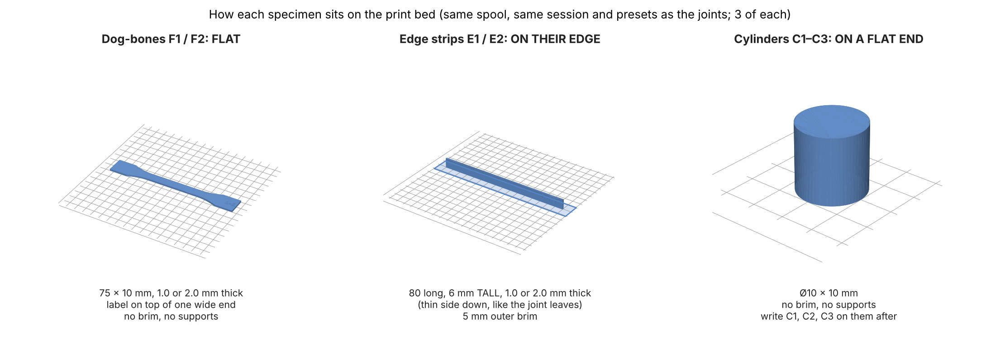
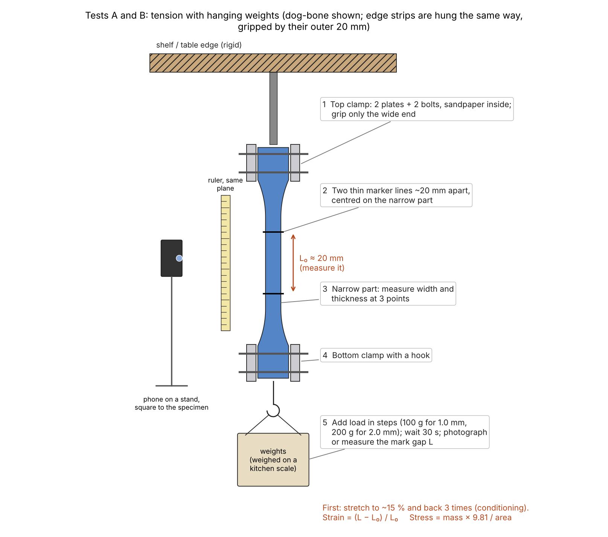
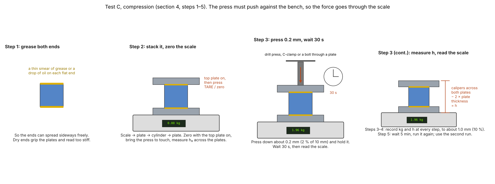
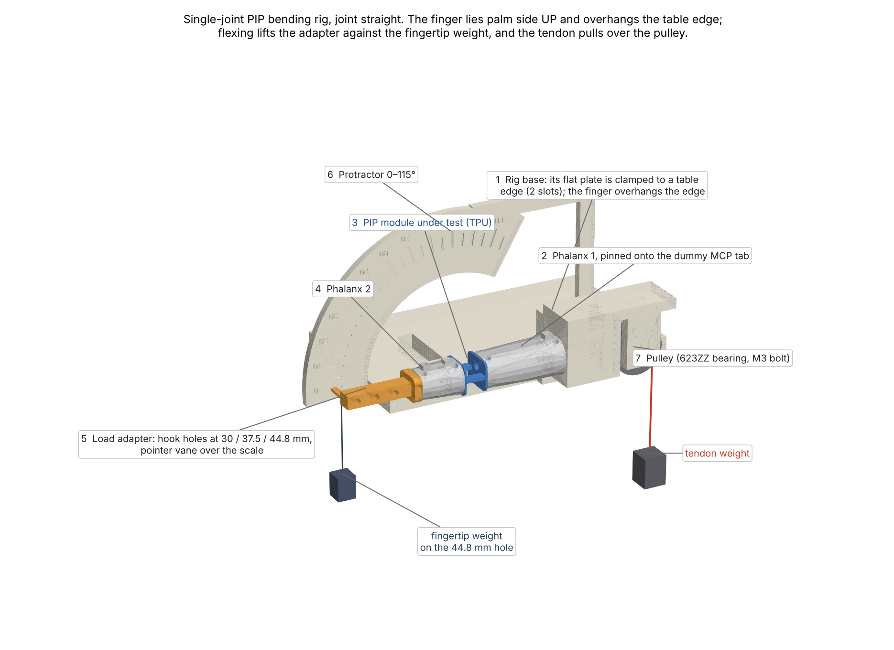
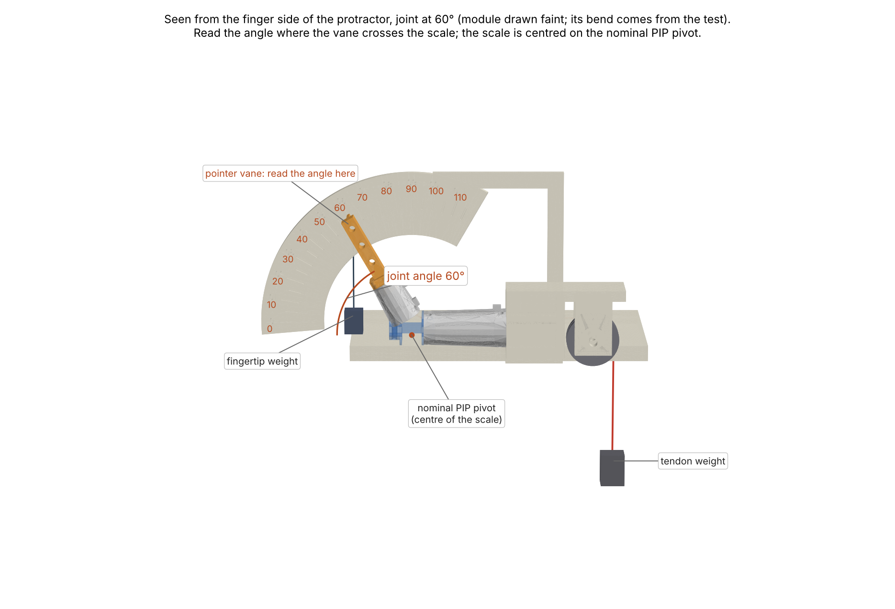

# TPU specimen and joint rig test procedure

Part 1 (sections 1–5) measures the TPU itself on printed specimens. Part 2 (sections 6–10)
tests each printed PIP joint module on the bending rig. Do Part 1 first.

# Part 1: TPU specimens

**What this is for.** Every torque, force and return margin in the BARNES analyses was
computed at a provisional TPU modulus of **12 MPa** (SUNLU publishes none; the plausible
range is 5.3–19.3 MPa). They all scale in direct proportion to the real modulus E. These
tests measure E on the spool you print the joints with, so the predictions can be rescaled
before you compare them with the rig.

**What you get out:** three numbers. Report them, and the analyses are rescaled by E ÷ 12.

| Test | Specimens (label) | Gives |
|---|---|---|
| A. Tension, printed flat | 1BA dog-bones, 1.0 mm (F1-1…3) and 2.0 mm (F2-1…3) | E (flat); optionally strength |
| B. Tension, printed on edge | Strips, 1.0 mm (E1-1…3) and 2.0 mm (E2-1…3) | **E (edge): the main number**, because the joint leaves are printed this way |
| C. Compression | Ø10 × 10 mm cylinders, 3 (unlabelled: number them C1–C3 with a marker) | E in compression (used by the B4/B8 bearings) |

That is 12 tensile specimens and 3 cylinders. (The specimen codes E1/E2 are "edge"; they
have nothing to do with joint module E-P in Part 2.)

Specimen files: [`TYPE B/round2/test_rig/`](../TYPE%20B/round2/test_rig/) (labelled
copies in [`print_ready/specimens/`](../print_ready/specimens/)).

**Record tests A and B in the workbook**
[`results/material_tests/tension_tests_AB.xlsx`](../results/material_tests/tension_tests_AB.xlsx):
one sheet per specimen with the load steps already listed and every formula in place (you
fill in the blue cells: sizes, L₀ and the mark gap at each step), and a Summary sheet that
gives E for each specimen, the group means, the ±10 % check, flat against edge, and the
rescale factor. Test C and anything else go in the plain log
[`results/material_tests/specimen_log.csv`](../results/material_tests/specimen_log.csv).

**Mistakes that spoil the result** (each is covered in the steps below):

* using the nominal sizes instead of the measured ones (5–10 % error goes straight into E);
* measuring L₀ *before* conditioning instead of after (the specimen comes back slightly longer);
* counting the bottom grip and empty bag as load (F is only the mass *added* after the zero);
* entering strain in % in the formulas (they need a fraction: 5 % is 0.05);
* reading too soon after a load change (always wait the same 30 s);
* squeezing the specimen with the calipers;
* in compression, letting the clamp grip the scale as well (the scale then reads nothing).

---

## 1. Before you test

1. **Print the specimens with the joints:** same spool, same session, same presets (see
   the print settings you saved, e.g. "BARNES TPU"), 100 % infill. Dry the filament first
   (about 50 °C for 4–6 h). Orientation: dog-bones flat; strips standing on their long
   edge (6 mm tall) with a 5 mm brim; cylinders on a flat end. Print 3 of each.
2. **Let them rest 24 h** at room temperature in a closed bag (TPU picks up moisture and
   softens). Test them all within a day of each other, at 20–25 °C, and write down the
   room temperature each session.
3. **Measure each specimen** with calipers, closing them gently until they just touch (TPU
   squashes; if the reading drops when you push harder, you are squeezing):
   * dog-bone: width and thickness of the narrow 30 mm section, at 3 points;
   * strip: height (about 6 mm) and thickness, at 3 points in the middle 40 mm;
   * cylinder: diameter at 3 heights, and height h₀.

   Use the averages. Area A = width × thickness (strips: height × thickness), or π d² ÷ 4
   for the cylinder, in mm². Do not use the nominal sizes.
4. **Mark the gauge length** on every tensile specimen: two thin, sharp marker lines about
   20 mm apart, square across, centred on the narrow section (strips: centred on the
   middle, on the 6 mm face). Put them on the face that will face the camera. Their exact
   spacing does not matter: L₀ is measured later, under the zero load (section 3, step 3).

## 2. Equipment

* **Top grip:** two flat plates (PLA or wood, about 20 × 25 × 3 mm) with two M3 bolts and
  nuts, hung from a rigid shelf or bracket so the specimen hangs freely and straight, not
  touching anything. A bench vice also works.
* **Bottom grip:** the same, with a hook (an eye bolt or a loop of wire through one bolt).
* **Load bag:** a light bag or cup on the hook. Keep the bottom grip + empty bag **under
  about 50 g**: it pre-stretches the specimen a little before the zero.
* **Loads:** anything weighed on a kitchen scale to ±1 g (water, coins, washers), made up
  in steps of about **100 g** for the 1.0 mm specimens and **200 g** for the 2.0 mm ones,
  up to about 4 kg (most of it only for the 2.0 mm specimens if your TPU is at the stiff
  end). Weigh each step before the test and label it.
* **Measuring L:** a phone on a stand, square to the specimen about 20–30 cm away, with a
  steel ruler touching the specimen's face (same plane as the marks); or calipers.
* **Compression:** a kitchen or parcel scale reading to about 20 kg (turn auto-off off if
  it has one), two rigid flat plates larger than the cylinder (3–5 mm steel or aluminium,
  or thick acrylic; measure their thickness first), grease or oil, and a press that pushes
  down **against the bench**: a drill press, a C-clamp gripping the bench top, or a bolt
  through a bar fixed over the bench (see section 4).

Grip only the wide ends (dog-bones) or the outer 20 mm (strips). Put a strip of sandpaper,
grit side to the specimen, on each inner face of the grip, and tighten firmly but not so
hard that you cut the TPU. The specimen must hang straight, not twisted.

## 3. Test A and B: tension (same steps for dog-bones and strips)

1. **Hang it** in the top grip, fit the bottom grip and hang the empty bag. Let it settle.
2. **Condition it:** add, gently, about the mass in the table below (around 15 % strain),
   wait 30 s, take it off; repeat three times. TPU is stiffer on its very first stretch
   (the Mullins effect); the joints in use are cycled, so the conditioned value is the
   one that counts.
3. **Zero:** with only the empty bag hanging, wait 2 minutes, then measure the mark gap.
   **This is L₀**, and the added mass here is 0.
4. **Measure:** add the load in steps, gently (lower each weight in, do not drop it; stop
   the bag swinging). At each step **wait 30 s**, then record the *total added mass so far*
   and the mark gap L. Go on until the strain is at least 15 % (20 % if you can, for the
   stress at 20 %), then stop: the workbook lists steps up to 2 kg (1.0 mm) and 4 kg
   (2.0 mm) to cover the stiffest TPU, but you do not have to use them all.
   * Photographs: take one photo per step from the same spot; afterwards, read both marks
     against the ruler, or measure them in a photo app (ImageJ, or any app that measures
     distances using the ruler as the scale).
   * Calipers: touch the jaw tips to the marks without squeezing the specimen.
   * You need **at least 4 readings between 2 % and 10 % strain**. If the steps turn out
     bigger than about 2 % strain each (soft TPU), repeat the test with half-size steps.
5. **Unload** and let the specimen recover; it can be reused for nothing else.
6. **Optional, one 1.0 mm dog-bone to break.** Not needed for the analyses. TPU 90A
   stretches several times its length and holds roughly 10–20 kg in the 1.0 mm dog-bone
   before breaking, so only do it if you can hang that safely (stand clear, put a box
   under the load). Record the last mass held and where it broke; a break at a grip is not
   a valid strength.
7. Do the other copies the same way, each with its own L₀.

Approximate load for 15 % strain (×0.45 to ×1.6 if E is at the ends of its range):

| Specimen | Area | Mass for ~15 % at 12 MPa | Step size |
|---|---|---|---|
| 1BA 1.0 mm (F1) | 5 mm² | ≈ 0.9 kg | 100 g |
| 1BA 2.0 mm (F2) | 10 mm² | ≈ 1.8 kg | 200 g |
| Strip 1.0 mm (E1) | 6 mm² | ≈ 1.1 kg | 100 g |
| Strip 2.0 mm (E2) | 12 mm² | ≈ 2.2 kg | 200 g |

**Working out E.** For each step (one row of the log sheet):

* force F = added mass (kg) × 9.81, in N
* strain ε = (L − L₀) ÷ L₀, **as a fraction** (5 % = 0.05)
* stress σ = F ÷ A, in MPa when F is in N and A in mm²
* **E for that row** = 3σ ÷ ((1 + ε) − 1 ÷ (1 + ε)²). In the log sheet, strain is column M
  and stress column N: put `=3*N2/((1+M2)-1/(1+M2)^2)` in column O (E_row) and copy it down.

**E is the average of column O over the rows between 2 % and 10 % strain** (for one
specimen: `=AVERAGEIFS(O:O, A:A, "F1-1", M:M, ">=0.02", M:M, "<=0.10")`). This is the
formula for the neo-Hookean material the analyses use, so it gives exactly the E they
need. Do not take the straight-line slope of σ against ε: TPU's curve bends over, and the
slope reads about 10 % low. The rows' E values should be roughly level; if they climb or
fall steadily, note it. Also note σ at 20 % strain if you reached it: the designs are held
to 20 %.

## 4. Test C: compression

**The force must go through the scale.** Put the scale on the bench and press down on the
stack from above, with the press reacting against the bench (drill press base on the bench,
C-clamp gripping the bench top beside the scale with a bar across the stack, or a bolt
through a bar fixed over it). If the clamp grips the scale and the stack together, the
scale reads nothing.

1. Put a drop of oil or a thin smear of grease on both flat ends of the cylinder, so they
   can spread sideways freely (dry ends make it look stiffer).
2. Stack it: scale → bottom plate → cylinder (centred) → top plate. **Zero (tare) the scale
   with the top plate resting on it**, then bring the press down until it just touches
   the top plate (the scale still reads about 0). Measure the height across both plates:
   minus the two plate thicknesses, that is h₀ for this run.
3. **Press it down about 0.2 mm** (2 % of the height) and hold it there. The step does not
   need to be exact: what counts is the h you measure. **Wait 30 s**, then record the scale
   reading (kg) and the height h (calipers across both plates, minus the two plate
   thicknesses). The reading creeps down slightly while held; always read at 30 s.
4. Repeat in steps to about 1.0 mm (10 %): about 10 kg at 12 MPa, up to 16 kg if the TPU
   is at the stiff end. Then release.
5. Wait 5 minutes and do the whole run again on the same cylinder; **use the second run**.
   Then do the other two cylinders.

**Working out E:** F = scale reading (kg) × 9.81; strain ε = (h₀ − h) ÷ h₀ and stress
σ = F ÷ A (both positive, ε as a fraction); for each row E = 3σ ÷ (1 ÷ (1 − ε)² − (1 − ε)),
in the log sheet `=3*N2/(1/(1-M2)^2-(1-M2))` in column O; then average the rows from 2 % to
10 %, as for tension.

## 5. Checking and reporting

* The three copies of each specimen should agree within about **±10 %**. If one is out,
  look at it (voids, a slipped grip, a bad measurement) and test a spare if you have one.
* **Flat against edge:** if they differ by more than 15 %, the print direction matters,
  and the **edge** value is the one to use for the joints.
* **Tension against compression:** they should be within about 20 %. If not, both numbers
  are used: compression for the B4/B8 bearings, tension for everything else.
* Fill in [`results/material_tests/specimen_log.csv`](../results/material_tests/specimen_log.csv)
  (one row per load step), commit it, and send me the E values. Every prediction is then
  rescaled by E ÷ 12 MPa before you compare it with the rig: a Type A or Type B torque,
  force or return margin in the report at 12 MPa is multiplied by E ÷ 12.

| Result to report | Value |
|---|---|
| Room temperature | °C |
| E, tension, printed flat (mean of F1 and F2) | MPa |
| **E, tension, printed on edge (mean of E1 and E2)** | MPa |
| E, compression | MPa |
| Strength at break (optional, 1BA 1.0 mm) | MPa |

---

# Part 2: joint tests on the bending rig

**What this is for.** The specimens give the material; the rig tests each printed PIP joint
module as a joint: how much tendon pull closes it, how much fingertip load it holds, where
it gives way, how well it springs back, and how long it lasts.

**Mistakes that spoil the result:**

* the finger upside down (it must lie **palm side up**: see section 7, step 3);
* a deep-tendon module in the as-built phalanges, or the other way round (section 6);
* forgetting the hangers' own mass (tension and fingertip load include them);
* pulley friction not checked (it can hide 5–10 % of the tension);
* holding the joint at 30° in step 3 with a prop *underneath*: it must be a stop *above*;
* the joint bending backwards under the fingertip weight at 0° (it needs a rest block:
  section 8);
* reading the protractor at an angle instead of square on.

## 6. What goes on the rig

All PIP modules, labelled. Each module goes between the phalanges its tendon depth needs;
one set of phalanges serves every module of its kind (pull the pins and swap the module).
Phalanx 3 (the fingertip) is not used on the rig: the load adapter takes its place.

| Module (label) | Design | Phalanges | Copies | Notes |
|---|---|---|---|---|
| A1-P, A2-P | B5 crossed strip t2.0, deep tendon | X1, X2 (deep) | 2 | |
| B1-P, B2-P | B5 crossed strip t1.5, as built | S1, S2 (as built) | 2 | |
| C-P | B4 rolling contact, deep | X1, X2 | 1 | check the 0.5 mm gap is open first |
| E-P | B8 knuckle, 2 mm dorsal, deep | X1, X2 | 1 | check the gap is open first |
| F-P | B8 knuckle, central, as built | S1, S2 | 1 | check the gap is open first |
| G-P | B3 dual leaf (control), as built | S1, S2 | 1 | optional |
| **H1-P, H2-P** | **Pinned B5, plates outside** (B5 t1.5 deep) | **H1, H2** + two Ø2 mm hinge pins | 2 | the pins carry the tendon's squeeze |
| **K1-P, K2-P** | **Inset pinned B5** (strips t1.75) | **K1, K2** + two Ø2 × 1.8 mm hinge pins | 2 | glue the pins' outer ends |

The pinned phalanges (H, K) fit the rig: checked in CAD with no clash from 0° to 115°.
Their hinge pins sit 0.65 mm (H) and 0.8 mm (K) palm-side of the scale's centre, which
changes the angle you read by well under 1°.

**Also needed:**

* the rig parts: RIG base, ADP load adapter, PUL pulley;
* a 623ZZ bearing and an M3 bolt (about 20 mm) with nut, for the pulley;
* **tab pins: 8 per assembly**, Ø2 mm (steel dowel or 1.75 mm filament), each cut to the
  depth of the phalanx at its hole so it sits flush both sides: about 14 mm for the two
  through the post and Phalanx 1's back end, 12 mm for the four at the module's tabs, and
  10–11 mm for the two at the adapter;
* braided fishing line 0.5–0.8 mm (Dyneema/PE), the same line for every test;
* two weight hangers (a light cup or bag on an S-hook, **under about 20 g each**, weighed);
* weights up to about 5 kg, weighed on a kitchen scale;
* a small rest block (a few coins, a printed block or a stack of washers) to hold the
  adapter level at 0° (section 8);
* a stop for step 3 (a pencil or wooden stick clamped across the protractor frame);
* calipers, 0.25 and 0.5 mm feeler gauges (or shims), a phone on a stand, two C-clamps, a
  box or cushion under the hanging weights.

## 7. Assembling the rig

1. **Base.** Clamp the RIG base to a firm table edge with two C-clamps through its two
   slots, flat plate down on the table, with the protractor and the finger's post hanging
   past the edge, so the finger, the pulley and both weight strings hang clear. Put a box
   or cushion on the floor under where the weights will hang.
2. **Pulley.** Press the 623ZZ bearing into the PUL pulley and mount it in the clevis at
   the back of the post with the M3 bolt. Tighten the nut only until the bolt is snug: the
   pulley must spin freely.
3. **Phalanx 1, palm side up.** The palm side of each phalanx is the side with the small
   square nub near its back end and the tendon groove; on the rig it faces **up**, the same
   side as the tendon slot in the post. Slide Phalanx 1 onto the post's dummy MCP tab and
   push two tab pins through the cross holes.
4. **Module.** Push the module's proximal tab (the end with the design and joint letters)
   into Phalanx 1 and pin it. Push Phalanx 2 (palm side up too) onto its distal tab and pin
   it.
   * *H and K only:* line up the plate holes and push in the two hinge pins (H: through
     both plates; K: from outside through K1's plate into K2's blind hole, then a drop of
     glue on the outer end). The joint must swing freely with no rubbing between plates.
5. **Tendon.** Thread the line from the back of the post forward through Phalanx 1, the
   module and Phalanx 2, along the palm-side groove, then through the ADP adapter's anchor
   hole. Tie it off there with a knot that cannot slip or pull through the hole (e.g. a
   double overhand knot, then a drop of glue); leave the line long at the post end.
6. **Adapter.** Push the adapter's dummy DIP tab into Phalanx 2's far end, its pointer vane
   towards the protractor, and pin it.
7. **Tendon hanger.** Take the line out of the back of the post, over the top of the
   pulley, and tie the empty tendon hanger to it so it hangs clear of the floor and table.
   Tendon tension T = (hanger + weights, in kg) × 9.81 N, less the pulley friction
   (section 8).
8. **Fingertip hanger.** Hang the second hanger from the adapter's **44.8 mm** hole (the
   outermost; it is the fingertip of the finger). The 30 and 37.5 mm holes are spares.
   Fingertip load W = (hanger + weights, in kg) × 9.81 N. 2 N is 204 g.

The finger lies **palm side up**: pulling the tendon lifts the adapter against the
fingertip weight.

## 8. Reading the angle, and checks before testing

* **Angle:** read where the centre of the pointer vane crosses the scale (5° ticks,
  numbered every 10°), looking from the finger side, square on to the protractor. Good to
  about ±2°; for better, photograph square on and measure the adapter's angle in the photo.
* **Rest block:** for steps 2 and 3 the fingertip weight would bend the joint *backwards*
  (below 0°). Put the rest block under the adapter so it sits level at 0° on it. "Lift-off"
  is the moment the adapter leaves the block. Remove the block for steps 1, 4 and 5.
* **Pulley friction (once):** hang equal weights (about 500 g) on both ends of a line over
  the pulley and add small weights to one side until it starts to move. The extra, as a %
  of 500 g, is the friction. Under 2 %, ignore it; otherwise reduce every tendon tension
  by that %.
* **Zero (each module):** empty tendon hanger on, no fingertip hanger: record the resting
  angle. The empty hanger's own weight is your first tension reading.
* **H and K only, pin check:** with nothing hung, lift the adapter by hand and let go. It
  should fall back smoothly. If it sticks, the plates rub: ease them (sand the inner faces
  lightly) before testing.

## 9. The rig tests, in order

Do them in this order on every module: they go from gentle to destructive. Where there are
two copies, steps 1, 2 and 4 on both; step 3 on copy 1 only; step 5 on copy 2 only. **Wait
10 s after every load change before reading.** Add weights gently and stop the hangers
swinging.

| Step | What you do | What you record |
|---|---|---|
| **1. Free closing curve** | No fingertip hanger, no rest block. Add tendon weight in small steps (about 20 g, then 50 g past 200 g). Stop when the angle grows by less than 1° over two steps (the collars have met; pinned joints stop at about 74–76°), or at 115°. Then take the weight off in the same steps | Tension and angle at every step, up and down (the gap between the two curves is hysteresis) |
| **2. Fingertip force held** | Rest block in. Fingertip load W on the 44.8 mm hole: 50, 100, 200, 300, 500 g (including the hanger) in turn. For each W, add tendon weight until the adapter lifts off the block, then until it reaches 30°, then 60°; then unload the tendon | Tension at lift-off, at 30° and at 60°, for each W. Stop increasing W if the tension needed would pass about 4.8 kg |
| **3. Where it gives way** (copy 1) | Clamp the stop across the protractor frame so the adapter presses **up against it at 30°**; leave a small fingertip weight on (100 g) to keep it steady. Add tendon weight in 100–200 g steps until it buckles (angle jumps back, a strip bows sideways), squashes (the collar gap on the palm side, the upper side on the rig, closes by more than 0.5 mm: check with feeler gauges), twists (looking along the finger from the adapter end, the adapter visibly tilts sideways, more than about 3°), cracks, or the line cuts through. **Stop at 4.8 kg of tendon weight (47 N, the servo's limit)** even if nothing happens: past that it does not matter, and the rig is not designed for more | The tension, which way it failed (or "none at 47 N"), a photo. Then take the weight off, wait 1 min and record the resting angle |
| **4. Spring-back** | No fingertip hanger, no rest block. Bring it to 60° (or the most it reached) with tendon weight, hold 60 s, then lift the tendon hanger by hand so the line goes slack | Angle 1 s, 10 s, 60 s and 10 min after release. Repeat after the first 1,000 cycles of step 5 |
| **5. Cycles** (copy 2) | Rest block out. Fingertip weight of half the step-2 value at 30°. Cycle 0 → 60° (or 80 % of its range): by hand, lifting and lowering the tendon hanger, or with the servo. At least 1,000 cycles; up to 10,000 if you use the servo | Every 100 cycles: resting angle and the tension to reach 30°. Stop at a crack, a 20 % change in that tension, a 5° change in the resting angle, or 10,000 cycles; record which |

**What to expect** (at 12 MPa; multiply forces by your E ÷ 12, except the servo limit):

| Module | Tendon pull to reach 30°, no fingertip weight | Expected way it gives way |
|---|---|---|
| A (B5 t2.0 deep) | about 1.3 N (130 g) | 20 % strain / bowing at about 30 N at 0°, 10 N at 60° |
| B (B5 t1.5, as built) | about 1.0 N (100 g) | buckles at about 17 N |
| H (pinned, outside) | about 0.6 N (60 g) | should reach the servo's 47 N with no buckle (the pins carry it) |
| K (pinned, inset) | about 0.5 N (50 g) | as H |

The other modules' figures are in [`TYPE B/round2/predictions.csv`](../TYPE%20B/round2/predictions.csv)
and section 5 of the report; H and K are in the report's section 5.5. The fingertip load a
module holds at angle θ for tendon tension T is about (T × lever − spring moment) ÷
(44.8 mm × cos θ); the levers are 3.4 mm (deep), 1.9 mm (as built), 2.75 mm (H), 2.6 mm (K).

## 10. Recording and reporting the rig results

* One row per reading in [`results/rig_tests/rig_log.csv`](../results/rig_tests/rig_log.csv)
  (delete the example row first); photos named `<label>_<step>_<n>.jpg` next to it, e.g.
  `H1-P_3_1.jpg`.
* Before each module, measure its strips or leaves (thickness and width, 3 points each)
  and any bearing gap, and write them in the log: the analyses are rerun with the measured
  sizes, not the nominal ones. Also weigh the module.
* **A design passes** if, at your measured E, it holds at least 2 N (204 g) at the 44.8 mm
  hook at 30°, gives way gradually (squash) rather than suddenly (buckle or twist),
  springs back to within 5° after 10 min, and survives 1,000 cycles.
* Send me the log (and the specimen E values from Part 1) and I'll compare every module
  with its prediction and update the report.
