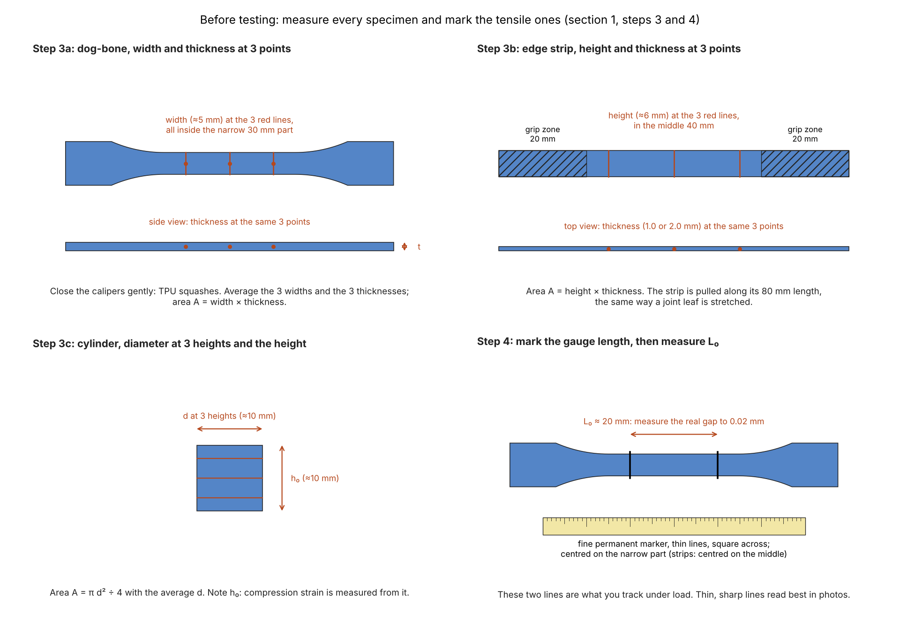
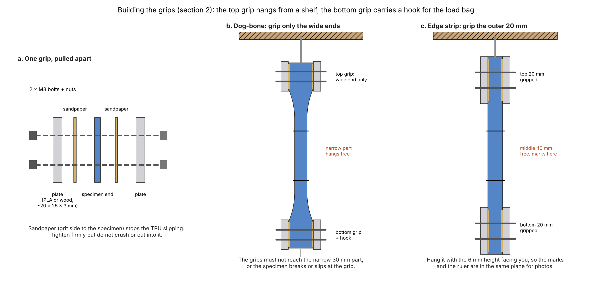
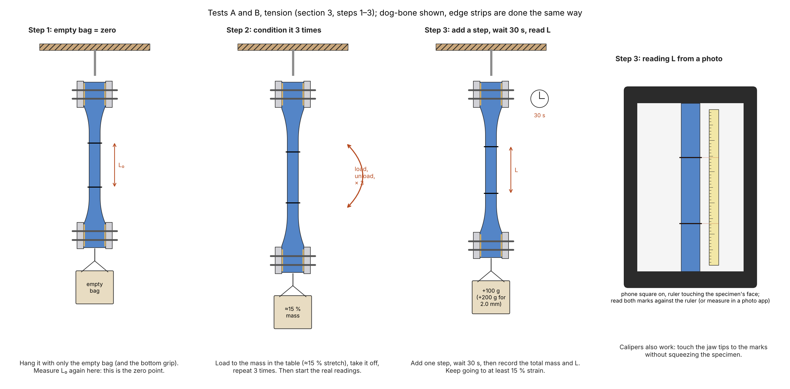
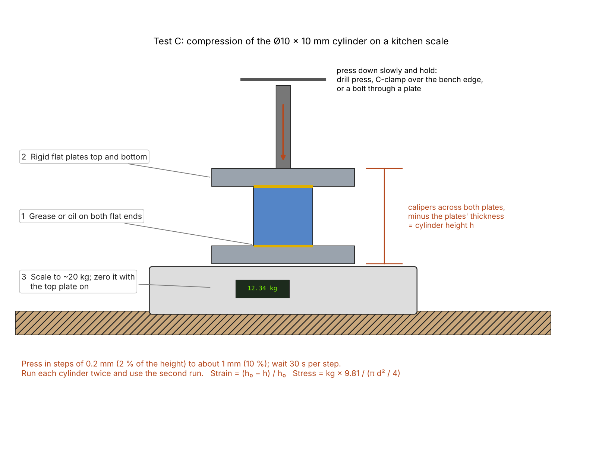
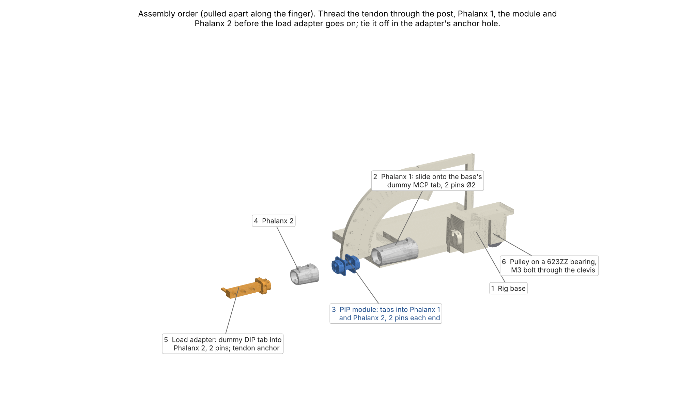

# TPU specimen and joint rig test procedure

Part 1 (sections 1–5) measures the TPU itself on printed specimens. Part 2 (sections 6–10)
tests each printed PIP joint module on the bending rig.

# Part 1: TPU specimens

**What this is for.** Every torque, force and return margin in the BARNES analyses was
computed at a provisional TPU modulus of **12 MPa** (SUNLU publishes none; the plausible
range is 5.3–19.3 MPa). They all scale in direct proportion to the real modulus E. These
tests measure E on the spool you print the joints with, so the predictions can be rescaled
before you compare them with the rig.

**What you get out:** three numbers. Report them, and the analyses are rescaled by E ÷ 12.

| Test | Specimens (label) | Gives |
|---|---|---|
| A. Tension, printed flat | 1BA dog-bones, 1.0 mm (F1-1…3) and 2.0 mm (F2-1…3) | E (flat); optionally strength |
| B. Tension, printed on edge | Strips, 1.0 mm (E1-1…3) and 2.0 mm (E2-1…3) | **E (edge): the main number**, because the joint leaves are printed this way |
| C. Compression | Ø10 × 10 mm cylinders, 3 (unlabelled: number them C1–C3 with a marker) | E in compression (used by the B4/B8 bearings) |

Specimen files: [`TYPE B/round2/test_rig/`](../TYPE%20B/round2/test_rig/) (labelled
copies in [`print_ready/specimens/`](../print_ready/specimens/)). Log template:
[`results/material_tests/specimen_log.csv`](../results/material_tests/specimen_log.csv).

---

## 1. Before you test

1. **Print the specimens with the joints:** same spool, same session, same settings
   (100 % infill, 0.4 mm line, 0.2 mm layer, same temperatures and speed). Dry the
   filament first (about 50 °C for 4–6 h). Orientation: dog-bones flat; strips standing on
   their long edge (6 mm tall); cylinders on a flat end.
2. **Let them rest 24 h** at room temperature, and test them all within a day of each
   other. Write down the room temperature: TPU softens noticeably as it warms.
3. **Measure each specimen** with calipers, closing gently (TPU squashes):
   * dog-bone: width and thickness of the narrow 30 mm section, at 3 points;
   * strip: height (about 6 mm) and thickness, at 3 points in the middle 40 mm;
   * cylinder: diameter at 3 heights, and height.

   Use the averages. Area A = width × thickness (strips: height × thickness), or π d²/4
   for the cylinder. Do not use the nominal sizes: printed sizes are often 5–10 % off,
   and that error goes straight into E.
4. **Mark the gauge length** on every tensile specimen: two thin marker lines about 20 mm
   apart, centred on the narrow section (strips: centred on the middle). Measure the
   actual gap L₀ unloaded, to 0.02 mm.

## 2. Equipment

* A fixed top clamp, e.g. two flat PLA or wood plates with two M3 bolts, or a bench vice,
  clamped to a shelf so the specimen hangs freely.
* A bottom clamp of the same kind with a hook, and a bag or bucket to hang loads on.
* Loads: anything weighed on a kitchen scale (water, coins, washers), made up in steps of
  about **100 g** for the 1.0 mm specimens and **200 g** for the 2.0 mm ones. Up to about
  3 kg is needed. Force F (N) = mass (kg) × 9.81.
* Calipers; or better, a phone on a stand, square to the specimen, with a ruler in the
  same plane, so you can measure the marks from photos afterwards.
* For compression: a kitchen or parcel scale reading to about 20 kg, and a way to press
  down slowly and hold it (a drill press, a C-clamp, or a bolt through a plate).

Grip only the wide ends (dog-bones) or the outer 20 mm (strips). Put a strip of sandpaper
in the clamps so the TPU does not slip, and do not tighten so hard that you cut it.

## 3. Test A and B: tension (same steps for dog-bones and strips)

1. Hang the specimen with only the empty bag. That is the zero point: measure L₀ again here.
2. **Condition it:** load to about the mass in the table below (around 15 % strain),
   unload, and repeat three times. TPU is stiffer on its very first stretch (the Mullins
   effect); the joints in use are cycled, so the conditioned value is the one that counts.
3. **Measure:** add the load in steps. At each step **wait 30 s**, then record the mass and
   the mark gap L. Go on until the strain is at least 15 %.
4. **Optional, one 1.0 mm dog-bone to break.** Not needed for the analyses. TPU 90A
   stretches several times its length and holds roughly 10–20 kg in the 1.0 mm dog-bone
   before breaking, so only do it if you can hang that safely (stand clear of the load).
   Record the last mass held and where it broke; a break at a grip is not a valid strength.
5. Do the other two copies the same way.

Approximate load for 15 % strain (×0.45 to ×1.6 if E is at the ends of its range):

| Specimen | Area | Mass for ~15 % at 12 MPa |
|---|---|---|
| 1BA 1.0 mm (F1) | 5 mm² | ≈ 0.9 kg |
| 1BA 2.0 mm (F2) | 10 mm² | ≈ 1.8 kg |
| Strip 1.0 mm (E1) | 6 mm² | ≈ 1.1 kg |
| Strip 2.0 mm (E2) | 12 mm² | ≈ 2.2 kg |

**Working out E.** For each step:

* strain ε = (L − L₀) ÷ L₀
* stress σ = F ÷ A, in MPa when F is in N and A in mm²

* **E for that row** = 3σ ÷ ((1 + ε) − 1 ÷ (1 + ε)²)
  (in the log sheet, strain is column M as a fraction and stress column N: put `=3*N2/((1+M2)-1/(1+M2)^2)` in column O, E_row)

**E is the average of that last column over the rows between 2 % and 10 % strain**
(for one specimen: `=AVERAGEIFS(O:O, A:A, "F1-1", M:M, ">=0.02", M:M, "<=0.10")`). This is the formula for the
neo-Hookean material the analyses use, so it gives exactly the E they need. Do not just
take the straight-line slope of σ against ε: TPU's curve bends over, and the slope reads
about 10 % low. The rows' E values should be roughly level; if they climb or fall steadily,
note it. Also note σ at 20 % strain: the designs are held to 20 %.

## 4. Test C: compression

1. Put a drop of oil or a smear of grease on both flat ends of the cylinder, so they can
   spread sideways freely (dry ends make it look stiffer).
2. Stand it on the scale between two flat, rigid plates, the top plate under the press.
   Zero the scale with the top plate on.
3. Press it down in steps of about **0.2 mm** (2 % of the height). At each step **wait
   30 s**, then record the scale reading and the height h (calipers across the two plates,
   minus the plates' thickness). Go to about 1.0 mm (10 %): about 10 kg at 12 MPa, up to
   16 kg if the TPU is at the stiff end. A scale reading to 20 kg covers it.
4. Do it twice on the same cylinder (the second run is the one to use), then repeat on
   the other two.

**Working out E:** strain ε = (h₀ − h) ÷ h₀ and stress σ = F ÷ A (both positive); for each
row E = 3σ ÷ (1 ÷ (1 − ε)² − (1 − ε)), in the log sheet `=3*N2/(1/(1-M2)^2-(1-M2))` in column O; then
average the rows from 2 % to 10 %, as for tension.

## 5. Checking and reporting

* The three copies of each specimen should agree within about **±10 %**. If one is out,
  look at it (voids, a slipped grip, a bad measurement) and test a spare if you have one.
* **Flat against edge:** if they differ by more than 15 %, the print direction matters,
  and the **edge** value is the one to use for the joints.
* **Tension against compression:** they should be within about 20 %. If not, both numbers
  are used: compression for the B4/B8 bearings, tension for everything else.
* Fill in [`results/material_tests/specimen_log.csv`](../results/material_tests/specimen_log.csv)
  (one row per load step), commit it, and send me the three E values. Every prediction is
  then rescaled by E ÷ 12 MPa before you compare it with the rig. As a quick check: a Type A
  or Type B torque, force or return margin in the report at 12 MPa is multiplied by E ÷ 12.

| Result to report | Value |
|---|---|
| Room temperature | °C |
| E, tension, printed flat (mean of F1 and F2) | MPa |
| **E, tension, printed on edge (mean of E1 and E2)** | MPa |
| E, compression | MPa |
| Strength at break (optional, 1BA 1.0 mm) | MPa |

---

# Part 2: joint tests on the bending rig

**What this is for.** The specimens give the material; the rig tests each printed PIP joint
module as a joint: how much tendon pull closes it, how much fingertip load it holds, where
it gives way, how well it springs back, and how long it lasts. Do Part 1 first, so every rig
result can be compared with the analyses rescaled to your measured E.

## 6. What goes on the rig

All PIP modules, labelled. Each module goes between the phalanges its tendon depth needs;
one set of phalanges serves every module of its kind (pull the pins and swap the module).

| Module (label) | Design | Phalanges | Copies | Notes |
|---|---|---|---|---|
| A1-P, A2-P | B5 crossed strip t2.0, deep tendon | X1, X2 (deep) | 2 | |
| B1-P, B2-P | B5 crossed strip t1.5, as built | S1, S2 (as built) | 2 | |
| C-P | B4 rolling contact, deep | X1, X2 | 1 | check the 0.5 mm gap is open first |
| E-P | B8 knuckle, 2 mm dorsal, deep | X1, X2 | 1 | check the gap is open first |
| F-P | B8 knuckle, central, as built | S1, S2 | 1 | check the gap is open first |
| G-P | B3 dual leaf (control), as built | S1, S2 | 1 | optional |
| **H1-P, H2-P** | **Pinned B5, plates outside** (B5 t1.5 deep) | **H1, H2** + two Ø2 mm pins | 2 | the pins carry the tendon's squeeze |
| **K1-P, K2-P** | **Inset pinned B5** (strips t1.75) | **K1, K2** + two Ø2 × 1.8 mm pins | 2 | glue the pins' outer ends |

The pinned phalanges (H, K) fit the rig: checked in CAD with no clash from 0° to 115°.
Their pins sit 0.65 mm (H) and 0.8 mm (K) palm-side of the scale's centre, which changes
the angle you read by well under 1°.

**Also needed:** the rig parts (RIG base, ADP load adapter, PUL pulley), a 623ZZ bearing
and an M3 bolt (about 20 mm) with nut, Ø2 mm pins (steel dowels or 1.75 mm filament) for the tabs,
braided fishing line 0.5–0.8 mm (Dyneema/PE; the same line for every test), two weight
hangers (a cup or bag on a hook, weighed), weights up to about 5 kg, a kitchen scale,
calipers and feeler gauges, a phone on a stand, two C-clamps.

## 7. Assembling the rig

1. **Base.** Clamp the RIG base to a table edge through its two slots, flat plate down on
   the table, with the protractor and the finger's post hanging past the edge, so the
   finger, the pulley and both weight strings hang clear.
2. **Pulley.** Press the 623ZZ bearing into the PUL pulley and mount it in the clevis at
   the back of the post with the M3 bolt. It must spin freely.
3. **Phalanx 1.** Slide it onto the post's dummy MCP tab and push two Ø2 pins through the
   cross holes.
4. **Module.** Push the module's proximal tab into Phalanx 1 (the label code reads on that
   end) and pin it. Push Phalanx 2 onto its distal tab and pin it.
   * *H and K only:* line up the plate holes and push in the two hinge pins (H: through
     both plates; K: from outside through K1's plate into K2's blind hole, then a drop of
     glue on the outer end). The joint must swing freely with no rubbing between plates.
5. **Tendon.** Thread the line from the back of the post forward through Phalanx 1, the
   module and Phalanx 2, then through the ADP adapter's anchor hole; tie it off there.
6. **Adapter.** Push the adapter's dummy DIP tab into Phalanx 2's far end and pin it.
7. **Tendon hanger.** Take the line over the pulley and tie the tendon weight hanger to it.
   Tendon tension = (hanger + weights, in kg) × 9.81 N.
8. **Fingertip hanger.** Hang the second hanger from the adapter's **44.8 mm** hole (the
   fingertip of the finger); 30 and 37.5 mm are spare positions.

The finger lies **palm side up**: pulling the tendon lifts the adapter against the
fingertip weight.

## 8. Reading the angle, and two checks before testing

* **Angle:** read where the centre of the pointer vane crosses the scale (5° ticks,
  numbered every 10°), looking from the finger side, square on. Good to about ±2°; for
  better, photograph square on and measure the adapter's angle from the photo.
* **Pulley friction (once):** hang equal weights on both ends of a line over the pulley and
  add to one side until it moves. Note the extra as a % of the weight. Under 2 %, ignore it;
  otherwise reduce every tendon tension by that %.
* **Zero (each module):** no tendon weight, no fingertip weight: record the resting angle.
* **H and K only, pin check:** with nothing hung, lift the adapter by hand and let go. It
  should fall back smoothly. If it sticks, the plates rub: ease them (sand or a thin washer)
  before testing.

## 9. The rig tests, in order

Do them in this order on every module: they go from gentle to destructive. Where there are
two copies, steps 1, 2 and 4 on both; step 3 on copy 1 only; step 5 on copy 2 only. Wait
10 s after every load change before reading.

| Step | What you do | What you record |
|---|---|---|
| **1. Free closing curve** | No fingertip weight. Add tendon weight in small steps (about 20 g, then 50 g past 200 g) up to where the collars touch or it stops; then take it off in the same steps | Tension and angle at every step, up and down (the gap between the two curves is hysteresis) |
| **2. Fingertip force held** | Fingertip weight W on the 44.8 mm hole: 50, 100, 200, 300, 500 g in turn. For each, add tendon weight until the adapter lifts off, then reaches 30°, then 60° | Tension at lift-off, at 30° and at 60°, for each W. Stop increasing W once step 3's limit is near |
| **3. Where it gives way** (copy 1) | Hold the adapter at 30° (a fingertip weight, or prop it). Add tendon weight in 100–200 g steps until it buckles (angle jumps, a strip bows sideways), squashes (collar gap closes by more than 0.5 mm), twists (more than about 3°), cracks, or the line cuts through. **Stop at 4.8 kg (47 N, the servo's limit)**: past that it does not matter, and the rig is not designed for more | The tension, which way it failed, a photo. Then take the weight off, wait 1 min and record the angle |
| **4. Spring-back** | Bring it to 60° (or the most it reached) with tendon weight, hold 60 s, take all the weight off | Angle 1 s, 10 s, 60 s and 10 min after release. Repeat after 1,000 cycles in step 5 |
| **5. Cycles** (copy 2) | Cycle 0 → 60° (or 80 % of its range) by lifting and lowering the tendon weight, or with the servo, with a fingertip weight of half the step-2 value at 30° | Every 100 cycles: resting angle and the tension to reach 30°. Stop at a crack, a 20 % change in that tension, a 5° change in the resting angle, or 10,000 cycles; record which |

**What to expect** (at 12 MPa; multiply forces by your E ÷ 12, except the servo limit):

| Module | Tendon pull to reach 30°, no fingertip weight | Expected way it gives way |
|---|---|---|
| A (B5 t2.0 deep) | about 1.3 N | 20 % strain / bowing at about 30 N at 0°, 10 N at 60° |
| B (B5 t1.5, as built) | about 1.0 N | buckles at about 17 N |
| H (pinned, outside) | about 0.6 N | should reach the servo's 47 N with no buckle (the pins carry it) |
| K (pinned, inset) | about 0.5 N | as H |

The other modules' figures are in [`TYPE B/round2/predictions.csv`](../TYPE%20B/round2/predictions.csv)
and section 5 of the report; H and K are in the report's section 5.5. The fingertip load a
module holds at angle θ for tendon tension T is about (T × lever − spring moment) ÷
(44.8 mm × cos θ); the levers are 3.4 mm (deep), 1.9 mm (as built), 2.75 mm (H), 2.6 mm (K).

## 10. Recording and reporting the rig results

* One row per step per module copy in
  [`results/rig_tests/rig_log.csv`](../results/rig_tests/rig_log.csv); photos named
  `<label>_<step>_<n>.jpg` next to it.
* Before each module, measure its strips or leaves (thickness and width, 3 points each)
  and any bearing gap, and write them in the log: the analyses are rerun with the measured
  sizes, not the nominal ones.
* **A design passes** if, at your measured E, it holds at least 2 N at the 44.8 mm hook at
  30°, gives way gradually (squash) rather than suddenly (buckle or twist), springs back to
  within 5° after 10 min, and survives 1,000 cycles.
* Send me the log (and the specimen E values from Part 1) and I'll compare every module
  with its prediction and update the report.
