# Running a simulation end to end in the Barnes UI

A recorded walkthrough of the whole application, from an empty window to a
converged CalculiX answer and a Pareto front. Every number and every screenshot
below came from one sitting on one machine; nothing here is illustrative or
reconstructed. Where the run hit a defect, the defect is in the manual too,
because a manual that only records the happy path is a manual you cannot use to
tell whether your own run went wrong.

- **Recorded:** 28 October 2026
- **Build:** Barnes UI 0.1.0 (`155a169`, plus the meshing fix described in
  [Appendix A](#appendix-a--the-fea-defect-this-run-found))
- **Machine:** Windows 11, CalculiX 2.23 at
  `%LOCALAPPDATA%\Programs\CalculiX\calculix_2.23_4win\ccx_static.exe`
- **Geometry analysed:** the default 4-run meander, generated from parameters

---

## 0. What the application is organised around

Six steps across four workspaces. The strip under the title bar is the workflow;
the row under it (`Design` / `Analyse` / `Compare` / `Inspect`) is where each
step lives.

| Step | Workspace | What it asks of you |
|---|---|---|
| Geometry | Design | A valid exact solid — imported, or generated |
| Parameters | Design | A flexure family and its dimensions, then build |
| Joint axis | Design | Where the joint rotates. Every torque depends on it |
| Readiness | Analyse | Confirms prerequisites before a solve is submitted |
| Analysis | Analyse | Reduced-order model, CalculiX, or the motion preview |
| Comparison | Compare | Sweep candidates and read the trade-off |

Two conventions are worth knowing before you start, because they change how you
read the strip:

- **A step never goes green because you visited it.** Analysis is Complete only
  when a result exists *and* nothing it depends on has moved since. Change a
  parameter and the same step turns amber, naming what changed.
- **Blocked and Needs attention are different.** Blocked means an earlier step
  has to happen first and there is nothing to do here. Needs attention means
  *this* step is where the problem is. The headline sentence under the strip
  always names the one step to go to next.

## 1. Launch

```bash
cd "C:/Users/msaip/OneDrive/Desktop/Barnes/Barnes_UI" && .venv/Scripts/python.exe -m barnes_ui
```

The window opens with nothing loaded, Geometry Not started, and the headline
*"Open a CAD file, or set parameters in Design and generate a flexure."*

## 2. Geometry — import, or generate

Both routes are legitimate and the workflow treats them differently.

**Importing** puts the part in `Design ▸ Current geometry` with its source,
body count, envelope, volume and a readiness verdict. The run that opened this
session had `A3_PIP_twin_strap_1.0mm.step` loaded: 1 body, envelope
11.400 × 35.176 × 10.952 mm, volume 293.94 mm³, *Ready for analysis*.

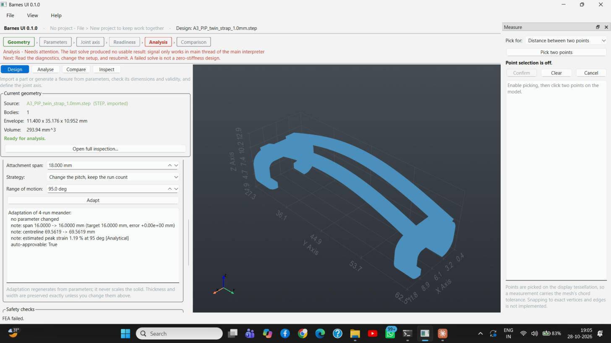

Note what the Parameters step says about an imported part: **Not started, with
nothing to do**. The application does not recover a parametric history from a
STEP file, and it says so rather than leaving the step looking unfinished for
the whole session. An import also leaves Comparison blocked — a sweep varies
parameters around a base design, and an import has none.

**Generating** is what the rest of this walkthrough uses, because it is the only
route that reaches all six steps. In `Design`, scroll to `Meander parameters`:

| Parameter | Value used |
|---|---|
| Run length | 12.000 mm |
| Runs | 4 |
| Pitch | 3.000 mm |
| Width (bending) | 1.000 mm |
| Thickness (out of plane) | 1.200 mm |

`Derived geometry` updates live and is tagged **MEASURED** — those are
measurements of the shape the parameters define, not predictions about it.
`Safety checks` reported *"No manufacturability issues at this minimum feature
size"* at a 0.40 mm minimum printable feature, with an estimated peak strain of
1.4 % at 100 deg marked `[Analytical]`.

Press **Build and display**. The status bar states what was built and, more
importantly, whether it is what you asked for:

> Built: Meander: 4 runs of 12.0 mm, pitch 3.0 mm, width 1.0 mm, thickness
> 1.2 mm. Centreline 62.1372 mm, envelope 16.000 × 10.000 × 1.200 mm, inner turn
> radius 1.0000 mm. — **volume matches the exact value the parameters imply.**

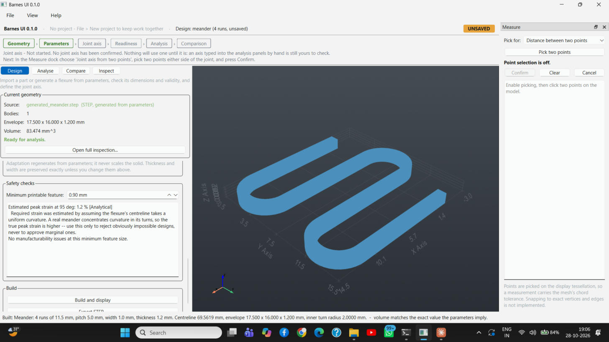

That last clause is the check that matters. If the measured volume had *not*
matched, Geometry would have gone amber and told you not to analyse the solid —
OpenCASCADE calling a solid valid is the weaker test.

## 3. Joint axis — the input with no default

In the **Measure** dock on the right:

1. `Pick for:` → **Joint axis from two points**
2. **Pick two points** (this arms picking; the dock says *"click the first point
   on the model"*)
3. Click two points on the solid, one either side of the joint
4. **Confirm**

The run recorded here picked (7.9725, 0.5000, 0.0681) and
(11.9910, 9.5000, 1.1482) mm, a 9.9154 mm baseline, giving:

```
Axis origin:     (9.9817, 5.0000, 0.6081) mm
Axis direction:  (0.40528, 0.90768, 0.10893)
```

On Confirm the axis is drawn in the viewport and **written into both the Flexure
and the FEA panels**, and Readiness goes green with it.

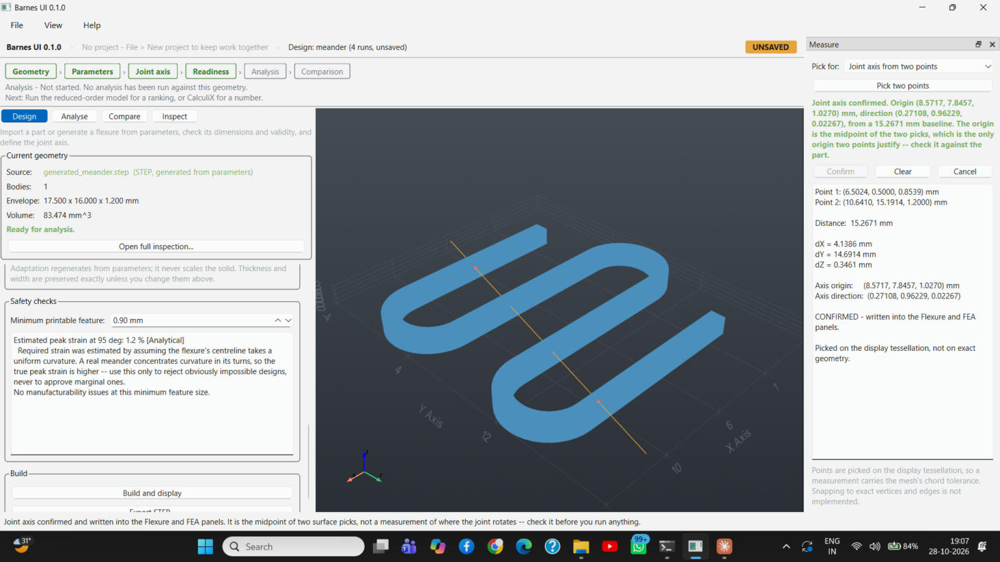

Read the dock's own warning rather than trusting the number: the origin is the
midpoint of two *surface* picks, not a measurement of where the joint rotates,
and the picks land on the display tessellation, so they carry the mesh's chord
tolerance. A two-millimetre error here changes the reported stiffness
substantially. STEP carries no mates, so there is nothing in the file to read
the axis from, and on a compliant joint there is no pin on the axis either —
cylinder detection finds the mounting bosses instead. Stating the axis is the
only honest option the format leaves.

## 4. Analysis — run the reduced-order model first

`Analyse` has three tabs: **Reduced-order model**, **Nonlinear FEA**, **Motion**.

> **Run the reduced-order model before the FEA, not after.** The
> *Reduced-order versus FEA* box in the FEA tab is only filled in when an FEA
> *finishes* (`fea_panel._update_comparison` is called from the FEA completion
> handler). A reduced-order run that lands afterwards is remembered, but the box
> keeps its placeholder text until the next solve. This run went FEA-first and
> the comparison therefore had to be done by hand, below.

The reduced-order tab arrives pre-filled from the confirmed axis. The settings
used:

| Group | Setting | Value |
|---|---|---|
| Centreline extraction | Strategy | Path-following trace — meanders |
| | Range | 0.500 → 8.500 mm, 120 samples |
| Material | Initial Young's modulus | 12.0000 MPa |
| Motion range and solver | Maximum joint angle | 90.0 deg |
| | Curve points | 46 |
| | Axial / shear flexibility | both on |

Press **Run reduced-order analysis**.

```
Reduced-order analysis complete: 0.0279319 N.mm/rad at neutral
```

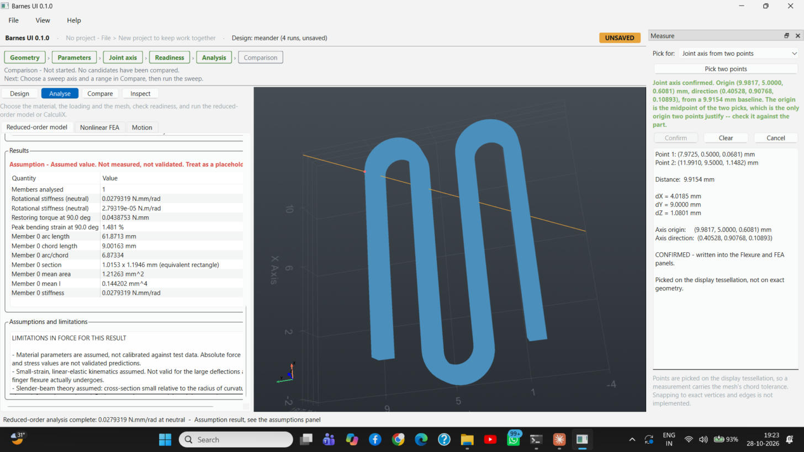

| Quantity | Value |
|---|---|
| Members analysed | 1 |
| Rotational stiffness (neutral) | 0.0279319 N·mm/rad |
| Restoring torque at 90.0 deg | 0.0438753 N·mm |
| Peak bending strain at 90.0 deg | 1.481 % |
| Member 0 arc length | 61.8713 mm |
| Member 0 chord length | 9.00163 mm |
| Member 0 arc/chord | 6.87334 |
| Member 0 section | 1.0153 × 1.1946 mm (equivalent rectangle) |
| Member 0 mean area | 1.21263 mm² |
| Member 0 mean I | 0.144202 mm⁴ |

The whole table is stamped **Assumption — assumed value, not measured, not
validated, treat as a placeholder**, and the `Assumptions and limitations` box
below it lists why: the material is not calibrated TPU, the kinematics are
small-strain and linear-elastic and so are not valid for the deflections a
finger flexure actually undergoes, and slender-beam theory assumes a section
small relative to the radius of curvature.

### The plots dock

Running the model opens a **Plots** dock with four tabs. Everything derived from
the assumed modulus is watermarked `UNVALIDATED — material parameters are
assumed, not measured`; everything read off the CAD is tagged `Measured`.

| Tab | What it shows |
|---|---|
| Torque-angle | Restoring torque against joint angle, labelled `[Assumption]` |
| Strain-angle | Peak bending strain against joint angle |
| Centreline | The traced centreline, `Measured` from the CAD geometry |
| Section profile | Normal-section properties along the centreline |

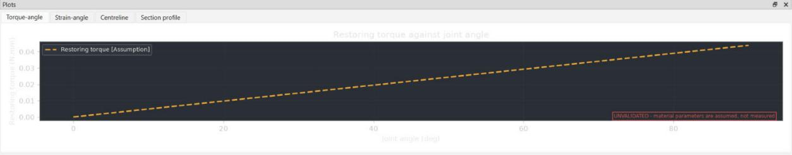
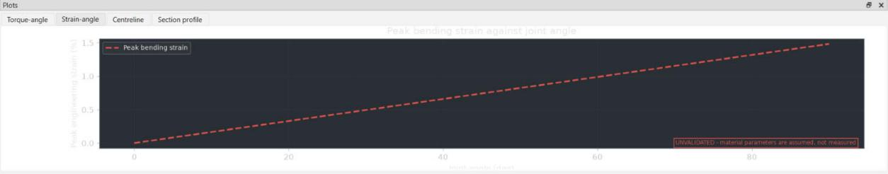
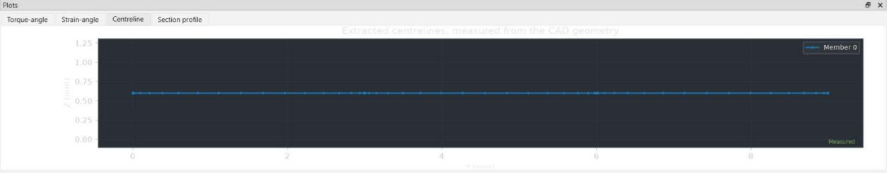
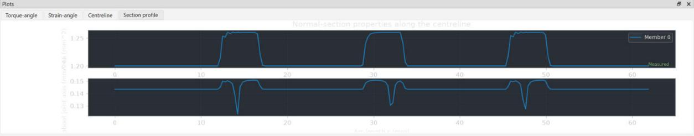

The section-profile plot is the one to look at when a result surprises you: the
steps in area and the dips in second moment are the turns, and they are where a
meander concentrates its curvature.

## 5. Nonlinear FEA — the CalculiX solve

The `Solver` group at the top of the tab reports what was found on this machine.
Here it read *"CalculiX unknown at …\ccx_static.exe"* — "unknown" is the version
probe failing, not the binary missing, and the solve ran. **Look again**
re-probes after an install.

Settings used:

| Group | Setting | Value |
|---|---|---|
| Mesh | Thinnest feature | 1.000 mm |
| | Elements across it | 2 |
| | Second-order tetrahedra (C3D10) | on |
| Joint rotation | Prescribed rotation | 2.00 deg |
| | Attachment depth | 3.20 mm |
| | Axis passes through | 9.982, 5.000, 0.608 mm |

Leave second order on. First-order tetrahedra lock in a nearly incompressible
material: the run converges cleanly and reports the part far stiffer than it is,
with no warning from the solver. That silence is the hazard.

Press **Run FEA**. The status bar goes to *"Submitting to CalculiX…"* with a
progress bar, the Analysis step turns to In progress, and **Cancel** becomes
live. This solve took a little over two minutes.

```
FEA complete: 0.811602 N.mm/rad. Converged in 11 increment(s) with 47 cutback(s)
```

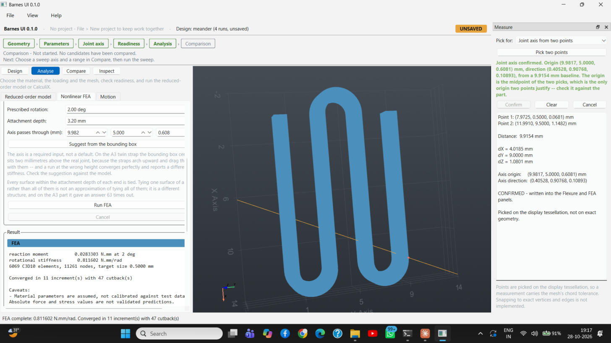

| Quantity | Value |
|---|---|
| Reaction moment | 0.0283303 N·mm at 2 deg |
| Rotational stiffness | 0.811602 N·mm/rad |
| Mesh | 6069 C3D10 elements, 11261 nodes, target size 0.5000 mm |
| Convergence | 11 increments, 47 cutbacks |

Caveats printed with the result: material parameters are assumed and not
calibrated, absolute force and stress are not validated predictions, and **no
mesh-convergence study accompanies this result, so its discretisation error is
unknown** — a single mesh cannot tell you how far from the converged answer it
is. 47 cutbacks in 11 increments is a solve that fought; it is not a failure,
but it is a reason to repeat the run at a finer mesh before quoting the number.

### Reduced-order versus FEA on this part

| Model | Rotational stiffness at neutral |
|---|---|
| Reduced-order | 0.0279319 N·mm/rad |
| CalculiX | 0.811602 N·mm/rad |
| Ratio (ROM / FEA) | 0.0344 |

**The fast model is about 29 times softer than the FEA of the same joint.** Both
models are linear in the elastic modulus, so that ratio does not depend on the
material being calibrated, even though neither absolute value can be trusted
until it is. A gap this size is the point of running both: use the reduced-order
model to rank designs, and do not read either number as a torque.

The `Advanced capabilities (Phase 6)` table at the foot of the tab states what
this toolchain has actually demonstrated on this machine, read from the
benchmark registry written by `scripts/phase6_benchmarks.py`:

| Capability | Status |
|---|---|
| Gravity (body load) | Benchmark passed |
| Tendon load (concentrated force) | Benchmark passed |
| Frictionless contact | Benchmark passed |
| Contact with Coulomb friction | Benchmark passed |
| Self-contact | Benchmark passed |
| Mechanical stops and joint limits | Benchmark passed |
| Viscoelastic material behaviour | Not available in this solver |

A capability is offered only where a benchmark with a known answer has been
reproduced here. Untested means unavailable, not "probably fine".

## 6. Motion — kinematic preview

The Motion tab opens with a banner that is the whole point of the tab:
**KINEMATIC PREVIEW — geometry only. This animation shows where the parts go,
not what force it takes to put them there. No value on this screen is a force or
a torque.**

Settings: Profile `Linear ramp`, 0.0 → 90.0 deg, 51 samples. Press **Run**.

```
Kinematic preview: 51 poses. No force or torque is reported, because none was computed.
```

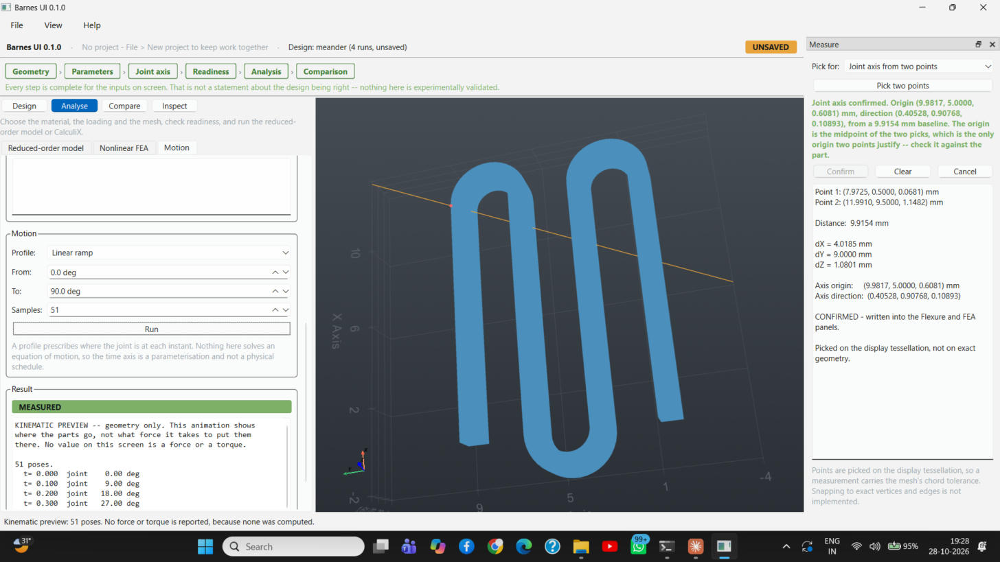

The result is tagged **MEASURED** — the poses are geometry, and geometry is
measured. The `Joint spring, from FEA points` table above takes one
angle/torque row per FEA run of the joint and fits a curve (PCHIP by default);
three points is the minimum, since two give you a straight line and you should
fit a line rather than a curve for those. Coupled FEA is not offered: Phase 6
established that a whole-hand deformable solve is not on this toolchain's list.

## 7. Compare — the parameter sweep

`Compare` needs a base design, which is set when a flexure is generated from
parameters. Settings used:

| Group | Setting | Value |
|---|---|---|
| Sweep axes | Axis 1 | `width`, 0.800 → 1.600 mm, 5 steps |
| | Axis 2 | `pitch`, 2.000 → 5.000 mm, 5 steps |
| Objectives | Material volume (minimise) | on |
| | Centreline length (maximise) | on |
| | Smallest feature (maximise) | off |
| | Peak bending strain (minimise) | off |
| | Strain evaluated at | 100.0 deg |
| | Minimum printable feature | 0.40 mm |

Press **Sweep**.

```
Sweep width(5) x pitch(5): 25 points evaluated, 22 valid, 3 inadmissible.
  Weakest provenance across the sweep: Measured
```

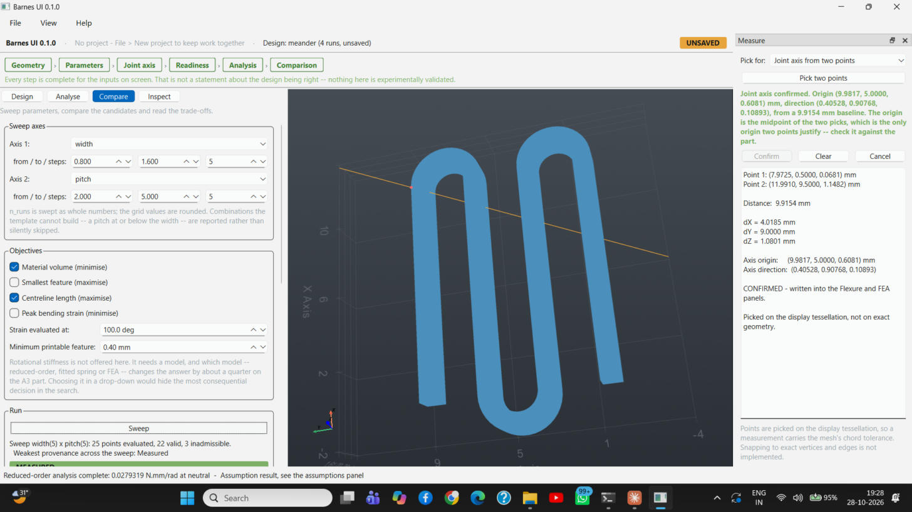

With the sweep done, all six steps are green and the headline changes to the one
sentence the whole application is built to be able to say honestly:

> Every step is complete for the inputs on screen. That is not a statement about
> the design being right — nothing here is experimentally validated.

That is what finishing looks like. It is not a result you can quote.

The three inadmissible points are combinations the template cannot build — a
pitch at or below the width merges adjacent runs into a solid block. They are
*reported* rather than silently skipped, which is how you can see the edge of
the feasible region.

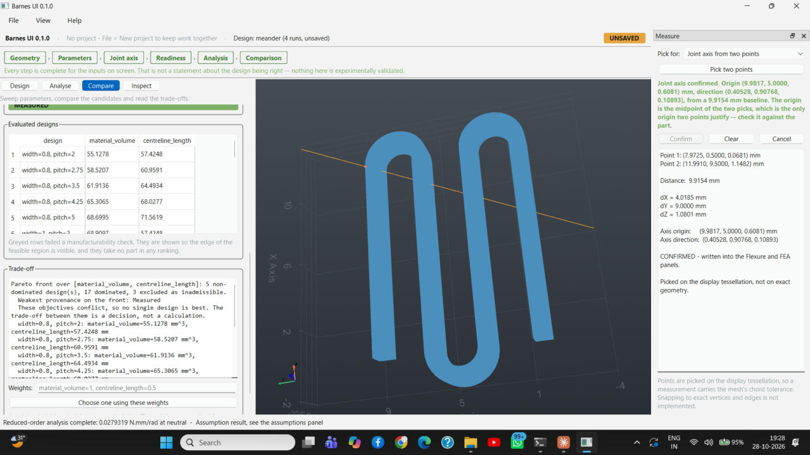

```
Pareto front over [material_volume, centreline_length]:
  5 non-dominated design(s), 17 dominated, 3 excluded as inadmissible.
  Weakest provenance on the front: Measured
  These objectives conflict, so no single design is best.
  The trade-off between them is a decision, not a calculation.
  width=0.8, pitch=2:    material_volume=55.1278 mm^3, centreline_length=57.4248 mm
  width=0.8, pitch=2.75: material_volume=58.5207 mm^3, centreline_length=60.9591 mm
  width=0.8, pitch=3.5:  material_volume=61.9136 mm^3, centreline_length=64.4934 mm
  width=0.8, pitch=4.25: material_volume=65.3065 mm^3, centreline_length=68.0277 mm
  width=0.8, pitch=5:    material_volume=68.6995 mm^3, centreline_length=71.5619 mm
```

Every point on the front is at the minimum width, which is the shape of this
particular trade-off rather than a result: narrowing the member saves material
and lengthens nothing, so width is dominated along one axis and the front
collapses onto its lower bound. Add *Smallest feature (maximise)* as a third
objective and the front spreads out, because the printer then gets a say.

Greyed rows in `Evaluated designs` failed a manufacturability check; they are
shown so the edge of the feasible region is visible, and they take no part in
any ranking. The `Weights:` field at the foot scalarises the front if you want a
single pick — but the panel is right that choosing the weights *is* the
decision.

Rotational stiffness is deliberately **not** offered as a sweep objective. It
needs a model, and which model — reduced-order, fitted spring or FEA — changes
the answer by about a quarter on the A3 part (and, as section 5 shows, by 29×
on this meander). Hiding that choice in a drop-down would hide the most
consequential decision in the search.

## 8. Inspect — when a result looks wrong

`Inspect` is the diagnostic workspace: source and format, the unit declared in
the file header, the body list with per-body validity, and the measured
properties, all tagged **Measured — read from the CAD model, not estimated**.

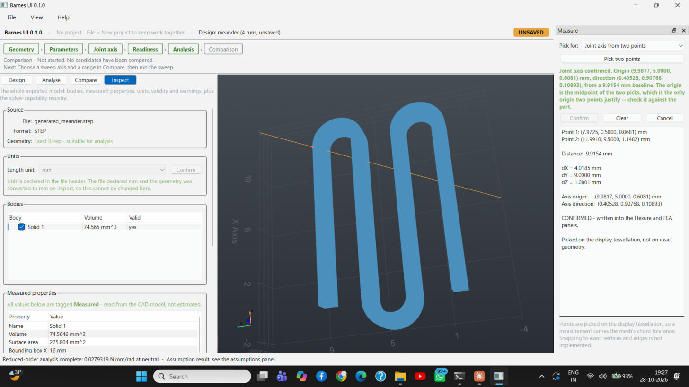

For the generated meander: `generated_meander.step`, STEP, *Exact B-rep —
suitable for analysis*; one body, 74.565 mm³, valid; surface area 275.804 mm²,
bounding box X 16 mm. The length unit is greyed out because the file declared mm
and the geometry was converted on import, so there is nothing left to
reinterpret.

The workflow strip stays green here, which is the point: Inspect is a place to
look, not a step, and nothing in it can be the reason an analysis is blocked.

---

## Appendix A — the FEA defect this run found

**Nonlinear FEA could not be run from the GUI at all in `155a169`.** Every
submission failed immediately, on any geometry, with:

> signal only works in main thread of the main interpreter

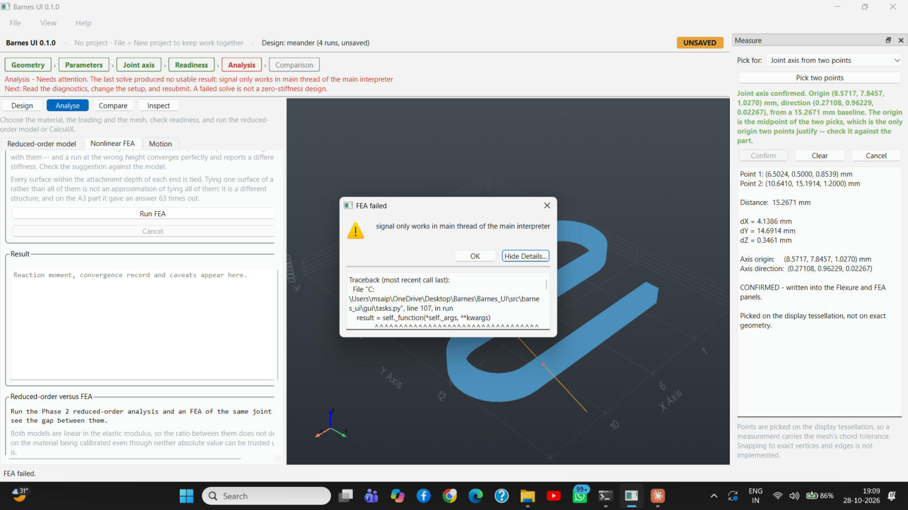

**Show Details…** gives the chain: `gui/tasks.py:107` → `main_window._fea_worker`
→ `core/fea/joint_stiffness.py:278` → `core/fea/meshing.py:165`
`gmsh.initialize()` → `gmsh.py:295`, which does

```python
prev_interrupt_handler = signal.signal(signal.SIGINT, signal.SIG_DFL)
```

Gmsh's default initialise installs its own SIGINT handler, and CPython refuses
to set a signal handler from any thread but the main one. The GUI only ever
meshes from its worker thread, so the default could never work there. The
reduced-order model was unaffected because it never touches Gmsh, which is why
the failure looked geometry-specific rather than structural.

The fix is to tell Gmsh not to install the handler, in
`src/barnes_ui/core/fea/meshing.py`:

```python
try:
    gmsh.initialize(interruptible=False)
except TypeError:
    gmsh.initialize()
```

`interruptible` exists from Gmsh 4.11; older builds install no such handler, so
falling back to the bare call is correct rather than merely tolerable. Verified
off the main thread before re-running, and the FEA in section 5 is the first
GUI-launched solve to complete.

## Appendix B — driving notes

Two things cost time in this session and will cost you the same.

**The window must genuinely have input focus.** Bringing it forward with
`SetForegroundWindow` is not enough — tab clicks and workspace-button clicks are
silently swallowed while another application holds keyboard focus, while *wheel*
events still arrive, so the panel scrolls and looks alive. Click the title bar or
the viewport once first; after that the tab bar responds normally. This is not an
application bug, and nothing on screen tells you it is happening.

**Do not scroll the panel with the pointer over a field.** The parameter fields
are spin boxes, and a wheel event over one changes its value instead of
scrolling the panel. During this session that silently moved the attachment
depth 3.20 → 3.30 mm, the prescribed rotation 2.00 → 7.50 deg and the axis X
9.982 → 10.982 mm. Scroll with the pointer over the **label column on the far
left**, where there is nothing to edit, and re-read the inputs before every
submission.

## Appendix C — the numbers from this run, in one place

| | |
|---|---|
| Geometry | Meander, 4 runs of 12.0 mm, pitch 3.0 mm, width 1.0 mm, thickness 1.2 mm |
| Centreline | 62.1372 mm |
| Envelope | 16.000 × 10.000 × 1.200 mm |
| Inner turn radius | 1.0000 mm |
| Joint axis origin | (9.9817, 5.0000, 0.6081) mm |
| Joint axis direction | (0.40528, 0.90768, 0.10893) |
| Young's modulus (assumed) | 12.0000 MPa |
| Reduced-order stiffness | 0.0279319 N·mm/rad |
| FEA stiffness | 0.811602 N·mm/rad |
| FEA reaction moment | 0.0283303 N·mm at 2 deg |
| FEA mesh | 6069 C3D10, 11261 nodes, 0.5000 mm target |
| FEA convergence | 11 increments, 47 cutbacks |
| Sweep | width × pitch, 25 points, 22 valid, 3 inadmissible, 5 non-dominated |
| Motion | 51 poses, kinematic only |

None of the absolute force or torque values above is a prediction. The material
is a provisional 12 MPa modulus, not a characterisation of TPU 90A, and no
defensible derivation of one from a hardness grade exists. Until a tensile test
on a specimen printed with the same filament, printer, orientation and settings
as the real part is fitted, only the *ranking* between designs is sound.
