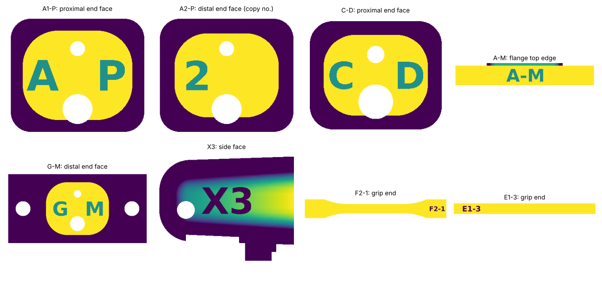

# Print labels: what each engraved code means

Generated by `scripts/label_print_parts.py`; the files here are the selected print files with an ID engraved (cut 0.4 mm into TPU, 0.6 mm into PLA, 0.3 mm into the specimens). Nothing else about the parts changed: labels are only on faces that sit in a socket, on the MCP flange edge, on the phalanx side and on specimen grips, and each was checked to leave at least 0.5 mm (TPU tabs), 0.8 mm (PLA, MCP flange) or 0.4 mm (specimens) of material behind it.

## How to read a Type B module

Look at the **end face of the proximal tab** (the end that goes into the proximal phalanx; for the MCP module, the distal tab's end face, and the flange's top edge). With the back of the finger up, the **design letter** is on the left of the channels and the **joint letter** on the right.

| Design letter | Design | Folder |
|---|---|---|
| **A** | B5 crossed strip t2.0 / 45°, deep tendon | `TYPE B/round2/deep_offset/B5_t200_a45_deep` |
| **B** | B5 crossed strip t1.5 / 45°, as built | `TYPE B/B5_crossed_strip/B5_t150_a45` |
| **C** | B4 rolling contact t1.0 / 60°, deep tendon | `TYPE B/round2/deep_offset/B4_t100_a60_deep` |
| **E** | B8 knuckle 2 mm dorsal, r1.25, deep tendon | `TYPE B/round2/deep_offset/B8_y20_r125_deep` |
| **F** | B8 knuckle central, r1.5, as built | `TYPE B/round2/B8_y00_r150` |
| **G** | B3 dual leaf t1.5 / w3.0, as built (optional control) | `TYPE B/B3_dual_leaf/B3_t150_w30` |

| Joint letter | Joint |
|---|---|
| **M** | MCP (module with flange) |
| **P** | PIP (the module the rig tests) |
| **D** | DIP |

Letters D, M and P are never used for a design, so a design letter never reads as a joint. Where two copies are printed (the A and B PIP modules), the **copy number** is engraved on the other (distal) tab's end face.

## Every labelled part

| Code | Engraved | Part | Material | Label on | Smallest letter (mm) | File |
|---|---|---|---|---|---|---|
| **A-M** | A  M | B5 crossed strip t2.0 / 45°, deep tendon: MCP module | TPU | distal tab end face; 'A-M' on the flange top edge | 2.6 | [A-M_B5_t200_a45_deep_MCP.stl](type_b_modules/A-M_B5_t200_a45_deep_MCP.stl) |
| **A1-P** | A  P  (other end: 1) | B5 crossed strip t2.0 / 45°, deep tendon: PIP module, copy 1 | TPU | proximal tab end face; copy number 1 on the distal tab end face | 3.0 | [A1-P_B5_t200_a45_deep_PIP.stl](type_b_modules/A1-P_B5_t200_a45_deep_PIP.stl) |
| **A2-P** | A  P  (other end: 2) | B5 crossed strip t2.0 / 45°, deep tendon: PIP module, copy 2 | TPU | proximal tab end face; copy number 2 on the distal tab end face | 3.0 | [A2-P_B5_t200_a45_deep_PIP.stl](type_b_modules/A2-P_B5_t200_a45_deep_PIP.stl) |
| **A-D** | A  D | B5 crossed strip t2.0 / 45°, deep tendon: DIP module | TPU | proximal tab end face | 2.1 | [A-D_B5_t200_a45_deep_DIP.stl](type_b_modules/A-D_B5_t200_a45_deep_DIP.stl) |
| **B-M** | B  M | B5 crossed strip t1.5 / 45°, as built: MCP module | TPU | distal tab end face; 'B-M' on the flange top edge | 2.6 | [B-M_B5_t150_a45_MCP.stl](type_b_modules/B-M_B5_t150_a45_MCP.stl) |
| **B1-P** | B  P  (other end: 1) | B5 crossed strip t1.5 / 45°, as built: PIP module, copy 1 | TPU | proximal tab end face; copy number 1 on the distal tab end face | 3.0 | [B1-P_B5_t150_a45_PIP.stl](type_b_modules/B1-P_B5_t150_a45_PIP.stl) |
| **B2-P** | B  P  (other end: 2) | B5 crossed strip t1.5 / 45°, as built: PIP module, copy 2 | TPU | proximal tab end face; copy number 2 on the distal tab end face | 3.0 | [B2-P_B5_t150_a45_PIP.stl](type_b_modules/B2-P_B5_t150_a45_PIP.stl) |
| **B-D** | B  D | B5 crossed strip t1.5 / 45°, as built: DIP module | TPU | proximal tab end face | 2.4 | [B-D_B5_t150_a45_DIP.stl](type_b_modules/B-D_B5_t150_a45_DIP.stl) |
| **C-M** | C  M | B4 rolling contact t1.0 / 60°, deep tendon: MCP module | TPU | distal tab end face; 'C-M' on the flange top edge | 2.6 | [C-M_B4_t100_a60_deep_MCP.stl](type_b_modules/C-M_B4_t100_a60_deep_MCP.stl) |
| **C-P** | C  P | B4 rolling contact t1.0 / 60°, deep tendon: PIP module | TPU | proximal tab end face | 3.7 | [C-P_B4_t100_a60_deep_PIP.stl](type_b_modules/C-P_B4_t100_a60_deep_PIP.stl) |
| **C-D** | C  D | B4 rolling contact t1.0 / 60°, deep tendon: DIP module | TPU | proximal tab end face | 2.4 | [C-D_B4_t100_a60_deep_DIP.stl](type_b_modules/C-D_B4_t100_a60_deep_DIP.stl) |
| **E-M** | E  M | B8 knuckle 2 mm dorsal, r1.25, deep tendon: MCP module | TPU | distal tab end face; 'E-M' on the flange top edge | 2.6 | [E-M_B8_y20_r125_deep_MCP.stl](type_b_modules/E-M_B8_y20_r125_deep_MCP.stl) |
| **E-P** | E  P | B8 knuckle 2 mm dorsal, r1.25, deep tendon: PIP module | TPU | proximal tab end face | 3.8 | [E-P_B8_y20_r125_deep_PIP.stl](type_b_modules/E-P_B8_y20_r125_deep_PIP.stl) |
| **E-D** | E  D | B8 knuckle 2 mm dorsal, r1.25, deep tendon: DIP module | TPU | proximal tab end face | 2.4 | [E-D_B8_y20_r125_deep_DIP.stl](type_b_modules/E-D_B8_y20_r125_deep_DIP.stl) |
| **F-M** | F  M | B8 knuckle central, r1.5, as built: MCP module | TPU | distal tab end face; 'F-M' on the flange top edge | 2.6 | [F-M_B8_y00_r150_MCP.stl](type_b_modules/F-M_B8_y00_r150_MCP.stl) |
| **F-P** | F  P | B8 knuckle central, r1.5, as built: PIP module | TPU | proximal tab end face | 3.8 | [F-P_B8_y00_r150_PIP.stl](type_b_modules/F-P_B8_y00_r150_PIP.stl) |
| **F-D** | F  D | B8 knuckle central, r1.5, as built: DIP module | TPU | proximal tab end face | 2.4 | [F-D_B8_y00_r150_DIP.stl](type_b_modules/F-D_B8_y00_r150_DIP.stl) |
| **G-M** | G  M | B3 dual leaf t1.5 / w3.0, as built (optional control): MCP module | TPU | distal tab end face; 'G-M' on the flange top edge | 2.6 | [G-M_B3_t150_w30_MCP.stl](type_b_modules/G-M_B3_t150_w30_MCP.stl) |
| **G-P** | G  P | B3 dual leaf t1.5 / w3.0, as built (optional control): PIP module | TPU | proximal tab end face | 3.3 | [G-P_B3_t150_w30_PIP.stl](type_b_modules/G-P_B3_t150_w30_PIP.stl) |
| **G-D** | G  D | B3 dual leaf t1.5 / w3.0, as built (optional control): DIP module | TPU | proximal tab end face | 2.3 | [G-D_B3_t150_w30_DIP.stl](type_b_modules/G-D_B3_t150_w30_DIP.stl) |
| **8S-1** | 8S  (distal collar: 1) | A8 for the iteration 3 hand, 2 turns, 1.2 × 1.8 mm, lobes 5.5 mm, sagitta 0.75 mm (selected), copy 1 | TPU | outside of the proximal collar, thumb side; copy number on the distal collar | 2.5 | [8S-1_A8_it3_2turn_w1.2_h1.8_s0.75_a5.5_collared.stl](type_a/8S-1_A8_it3_2turn_w1.2_h1.8_s0.75_a5.5_collared.stl) |
| **8S-2** | 8S  (distal collar: 2) | A8 for the iteration 3 hand, 2 turns, 1.2 × 1.8 mm, lobes 5.5 mm, sagitta 0.75 mm (selected), copy 2 | TPU | outside of the proximal collar, thumb side; copy number on the distal collar | 2.5 | [8S-2_A8_it3_2turn_w1.2_h1.8_s0.75_a5.5_collared.stl](type_a/8S-2_A8_it3_2turn_w1.2_h1.8_s0.75_a5.5_collared.stl) |
| **8F** | 8F | A8 for the iteration 3 hand, 2 turns, 1.2 × 1.5 mm, lobes 5.5 mm, sagitta 0.75 mm (second option) | TPU | outside of the proximal collar, thumb side | 2.6 | [8F_A8_it3_2turn_w1.2_h1.5_s0.75_a5.5_collared.stl](type_a/8F_A8_it3_2turn_w1.2_h1.5_s0.75_a5.5_collared.stl) |
| **S1** | S1 | Type B phalanges, standard (as-built) tendon: Phalanx 1 | PLA | side face (+X), mid-length | 4.0 | [S1_common_phalanges_02_Phalanx1.stl](type_b_phalanges/S1_common_phalanges_02_Phalanx1.stl) |
| **S2** | S2 | Type B phalanges, standard (as-built) tendon: Phalanx 2 | PLA | side face (+X), mid-length | 4.0 | [S2_common_phalanges_04_Phalanx2.stl](type_b_phalanges/S2_common_phalanges_04_Phalanx2.stl) |
| **S3** | S3 | Type B phalanges, standard (as-built) tendon: Phalanx 3 | PLA | side face (+X), mid-length | 3.3 | [S3_common_phalanges_06_Phalanx3.stl](type_b_phalanges/S3_common_phalanges_06_Phalanx3.stl) |
| **X1** | X1 | Type B phalanges, deep tendon: Phalanx 1 | PLA | side face (+X), mid-length | 4.0 | [X1_deep_phalanges_02_Phalanx1.stl](type_b_phalanges/X1_deep_phalanges_02_Phalanx1.stl) |
| **X2** | X2 | Type B phalanges, deep tendon: Phalanx 2 | PLA | side face (+X), mid-length | 3.6 | [X2_deep_phalanges_04_Phalanx2.stl](type_b_phalanges/X2_deep_phalanges_04_Phalanx2.stl) |
| **X3** | X3 | Type B phalanges, deep tendon: Phalanx 3 | PLA | side face (+X), mid-length | 3.1 | [X3_deep_phalanges_06_Phalanx3.stl](type_b_phalanges/X3_deep_phalanges_06_Phalanx3.stl) |
| **F1-1** | F1-1 | Tensile dog-bone 1BA, 1.0 mm, printed flat, copy 1 | TPU | one grip end | 2.5 | [F1-1_tensile_1BA_t1.0_flat.stl](specimens/F1-1_tensile_1BA_t1.0_flat.stl) |
| **F1-2** | F1-2 | Tensile dog-bone 1BA, 1.0 mm, printed flat, copy 2 | TPU | one grip end | 2.6 | [F1-2_tensile_1BA_t1.0_flat.stl](specimens/F1-2_tensile_1BA_t1.0_flat.stl) |
| **F1-3** | F1-3 | Tensile dog-bone 1BA, 1.0 mm, printed flat, copy 3 | TPU | one grip end | 2.6 | [F1-3_tensile_1BA_t1.0_flat.stl](specimens/F1-3_tensile_1BA_t1.0_flat.stl) |
| **F2-1** | F2-1 | Tensile dog-bone 1BA, 2.0 mm, printed flat, copy 1 | TPU | one grip end | 2.5 | [F2-1_tensile_1BA_t2.0_flat.stl](specimens/F2-1_tensile_1BA_t2.0_flat.stl) |
| **F2-2** | F2-2 | Tensile dog-bone 1BA, 2.0 mm, printed flat, copy 2 | TPU | one grip end | 2.6 | [F2-2_tensile_1BA_t2.0_flat.stl](specimens/F2-2_tensile_1BA_t2.0_flat.stl) |
| **F2-3** | F2-3 | Tensile dog-bone 1BA, 2.0 mm, printed flat, copy 3 | TPU | one grip end | 2.6 | [F2-3_tensile_1BA_t2.0_flat.stl](specimens/F2-3_tensile_1BA_t2.0_flat.stl) |
| **E1-1** | E1-1 | Tensile strip 1.0 mm, printed on edge, copy 1 | TPU | one grip end | 3.2 | [E1-1_tensile_strip_t1.0_edge.stl](specimens/E1-1_tensile_strip_t1.0_edge.stl) |
| **E1-2** | E1-2 | Tensile strip 1.0 mm, printed on edge, copy 2 | TPU | one grip end | 3.2 | [E1-2_tensile_strip_t1.0_edge.stl](specimens/E1-2_tensile_strip_t1.0_edge.stl) |
| **E1-3** | E1-3 | Tensile strip 1.0 mm, printed on edge, copy 3 | TPU | one grip end | 3.2 | [E1-3_tensile_strip_t1.0_edge.stl](specimens/E1-3_tensile_strip_t1.0_edge.stl) |
| **E2-1** | E2-1 | Tensile strip 2.0 mm, printed on edge, copy 1 | TPU | one grip end | 3.2 | [E2-1_tensile_strip_t2.0_edge.stl](specimens/E2-1_tensile_strip_t2.0_edge.stl) |
| **E2-2** | E2-2 | Tensile strip 2.0 mm, printed on edge, copy 2 | TPU | one grip end | 3.2 | [E2-2_tensile_strip_t2.0_edge.stl](specimens/E2-2_tensile_strip_t2.0_edge.stl) |
| **E2-3** | E2-3 | Tensile strip 2.0 mm, printed on edge, copy 3 | TPU | one grip end | 3.2 | [E2-3_tensile_strip_t2.0_edge.stl](specimens/E2-3_tensile_strip_t2.0_edge.stl) |

## Not labelled

* **Compression cylinders Ø10 × 10**: an engraving would spoil a loading face or change the section. Mark them with a pen.
* **Rig parts (PLA)**: one of each, nothing to confuse.
* **A6 sliding leaf**: its cuffs were sized for the old finger and need redesigning for the iteration 3 hand before printing; it gets a label then.

## How to read a Type A (A8) part

The **design code** is on the outside of the proximal collar (the one on the proximal phalanx), on the thumb side: **8S** is the selected iteration 3 A8, **8F** the second option. Where two copies are printed, the **copy number** is on the distal collar.

## Printing the labels

The module labels are on a face that stands vertical when the module prints on its side, so the letters print as grooves in a wall: they come out cleanly at 0.4 mm line width and 0.2 mm layers. The DIP module letters are the smallest (about 2.1 mm tall); if they print soft, the design letter is still readable and the joint is obvious from the module's size.
