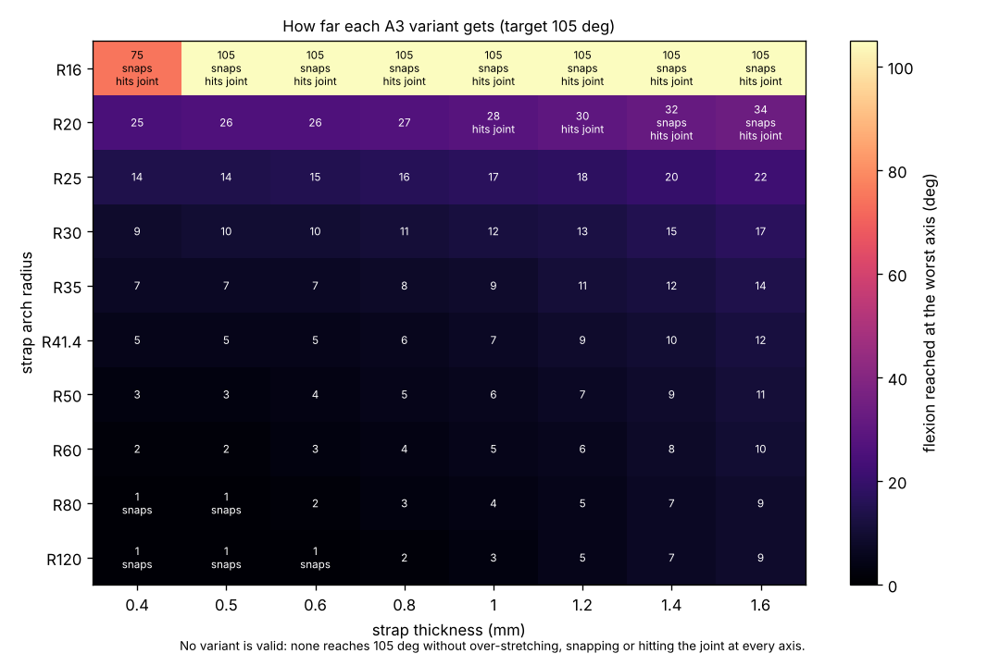

# A3 parameter sweep

Results from `scripts/a3_parameter_sweep.py`. The A3 twin strap was swept over arch
curvature, strap thickness and strap width, using the same procedure and pass criteria as
the A6 sweep in [`results/a6/`](../a6/README.md).

| File | Contents |
|---|---|
| `validation.json` | The model's neutral stiffness for the measured A3, against the project's FEA |
| `parameter_sweep.json` | Every simulation, per axis position |
| `parameter_sweep.csv` | One row per curvature, thickness and width, with validity and reason |
| `parameter_sweep.png` | How far each variant gets |

---

## 2026-10-30: curvature × thickness × width sweep

```bash
python scripts/a3_parameter_sweep.py --validate
```
```bash
python scripts/a3_parameter_sweep.py
```

### Set-up

* **Geometry:** the measured A3, from `A3_PIP_twin_strap_1.0mm.step` as recorded in
  docs/05 and scripts/a3_joint_stiffness.py.
  * Two straps, each 2.0 × 1.0 mm, 5.7 mm apart.
  * Clamped at y = 30.6 and 59.26, with the ends at z = 9.85.
  * Arch radius 41.7 mm (arc/chord 1.0208), top of the arch at z = 12.89.
  * The ends stay where the collars put them. Only the arch radius changes.
* **Model:** the A6 planar elastica, with both ends clamped. The A3 has only 0.58 mm of
  slack, so straps that stretch were added: EA/EI = 12/t², and energy is bending plus
  stretching. Peak strain is axial plus bending.
* **Swept values:**
  * **Radius:** R16, R20, R25, R30, R35, R41.4 (as built), R50, R60, R80 and R120.
  * **Thickness:** 0.4–1.6 mm.
  * **Width per strap:** 1.5–4.0 mm. The pitch is fixed at 5.7 mm, with at least 1.5 mm
    kept between the straps.
* **Pass criteria and figure of merit:** exactly the A6 ones.
  * **Criteria:** reach 105°, restoring at every angle, at least 3.5 mm from the axis,
    peak strain at most 20%.
  * **Figure of merit:** worst-case mean restoring torque from 0 to 105°.
* **Axis positions:** y = 38.31, 43.89, 49.47 and 53.94, all at z = 5.44. These are the
  same fractions of the gap between collars as A6's four guesses. The FEA's axis,
  y = 44.935, sits between the second and third.

### Model check against the A3's FEA

| | Neutral stiffness, E = 12 MPa |
|---|---|
| FEA (CalculiX, mesh-converged) | 6.10 N·mm/rad |
| Project's reduced-order model | 7.56 N·mm/rad |
| This elastica | 9.07 N·mm/rad (1.49 × FEA) |

The elastica is stiffer than the FEA. It leaves out shear, the compliance of the strap
roots and collars, and three-dimensional effects. The project's own reduced-order model is
also stiffer than the FEA, by 9–20%. So **absolute torques from this model are probably
overstated by up to about 50%** for A3. That doesn't change the result below, because the
result is about whether an equilibrium exists, not how big the torque is.

### Result: no A3 variant is valid, at any strain limit

The torque matrix is empty: every one of the 480 combinations fails. Width can't rescue any
of them, because it only scales torque. The best combination is `None` at every strain
limit from 10% to 30%.

Instead, the matrix below shows how far each variant gets: flexion reached at the worst
axis position.

| R \ t | 0.4 mm | 0.5 mm | 0.6 mm | 0.8 mm | 1 mm | 1.2 mm | 1.4 mm | 1.6 mm |
|---|---|---|---|---|---|---|---|---|
| R16 | 75° (snaps, hits joint) | 105° (snaps, hits joint) | 105° (snaps, hits joint) | 105° (snaps, hits joint) | 105° (snaps, hits joint) | 105° (snaps, hits joint) | 105° (snaps, hits joint) | 105° (snaps, hits joint) |
| R20 | 25° | 26° | 26° | **27°** | 28° (hits joint) | 30° (hits joint) | 32° (snaps, hits joint) | 34° (snaps, hits joint) |
| R25 | 14° | 14° | 15° | 16° | 17° | 18° | 20° | 22° |
| R30 | 9° | 10° | 10° | 11° | 12° | 13° | 15° | 17° |
| R35 | 7° | 7° | 7° | 8° | 9° | 11° | 12° | 14° |
| R41.4 (as built) | 5° | 5° | 5° | 6° | **7°** | 9° | 10° | 12° |
| R50 | 3° | 3° | 4° | 5° | 6° | 7° | 9° | 11° |
| R60 | 2° | 2° | 3° | 4° | 5° | 6° | 8° | 10° |
| R80 | 1° (snaps) | 1° (snaps) | 2° | 3° | 4° | 5° | 7° | 9° |
| R120 | 1° (snaps) | 1° (snaps) | 1° (snaps) | 2° | 3° | 5° | 7° | 9° |



* **The A3 as built** (R41.7, 1.0 mm) has an equilibrium only to about 7°. It picks up
  again from about 78°.
* **The best A3 variant** is **R20 / 0.8 mm**. It is the furthest-reaching variant that
  neither snaps nor touches the joint, but it still stops at 27°, a quarter of the
  target.

### Why: a strap clamped at both ends can't follow the finger

The straps sit about 4.4 mm above the joint axis. As the PIP flexes, the distance between
the two clamp points first grows. For the as-built A3 at the FEA's axis it rises from
28.66 mm to 30.0 mm at about 34°, longer than the strap itself (29.26 mm). Only past
about 60° does it fall below that again. Through that window, the strap has to stretch
as well as bend.

* **R25 and flatter:** too little arc length, so the strap runs out of length within
  the first 2–22°. Between there and the far end of the window, the only equilibria
  are highly stretched; the search found nothing below about 230% strain for the as-built
  arch.
* **R20:** enough length, but the clamped end angles fold the arch at 25–34°. It snaps
  to a shape that passes within about 1 mm of the axis.
* **R16 and tighter:** the arch is long enough to reach 105°, but it collapses into the
  joint (0.3–1.4 mm from the axis) and snaps on the way.

Within this model, that is the problem the A6 sliding end solves. Letting one end slide
takes away the change in end-to-end distance, and with it the over-stretching.

### Conclusion

* **No A3 variant meets the criteria**, so there is no "best A3" in the sense used for A6.
  Within this model, varying curvature, thickness and width does not fix the A3. The
  limit is the clamped-clamped layout.
* **The furthest-reaching A3 is R20 / 0.8 mm**, and it stops at about 27°. The as-built
  A3 stops at about 7° in this model.
* **For human-range flexion, A6 is the mechanism to develop.** Its best valid design is
  R32 / 1.8 × 6 mm ([results/a6](../a6/README.md)).

### Caveats

These could make the real A3 behave better than this model says:

* **Rigid collars.** The real A3 uses C-shaped clip collars, open on the palm side.
  Collars that flex, rotate or slide on the phalanx would act like a partial sliding
  end, which is exactly what this model shows the A3 lacks.
* **Planar and linear-elastic.** Out-of-plane buckling, twisting of the straps and TPU's
  large-strain behaviour aren't modelled. "Over-stretched" means the model has no
  equilibrium within its validity, not a measured failure.
* **The axis is still assumed.** A real axis closer to the straps (higher z) would shrink
  the stretch window. One further away would widen it.
* **This contradicts an earlier figure.** The project's reduced-order model reported the
  as-built A3 at 11.87 N·mm at 90° with 42% peak strain. That model is linear and
  small-deflection, so it can't see the loss of equilibrium found here.

**A quick physical test would settle it:** flex a printed A3 on the fit-check finger and
note whether it clicks or bottoms out around 10–35°.
