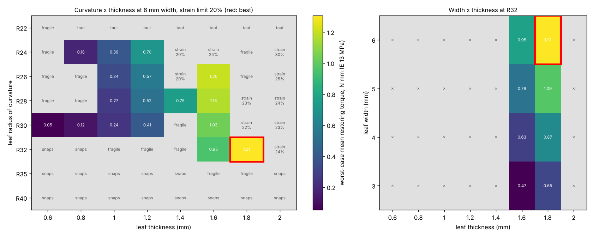

# A6 results

Analysis results for the A6 sliding-end leaf spring. The CAD is in [`A6 designs/`](../../A6%20designs/).
Each entry below records what was run, the script that produced it, and what it found.
Newest first.

| File | Written by |
|---|---|
| `parameter_sweep.json`, `.csv`, `.png` | `scripts/a6_parameter_sweep.py` |
| `rom_check.csv`, `rom_shapes.png` | `scripts/a6_rom_check.py` |

Common to every entry:

* **Range of motion:** 0° to 105° PIP flexion. Hyperextension is not included.
* **Joint axis:** assumed at y = 10, 15, 20 and 24 mm, with z = 0, in the A8 frame. A
  design has to pass at all four.
* **Pass criteria:**
  1. reaches 105°;
  2. restoring at every angle, so it never snaps;
  3. at least 3.5 mm from the axis;
  4. peak strain at most 20%. This limit is a placeholder until the filament has been
     tensile-tested.
* **Modulus:** uncalibrated. Torques use E = 13 MPa, the middle of the 8–18 MPa bracket.
  Rankings don't depend on it.

---

## 2026-10-30: the two sweep picks, generated and checked

The two picks from the sweep below are now CAD:

| Design | Links | Leaf | Travel |
|---|---|---|---|
| **Best**: R32 / 1.8 mm / 6 mm | [STEP](../../A6%20designs/A6_PIP_SlidingLeaf_R32_t1.8_w6.STEP) · [STL](../../A6%20designs/A6_PIP_SlidingLeaf_R32_t1.8_w6.STL) | R32, 1.8 × 6 mm | 11.5 mm |
| **Best with margin**: R28 / 1.4 mm / 6 mm | [STEP](../../A6%20designs/A6_PIP_SlidingLeaf_R28_t1.4_w6.STEP) · [STL](../../A6%20designs/A6_PIP_SlidingLeaf_R28_t1.4_w6.STL) | R28, 1.4 × 6 mm | 12.0 mm |

`python scripts/make_a6_designs.py` built them, from `SWEEP_PICKS` in that script. Each one
is two valid solids that do not overlap.

Then `python scripts/a6_rom_check.py` checked them as built, alongside the four earlier
designs. **24 of 24 cases pass**: six designs at four axis positions. Per-case detail is
in `rom_check.csv`, and the curves are in `rom_shapes.png`.

The figures below are per design, across the four axis positions:

| | Closest to axis | Peak strain | Head reaches stop at | Torque at 105° (E 8–18 MPa) | Stiffness near 0° (E 8–18 MPa) |
|---|---|---|---|---|---|
| R32 / 1.8 mm | 4.18–4.81 mm | 11.6–19.8% | 53–62° | 1.40–6.29 N·mm | 0.68–3.12 N·mm/rad |
| R28 / 1.4 mm | 4.26–5.07 mm | 10.5–16.8% | 50–58° | 0.43–3.35 N·mm | 0.32–1.66 N·mm/rad |
| *R28 / 1.0 mm, for comparison* | 4.05–4.83 mm | 7.5–12.1% | 49–56° | 0.26–1.20 N·mm | 0.12–0.61 N·mm/rad |

The check agrees with the sweep. Worst-case peak strain is 19.8% and 16.8%, exactly as the
sweep predicted. Worst-case torque at 105° at E = 13 MPa is 2.28 and 0.71 N·mm.

### Conclusion

* **Within the A6 mechanism, R32 / 1.8 mm / 6 mm gives the most spring-back.** It reaches
  105° at every assumed axis position and always pushes back toward straight. It stores
  about 5 times the return energy of the 1 mm R28 design.
* **Print R28 / 1.4 mm / 6 mm first.** The R32 / 1.8 mm design is right at the 20%
  placeholder strain limit. The R28 / 1.4 mm design has 3.2 percentage points of strain
  margin and the widest travel window (1.5 mm), so it is the one most likely to work on
  the first print. If it holds up, move to R32 / 1.8 mm.
* **Even the best A6 is weaker than the A3.** Its worst-case average to 105° is about
  1.2 N·mm/rad, a fifth of the A3's 6.1 N·mm/rad. Inside this mechanism, the only way to
  close that gap is a thicker leaf, and that needs a higher strain limit than 20%.
* **The filament's tensile test is the deciding input.** It sets the strain limit, and the
  strain limit sets the best design (see the strain-limit table below). The real PIP axis
  position comes second: every result here is a worst case over four guesses.

---

## 2026-10-30: curvature × thickness × width sweep

`python scripts/a6_parameter_sweep.py`. It took about 40 minutes on 4 cores.

The sweep covered:

* **Curvature:** R22, R24, R26, R28, R30, R32, R35 and R40.
* **Thickness:** 0.6 to 2.0 mm in steps of 0.2 mm.
* **Width:** 3, 4, 5 and 6 mm. 6 mm is the widest leaf whose guide still fits the MP cuff.

For each curvature and thickness, the guide travel was re-tuned from 9.5 to 14 mm, in 0.5 mm
steps. A combination needs at least two neighbouring travels to pass. Width only scales EI,
so it was applied analytically.

**Figure of merit:** the worst-case mean restoring torque over 0–105°. That is the energy
stored at full flexion divided by the angle: the work the spring has available to return
the finger.

### Matrix: mean restoring torque (N·mm) at 6 mm width

| R \ t | 0.6 mm | 0.8 mm | 1 mm | 1.2 mm | 1.4 mm | 1.6 mm | 1.8 mm | 2 mm |
|---|---|---|---|---|---|---|---|---|
| R22 | ✗ fragile | ✗ taut | ✗ taut | ✗ taut | ✗ taut | ✗ taut | ✗ taut | ✗ taut |
| R24 | ✗ fragile | 0.18 | 0.39 | 0.70 | ✗ strain 20% | ✗ strain 24% | ✗ fragile | ✗ strain 30% |
| R26 | ✗ fragile | ✗ fragile | 0.34 | 0.57 | ✗ strain 20% | 1.20 | ✗ fragile | ✗ strain 25% |
| R28 | ✗ fragile | ✗ fragile | 0.27 | 0.52 | 0.75 | 1.16 | ✗ strain 23% | ✗ strain 24% |
| R30 | 0.05 | 0.12 | 0.24 | 0.41 | ✗ fragile | 1.03 | ✗ strain 22% | ✗ strain 23% |
| R32 | ✗ snaps | ✗ snaps | ✗ fragile | ✗ fragile | ✗ fragile | 0.95 | **1.31 ★** | ✗ strain 24% |
| R35 | ✗ snaps | ✗ snaps | ✗ snaps | ✗ snaps | ✗ snaps | ✗ fragile | ✗ fragile | ✗ snaps |
| R40 | ✗ snaps | ✗ snaps | ✗ snaps | ✗ snaps | ✗ snaps | ✗ snaps | ✗ snaps | ✗ snaps |

What the failure labels mean:

* **taut:** the leaf goes tight before 105°.
* **snaps:** the tip jumps onto its stop, and the torque briefly reverses.
* **fragile:** only a single travel passes, so 0.5 mm of print or axis error would fail it.
* **strain:** peak strain is over 20% at the travel that passes. A cell showing 20% is
  just over the limit before rounding.



The right-hand panel shows width × thickness at the winning radius. Torque scales directly
with width, so the widest leaf always wins. Every valid row in the full CSV confirms it.

### Best combination

| | R | Thickness | Width | Travel | Mean torque | Torque at 105° | Peak strain | Travel window | Height above PP cuff |
|---|---|---|---|---|---|---|---|---|---|
| **Best (strain ≤ 20%)** | **32 mm** | **1.8 mm** | **6 mm** | **11.5 mm** | **1.31 N·mm** | **2.28 N·mm** | **19.8%** | **1.0 mm** | **9.2 mm** |
| Best with margin | 28 mm | 1.4 mm | 6 mm | 12.0 mm | 0.75 N·mm | 0.71 N·mm | 16.8% | 1.5 mm | 10.1 mm |

* **The strict optimum is right at the strain limit**, at 19.8% against 20%. Two of its
  four neighbours fail: R32 at 2.0 mm on strain, and R35 at 1.8 mm as fragile.
* **R28 / 1.4 mm / 6 mm is the safer choice to print first.** It has 3.2 percentage points
  of strain margin and the widest travel window of any well-performing cell. It gives up
  about 40% of the mean torque.
* **Stronger than the current designs, but still weaker than A3.** The current files are
  R24–R30 at 1.0 × 6 mm, with mean torque of 0.24–0.39 N·mm. The optimum is 3–5 times
  stronger. Its torque at 105° is 2.28 N·mm, an average of about 1.2 N·mm/rad, which is
  roughly a fifth of the A3's measured 6.1 N·mm/rad.

### The best combination depends on the strain limit

| Strain limit | Best combination | Mean torque | Torque at 105° |
|---|---|---|---|
| 10% | R30 / 0.8 mm / 6 mm, travel 11.0 | 0.12 N·mm | 0.21 N·mm |
| 15% | R30 / 1.2 mm / 6 mm, travel 11.5 | 0.41 N·mm | 0.74 N·mm |
| **20%** | **R32 / 1.8 mm / 6 mm, travel 11.5** | **1.31 N·mm** | **2.28 N·mm** |
| 25% | R26 / 2.0 mm / 6 mm, travel 13.5 | 2.51 N·mm | 4.32 N·mm |
| 30% | R24 / 2.0 mm / 6 mm, travel 13.5 | 3.34 N·mm | 5.15 N·mm |

Torque grows with thickness cubed but strain grows only linearly. So the answer is set
mainly by how much strain the filament can take. The TPU tensile test is the input that
decides this, more than any geometry choice. Once it exists, rebuild the tables without
re-simulating:

```bash
python scripts/a6_parameter_sweep.py --from-json
```

That run uses whatever `STRAIN_LIMIT` is set to in `scripts/a6_rom_check.py`.

### Caveats

* **The valid region is patchy.** "Fragile" cells sit between valid ones, because the
  passing travel window is often only 0.5–1.0 mm wide. Small changes in print or axis
  position can move a design across the boundary.
* **Validity depends on the assumed axis.** Every cell is judged at the worst of four
  guessed axis positions. Once the real axis is known, re-run the sweep against it.
* **Friction and finger contact aren't modelled.** Friction in the guide resists sliding
  and would raise the effective torque during flexion but lower it during return. Contact
  between the leaf and the finger is also ignored.

---

## 2026-10-29: range-of-motion check of the R24–R30 designs

`python scripts/a6_rom_check.py` produced `rom_check.csv` and `rom_shapes.png`.

The four designs in `A6 designs/` use a 1.0 × 6 mm leaf with tuned travel: R24 at 12.5 mm,
R26 at 11.5, R28 at 11.5 and R30 at 11.0.

**16 of 16 cases pass**: four designs at four axis positions.

* **Reach and clearance:** every case reaches 105°, staying 3.74–5.16 mm from the axis.
* **Strain:** peak strain is 6.9–14.4%.
* **Stop:** the T-head reaches its stop at 44–58°.
* **Torque:** 0.24–1.53 N·mm at 105°, for E = 8–18 MPa.

The first A6 set, with 2.5 mm travel and a 4 × 1 mm leaf, only reached 15–36°. Its files
are in git history at commit `6b3a303`.
