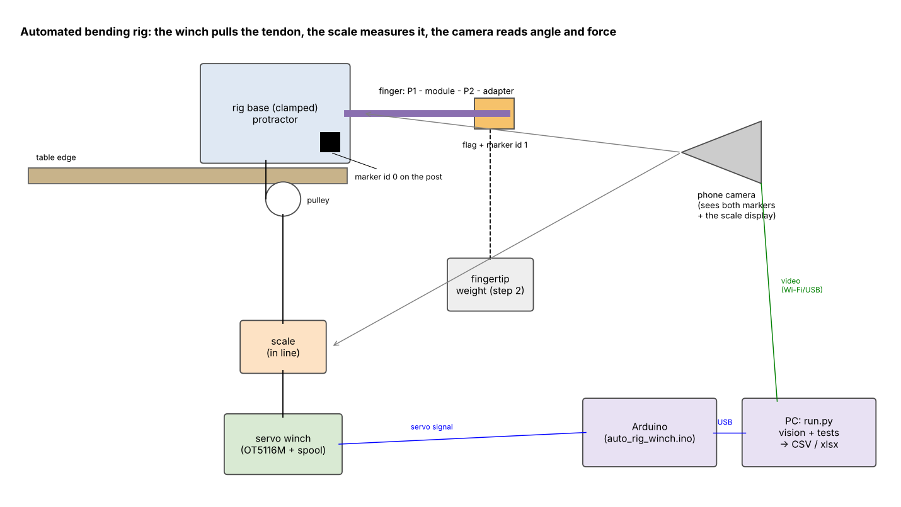

# Automated bending rig (steps 1-5 with minimal hands-on time)

The manual rig (docs/12, Part 2) needs someone to add weights and read the protractor at every
step. This version does it by itself:

* a **servo winch** pulls the tendon instead of hanging weights,
* the **scale** sits in the tendon line and measures the tension,
* a **phone camera** reads the joint angle from two printed ArUco markers and the force from the
  scale's display,
* a **Python program** runs each test, decides when to stop, and writes every reading to CSV,
  with a results workbook and plots at the end.

What you still do by hand: fit the module, hang the fingertip weight for step 2 (five times),
clamp the stop for step 3, and start each test. Step 4's release is automatic: the winch simply
lets the line go slack, so there is no pin to pull.



## What you need

| Item | Notes |
|---|---|
| The existing rig (RIG base, ADP-D / ADP-S adapter, 625ZZ pulley set) | unchanged |
| Servo for the winch | a standard positional servo: the OT5116M works (≈280°, 15 kg·cm). Not a continuous-rotation one |
| `print_ready/auto_rig/SPL_winch_spool.stl` | 20 mm spool; bolt it to the servo's round horn (the 1.8 mm holes take the horn's screws) |
| `print_ready/auto_rig/BRK_servo_bracket.stl` | holds the servo with the spool under the pulley; screw or clamp the base to a board or the table leg. Check the ear-hole pattern against your servo (49.5 × 10 mm assumed; change `SERVO_*` in `cad/build_auto_rig_parts.py` if not) |
| `print_ready/auto_rig/FLG_marker_flag.stl` | 0.5 g flag; its two pegs push into the adapter's 30 and 37.5 mm hook holes on the camera side. The 44.8 mm hole stays free for the fingertip weight |
| `markers_A4.pdf` (made by `run.py markers`) | print at 100 %, check the 100 mm bar. Glue a 16 mm marker id 0 on the rig post's camera-side face (below Phalanx 1) and a 14 mm id 1 on the flag |
| Your scale | an inline (hanging/luggage) scale goes in the line between the pulley and the winch. A platform scale also works: stand the winch on it and set `mode: platform` |
| Arduino Uno/Nano + 6 V supply (≥ 3 A) for the servo | |
| Phone on a stand + an app that streams video over Wi-Fi (e.g. IP Webcam on Android) | or a USB webcam |
| Optional: 5 or 10 kg load cell + HX711 board | **recommended**: faster and more reliable than reading the display (see below) |

## Wiring

| From | To |
|---|---|
| Servo signal | Arduino pin 9 |
| Servo + / − | 6 V supply + / −; supply − also to Arduino GND |
| HX711 (optional) DT, SCK, VCC, GND | pins 3, 4, 5 V, GND |
| Arduino | PC by USB |

Upload `firmware/auto_rig_winch/auto_rig_winch.ino` with the Arduino IDE.

## Software (once)

```bash
pip install opencv-contrib-python pyserial pyyaml numpy matplotlib openpyxl
```

```bash
cd tools/auto_rig
```

```bash
cp config.example.yaml config.yaml
```

Edit `config.yaml`: the phone's stream address (`camera.angle`), the Arduino's port
(`winch.port`), and the limits (`max_force_n` = what your rig takes; `max_angle_deg` just under
the module's collar contact).

## Setting up (once per session)

1. **Camera:** phone on a stand about 25-35 cm from the rig, looking square-ish at the finger
   from the protractor side, with both markers and the scale's display in view and evenly lit (no
   glare on the display). Lock focus and exposure in the app.
2. `python3 run.py check`: shows the angle, twist and force live. Bend the finger by hand: the
   angle must go up as it closes (if it goes down, set `markers.sign: -1`). Press `z` with the
   finger straight to check the zero.
3. **Force from the display:** `python3 run.py scale-setup`: click the four corners of the digits
   (top-left, top-right, bottom-right, bottom-left), answer the questions (number of digits,
   decimals, LCD or LED, unit), and watch the live reading match the display. If the digits lean,
   set `slant_deg: 8` in `config.yaml`. **With a load cell instead:** set `force.source: hx711`,
   send `T` (tare) and `C 500` with a 500 g weight hanging (Arduino Serial Monitor, 115200), and
   skip this step.
4. `python3 run.py winch-setup`: jog with `+` / `-` until the line just goes taut with the finger
   straight, type `s`, and answer which way slackens it. That stores the slack position and the
   pull direction.

## Running the tests

One command per test; `--module` is the workbook's sheet name. Each test asks you to confirm the
set-up (rest block in or out, weight on, stop placed), then runs on its own.

| Test | Command | What it does |
|---|---|---|
| 1 free curve | `python3 run.py run step1 --module H1-P` | pulls in small steps until the angle stops rising (collars met) or a limit, then back down; force-angle curve up and down, T at 30° and 60°, hysteresis, resting angle after |
| 2 fingertip force | `python3 run.py run step2 --module H1-P --weights 50,100,200 --hanger 12` | for each weight (it asks you to hang it): T at lift-off, 30° and 60°, the effective tendon lever, and the stop reason (sideways twist is detected and stops the pull) |
| 3 give way | `python3 run.py run step3 --module H1-P` | adapter against the stop at 30°: pulls until the force drops (buckle/squash), it twists, it falls off the stop, or the force limit |
| 4 spring-back | `python3 run.py run step4 --module H2-P` | pulls to 60°, holds 60 s, releases the line instantly, logs the angle (10 per second for 15 s, then every second) for 10 min; angles at 1, 10, 60 s and 10 min |
| 4 after cycles | `python3 run.py run step4 --module H2-P --label after1000` | the same, after step 5 |
| 5 cycles | `python3 run.py run step5 --module H2-P --cycles 1000 --every 100` | tendon-driven cycles 0 → 60° (with the fingertip weight if you hang one); every 100 cycles: resting angle and T to reach 30°; stops at a 20 % change in T or 5° in the resting angle |
| everything | `python3 run.py run all --module A1-P` | steps 1-5 in a row |

Step 5 here pulls the tendon, as in the original procedure, so it also measures the tension to
30° every 100 cycles. The four-bar rig (`TYPE B/round2/test_rig/automated/`) remains the faster
option for long pure-bending fatigue runs.

**Results:** every test writes `results/rig_auto/<module>/<test>_<time>.csv` (every reading)
and a `.json` summary. `python3 run.py export` gathers them into
`results/rig_auto/rig_auto_results.xlsx` (Summary, Step 2 points, Step 5 checks) and plots
(`step1_curves.png`, `step4_springback.png`).

**Dry run without hardware:** `python3 run.py sim step1` (any step) runs the sequence on a
simulated joint, which shows what each test does and produces example output.

## Safety and limits

* Every move is checked: force over `max_force_n`, angle over `max_angle_deg`, twist over
  `twist_limit_deg`, or the markers/display lost for `lost_limit` readings: the winch returns to
  slack and the test stops with the reason recorded.
* The winch never pulls more than `max_travel_us` beyond slack.
* `max_force_n` is 30 N in the example: raise it only as far as your rig takes (the servo-limit
  target is 47 N).

## Accuracy and what was checked

* Angle: on synthetic images with the camera deliberately off square, within 0.2° over 5-90°; a
  20° out-of-plane twist reads as 19.7° (`tests/test_vision.py`). On the real rig expect about
  ±0.5°, set by the marker print and lighting.
* Display reading: synthetic displays decode exactly (`tests/test_vision.py`); on a real scale it
  depends on glare and the display's update rate. Each value is accepted only after it repeats in
  3 frames, and every step waits `settle_s` for the scale to settle. A load cell (HX711) avoids
  both and reads ten times faster: worth the few dollars if the display gives trouble.
* The test sequences were dry-run end to end on the simulated joint (`tests/test_procedures.py`):
  lift-off force within 1 % of the physics, buckling and twist detected, spring-back logged.
  The real rig still needs a first supervised run of each test.
* The marker flag (0.5 g, `print_ready/auto_rig/checks.csv`) clears the rig base through 0-115°;
  the zero is taken with it fitted.

## Files

| Path | What |
|---|---|
| `run.py` | the program (setup, tests, export, simulation) |
| `auto_rig/vision.py` | ArUco angle tracker, seven-segment display reader, cameras |
| `auto_rig/hardware.py` | serial winch, force sources, simulated rig |
| `auto_rig/procedures.py` | the five tests |
| `tests/` | synthetic vision tests and simulated dry runs |
| `cad/build_auto_rig_parts.py` | flag, spool and bracket (CadQuery), with the clearance check |
| `firmware/auto_rig_winch/` (repo root) | Arduino winch firmware with optional HX711 |
